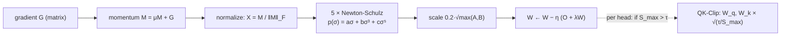

Adam and AdamW, from the optimizers lesson, treat every weight as an independent number: each
gets its own running mean and variance. But most of a transformer's parameters live in weight
**matrices**, and a matrix gradient has structure an elementwise method ignores. In practice
the momentum of a weight matrix is dominated by a few directions; an update proportional to it
moves the weights hard along those directions and barely at all along the rest. **Muon**
(MomentUm Orthogonalized by Newton-Schulz) replaces the update with its nearest orthogonal
matrix, so every direction moves by the same amount<FN n="1" />. Moonshot AI reported about twice
the compute efficiency of AdamW in their scaling-law runs<FN n="2" />, trained the 1.04-trillion
parameter Kimi K2 with a Muon variant<FN n="3" />, and Revolut's PRAGMA used Muon alongside
AdamW. This lesson derives the update and the two fixes that make it stable at scale.

## The update

For a weight matrix $W \in \mathbb{R}^{A \times B}$ with gradient $G_t$, Muon keeps a momentum
buffer and orthogonalizes it before stepping:

$$
M_t = \mu M_{t-1} + G_t, \qquad O_t = \mathrm{NS}_5(M_t), \qquad W_t = W_{t-1} - \eta\, O_t,
$$

where $\mathrm{NS}_5$ is five steps of a Newton-Schulz iteration that approximates the **polar
factor** of $M_t$: if $M_t = U \Sigma V^\top$ is its singular value decomposition, the polar
factor is $U V^\top$, the same singular vectors with every singular value set to 1.

## Why the polar factor: steepest descent in the spectral norm

Plain gradient descent is steepest descent when step size is measured with the Frobenius norm.
Muon measures it with the **spectral norm** $\|O\|_{\mathrm{op}}$, the largest singular value,
which bounds how much the step can stretch any input vector. The steepest step of unit size
solves

$$
\max_{\|O\|_{\mathrm{op}} \le 1} \langle G, O \rangle, \qquad \langle G, O\rangle = \mathrm{tr}(G^\top O).
$$

**Claim.** The maximizer is $O^\star = U V^\top$, and the maximum is $\sum_i \sigma_i$, the
nuclear norm of $G$.

**Step 1: Substitute the SVD.** With $G = U\Sigma V^\top$,
$\mathrm{tr}(G^\top O) = \mathrm{tr}(V \Sigma U^\top O) = \mathrm{tr}(\Sigma\, U^\top O V)$, using
the cyclic property of the trace.

**Step 2: Read off the diagonal.** Since $\Sigma$ is diagonal,
$\mathrm{tr}(\Sigma P) = \sum_i \sigma_i P_{ii}$ with $P = U^\top O V$.

**Step 3: Bound each entry.** $P_{ii} = u_i^\top O v_i$ for unit vectors $u_i, v_i$, so
$|P_{ii}| \le \|O\|_{\mathrm{op}} \le 1$. Hence $\langle G, O\rangle \le \sum_i \sigma_i$.

**Step 4: Attain the bound.** For $O = UV^\top$, $P = U^\top U V^\top V = I$, so every
$P_{ii} = 1$ and the bound is reached.

The polar factor keeps the gradient's directions and discards its magnitudes, so a direction
with a tiny singular value is updated as strongly as the dominant one. That is the sense in
which Muon "equalizes" the update.

## Newton-Schulz: the polar factor without an SVD

An SVD per weight matrix per step is too slow on a GPU. Newton-Schulz uses only matrix
multiplications.

**Step 1: Normalize.** Set $X_0 = M / \|M\|_F$, so every singular value lies in $(0, 1]$.

**Step 2: Iterate an odd polynomial.**
$X_{k+1} = a X_k + b (X_k X_k^\top) X_k + c (X_k X_k^\top)^2 X_k$.

**Step 3: See what it does to the SVD.** If $X_k = U \Sigma V^\top$, then
$X_k X_k^\top X_k = U \Sigma^3 V^\top$ and $(X_k X_k^\top)^2 X_k = U \Sigma^5 V^\top$. So

$$
X_{k+1} = U\, p(\Sigma)\, V^\top, \qquad p(\sigma) = a\sigma + b\sigma^3 + c\sigma^5.
$$

The singular vectors never change; only the singular values pass through $p$. Repeating the
map drives every singular value toward 1.

Muon's coefficients, $(a, b, c) = (3.4445, -4.7750, 2.0315)$, are tuned for speed rather than
exact convergence: the large slope $a$ lifts small singular values quickly, and five steps
suffice<FN n="1" />. After five steps every singular value from about 0.0015 to 1 lands in roughly
$[0.68, 1.20]$, which is close enough to orthogonal for an optimizer step.

![The quintic Newton-Schulz map applied 1 to 5 times. Small singular values are pushed up fast; after five steps everything above about 0.0015 sits in roughly [0.68, 1.20].](/figures/D1/muon-newton-schulz.svg)

Muon is meant only for the 2D weight matrices of hidden layers. Embeddings, the output head,
and scalar or vector parameters (norm gains, biases) stay on AdamW<FN n="1" />.

## Scaling up: RMS matching and weight decay

Moonshot's study identified two changes needed at LLM scale<FN n="2" />: weight decay, and an
update scale that matches AdamW's. The second follows from the size of the polar factor.

**Step 1: Its Frobenius norm is the rank.** $\|UV^\top\|_F^2 = \mathrm{tr}(V U^\top U V^\top) = r$,
where $r = \min(A, B)$ for a full-rank matrix.

**Step 2: So its RMS shrinks with size.** The root-mean-square entry is
$\sqrt{r / (AB)} = \sqrt{\min(A,B)/(AB)} = 1/\sqrt{\max(A, B)}$.

**Step 3: Rescale.** Multiplying by $0.2\sqrt{\max(A,B)}$ gives an RMS of 0.2, inside the
0.2 to 0.4 range typical of AdamW updates, so learning rates and weight decay tuned for AdamW
carry over:

$$
W_t = W_{t-1} - \eta_t \left(0.2\sqrt{\max(A,B)}\; O_t + \lambda W_{t-1}\right).
$$

With these changes, the Moonshot scaling-law fits (dense models of 399M to 1.5B parameters)
found Muon needing about 52% of AdamW's training FLOPs for the same loss<FN n="2" />.

## MuonClip: stopping attention logits from exploding

At larger scale a new failure appeared. Training with Muon, Kimi K2's team saw attention logits
grow past 1,000 and the loss spike. Their fix, **QK-Clip**, watches each head's largest logit
$S^h_{\max}$ and shrinks the query and key weights when it exceeds a threshold
$\tau$<FN n="3" />:

$$
\gamma_h = \min\!\left(1, \frac{\tau}{S^h_{\max}}\right), \qquad W_q^h \leftarrow \sqrt{\gamma_h}\, W_q^h, \quad W_k^h \leftarrow \sqrt{\gamma_h}\, W_k^h.
$$

Since a logit is bilinear in $W_q$ and $W_k$, scaling each by $\sqrt{\gamma_h}$ scales the logit
by exactly $\gamma_h$, which brings the maximum back to $\tau$. (For MLA, the shared rotary key
is left alone and the rotary query takes the full $\gamma_h$.) Kimi K2 used $\tau = 100$ and was
pretrained on 15.5 trillion tokens with zero loss spikes<FN n="3" />. This is the weight-space
counterpart of QK-norm from the [attention-stability lesson](/pillar/E/E3/attention-stability).



## Check it on arrays

```python
import numpy as np

rng = np.random.default_rng(0)
A, B = 64, 128
G = rng.normal(size=(A, 8)) @ rng.normal(size=(8, B)) + 0.05 * rng.normal(size=(A, B))  # low effective rank

def ns5(M, steps=5):
    a, b, c = 3.4445, -4.7750, 2.0315
    X = M / np.linalg.norm(M)
    for _ in range(steps):
        Y = X @ X.T
        X = a * X + b * Y @ X + c * Y @ Y @ X
    return X

U, s, Vt = np.linalg.svd(G, full_matrices=False)
polar = U @ Vt
O = ns5(G)
sv = np.linalg.svd(O, compute_uv=False)
print(f"singular values of G: {s.max():.1f} ... {s.min():.3f}")
print(f"after NS5: {sv.min():.2f} ... {sv.max():.2f}")
assert sv.max() < 1.25

# 1) The polar factor maximizes <G, O> over ||O||_op <= 1, reaching the nuclear norm
best = np.trace(G.T @ polar)
assert np.isclose(best, s.sum())
for _ in range(200):
    R = rng.normal(size=(A, B)); R /= np.linalg.svd(R, compute_uv=False).max()
    assert np.trace(G.T @ R) <= best + 1e-9
print(f"<G, UV^T> = {best:.1f} = nuclear norm; no random unit-spectral-norm O does better")

# 2) RMS of the polar factor is 1 / sqrt(max(A, B)); the 0.2 sqrt(max) scale gives RMS 0.2
rms = lambda X: np.sqrt((X**2).mean())
assert np.isclose(rms(polar), 1 / np.sqrt(max(A, B)))
assert np.isclose(rms(0.2 * np.sqrt(max(A, B)) * polar), 0.2)

# 3) QK-Clip: scaling W_q and W_k by sqrt(gamma) scales the max logit to tau
d, tau = 32, 100.0
x = rng.normal(size=(16, d))
Wq, Wk = 4 * rng.normal(size=(d, d)), 4 * rng.normal(size=(d, d))
smax = lambda Wq, Wk: ((x @ Wq) @ (x @ Wk).T / np.sqrt(d)).max()
gamma = min(1.0, tau / smax(Wq, Wk))
print(f"max logit {smax(Wq, Wk):.0f} -> {smax(np.sqrt(gamma) * Wq, np.sqrt(gamma) * Wk):.1f}")
assert np.isclose(smax(np.sqrt(gamma) * Wq, np.sqrt(gamma) * Wk), tau)
```

The run shows a gradient whose singular values span a ratio of about 730 (128.6 down to 0.176)
mapped by five Newton-Schulz steps into the band 0.33 to 1.19, confirms that the polar factor attains the
nuclear norm and that no random matrix of unit spectral norm beats it, verifies the
$1/\sqrt{\max(A,B)}$ RMS identity behind the 0.2 scale, and shows QK-Clip bringing a head's
maximum logit back to exactly $\tau = 100$.

## Exercises

**Exercise 1.** A feed-forward weight matrix is $4096 \times 11008$. What is the RMS of its
polar factor, and what scale factor does Moonshot's rule apply?

<details>
<summary>Solution</summary>

**Step 1.** RMS $= 1/\sqrt{\max(4096, 11008)} = 1/\sqrt{11008} = 1/104.9 = 0.00953$.

**Step 2.** The scale is $0.2\sqrt{11008} = 0.2 \times 104.9 = 20.98$, which multiplies the
RMS back up to 0.2.

</details>

**Exercise 2.** A head's maximum logit reaches 250 with $\tau = 100$. Compute $\gamma_h$, the
factor applied to $W_q^h$ and $W_k^h$, and verify the new maximum logit.

<details>
<summary>Solution</summary>

**Step 1.** $\gamma_h = \min(1, 100/250) = 0.4$.

**Step 2.** Each weight is multiplied by $\sqrt{0.4} = 0.6325$.

**Step 3.** The logit is bilinear, so it scales by $0.6325^2 = 0.4$: $250 \times 0.4 = 100 = \tau$.

</details>

**Exercise 3 (code).** Apply the Newton-Schulz map $p$ to a singular value of 0.01 for 1 through
10 steps. How many steps until it exceeds 0.5, and why does Muon still use only 5?

<details>
<summary>Solution</summary>

```python
a, b, c = 3.4445, -4.7750, 2.0315
x, path = 0.01, []
for _ in range(10):
    x = a * x + b * x**3 + c * x**5
    path.append(round(x, 3))
steps = next(i + 1 for i, v in enumerate(path) if v > 0.5)
print(path, steps)
assert steps == 4
```

Near zero, $p(\sigma) \approx 3.4445\,\sigma$, so the value grows about 3.4 times per step:
0.034, 0.118, 0.40, then 1.09 at step 4, after which it oscillates between about 0.69 and
1.12 instead of settling at 1. Five steps lift anything above about 0.0015 into the
$[0.68, 1.20]$ band (a value of 0.001 still ends at only 0.47), which covers all but the weakest directions after
Frobenius normalization; more steps would cost matrix multiplications without making the update
more orthogonal, because the tuned polynomial trades exact convergence for speed.

</details>

The next subsection (D2) applies these foundations to image data with convolutional networks.

<Footnotes>
  <FNItem n="1">**Jordan, K.** (2024). "Muon: An optimizer for hidden layers in neural networks". Blog post. [kellerjordan.github.io/posts/muon](https://kellerjordan.github.io/posts/muon/)</FNItem>
  <FNItem n="2">**Liu, J., Su, J., Yao, X., et al.** (2025). "Muon is Scalable for LLM Training". [arXiv:2502.16982](https://arxiv.org/abs/2502.16982)</FNItem>
  <FNItem n="3">**Kimi Team, Bai, Y., Bao, Y., Charles, Y., et al.** (2025). "Kimi K2: Open Agentic Intelligence". [arXiv:2507.20534](https://arxiv.org/abs/2507.20534)</FNItem>
</Footnotes>
