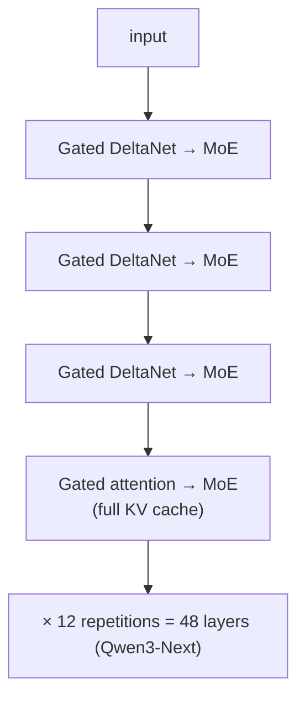

Linear attention, from the earlier lesson, replaces the growing KV cache with a fixed-size
state, so generation costs the same at token one million as at token one. Its weakness is
recall: ask it to retrieve a fact written thousands of tokens ago and it returns a blur of
everything written since. In 2025 two production model families shipped linear-attention
layers that fix much of this, using a learning rule older than the transformer: Qwen3-Next
stacks three **Gated DeltaNet** layers for every full-attention layer<FN n="1" />, and Kimi
Linear interleaves its delta-rule variant with full attention in the same 3:1
ratio<FN n="2" />. This lesson derives the delta rule, its gated form, and the arithmetic of
why hybrids keep a few softmax layers.

## Linear attention is a memory you only add to

Write linear attention's state as a matrix $S_t \in \mathbb{R}^{d_v \times d_k}$, updated per
token and read with the query:

$$
S_t = S_{t-1} + v_t k_t^\top, \qquad o_t = S_t q_t.
$$

This is a **fast-weight memory**<FN n="3" />: each token writes the association
$k_t \mapsto v_t$ into a matrix, and reading with $q = k_j$ returns

$$
S_t k_j = \sum_{i \le t} v_i (k_i^\top k_j) = v_j \|k_j\|^2 + \sum_{i \ne j} v_i (k_i^\top k_j).
$$

With unit keys, the first term is the wanted value and the sum is **interference** from every
other association. Two problems follow. The interference grows with the number of stored
pairs, since nothing is ever removed. And writing a new value for an existing key does not
replace the old one: storing $(k, v_1)$ and then $(k, v_2)$ makes $S k = v_1 + v_2$.

## The delta rule: write only the error

Schlag et al. observed that a better memory writes only what is *missing*<FN n="3" />. Before
storing $(k_t, v_t)$, read what the memory currently returns for $k_t$, and write the
difference:

$$
S_t = S_{t-1} + \beta_t \left(v_t - S_{t-1} k_t\right) k_t^\top,
$$

with a write strength $\beta_t \in (0, 1)$ computed from the input. The name comes from the
classic delta (Widrow-Hoff) rule, and the reason it works is that it is gradient descent.

**Step 1: Pose retrieval as regression.** At step $t$ the memory should map $k_t$ to $v_t$.
Measure its error with $\mathcal{L}_t(S) = \tfrac12 \|S k_t - v_t\|^2$.

**Step 2: Take the gradient.** Differentiating with respect to the matrix $S$,
$\nabla_S \mathcal{L}_t = (S k_t - v_t)\, k_t^\top$.

**Step 3: Take one SGD step with learning rate $\beta_t$.**

$$
S_t = S_{t-1} - \beta_t (S_{t-1} k_t - v_t) k_t^\top = S_{t-1}\left(I - \beta_t k_t k_t^\top\right) + \beta_t v_t k_t^\top.
$$

This is the delta rule, and Yang et al. state the same interpretation: it optimizes the online
regression objective by one step of test-time gradient descent per token<FN n="4" />.

**Step 4: Check the overwrite.** With a unit key and $\beta = 1$, after the update
$S_t k_t = S_{t-1}k_t - (S_{t-1}k_t - v_t) = v_t$. Writing $(k, v_2)$ after $(k, v_1)$ now
leaves $S k = v_2$: the old value is replaced, not summed.

## Gating: forget on purpose

The delta rule removes stale values only when the same key is written again. Long sequences
also need to forget *everything* gradually when the context changes, which is what the gates
of Mamba-2 and gated linear attention do with a decay $\alpha_t \in (0, 1)$. Gated DeltaNet
combines the two<FN n="4" />:

$$
S_t = S_{t-1}\Big(\alpha_t \left(I - \beta_t k_t k_t^\top\right)\Big) + \beta_t v_t k_t^\top.
$$

**Derivation.** Decay the old memory first, $\tilde S = \alpha_t S_{t-1}$, then apply the delta
step to $\tilde S$: $\tilde S(I - \beta_t k_t k_t^\top) + \beta_t v_t k_t^\top$. Substituting
gives the equation above. In the regression view, $\alpha_t$ is an adaptive weight decay on
the fast weights.

- $\alpha_t \to 0$ wipes the memory (a hard context switch).
- $\alpha_t = 1$ recovers the pure delta rule.
- $\beta_t \to 0$ skips writing a token that carries nothing worth remembering.

Kimi Delta Attention refines the decay from one scalar to a per-channel vector, so different
dimensions of the memory forget at different rates<FN n="2" />. Training is not done token by
token: the recurrence is rearranged into chunks so that most of the work becomes matrix
multiplications that run in parallel on a GPU<FN n="4" />.


## Why hybrids keep a few attention layers

A $d_v \times d_k$ state can store at most $d_k$ associations exactly, and only when their keys
are orthogonal; with real, overlapping keys every write disturbs earlier pairs, so the figure
shows recall error rising steadily with the number of stored pairs for both rules, with the
delta rule's error lower at every load. Full softmax attention has no
such limit, because it keeps every key, so it remains better at exact recall from far back.
The 2025 answer is a fixed ratio of the two.

**Qwen3-Next-80B-A3B** uses 48 layers laid out as 12 repetitions of three Gated DeltaNet layers
followed by one gated-attention layer, each followed by an MoE feed-forward block<FN n="1" />.
**Kimi Linear** interleaves three Kimi Delta Attention layers with one full MLA layer and
reports up to 75% less KV cache and up to 6 times the decoding throughput at a 1M-token
context<FN n="2" />.

The 75% follows directly from the ratio.

**Step 1.** A linear layer stores a fixed $d_v \times d_k$ state per head, independent of
context length $L$; a full-attention layer stores keys and values for all $L$ tokens.

**Step 2.** For long contexts the linear layers' fixed states are negligible next to the
attention layers' caches, so the KV cache is that of the full-attention layers alone.

**Step 3.** With one full-attention layer in four, the cache is $1/4$ of an all-attention
model's, a 75% reduction.



## Check it on arrays

```python
import numpy as np

rng = np.random.default_rng(0)
d = 32
unit = lambda x: x / np.linalg.norm(x, axis=-1, keepdims=True)

# 1) The delta rule is one SGD step on 1/2 ||S k - v||^2
S = rng.normal(size=(d, d)); k = unit(rng.normal(size=d)); v = rng.normal(size=d); beta = 0.7
grad = np.outer(S @ k - v, k)
assert np.allclose(S - beta * grad, S @ (np.eye(d) - beta * np.outer(k, k)) + beta * np.outer(v, k))

# 2) Overwriting a key: linear attention sums, the delta rule replaces
v1, v2 = rng.normal(size=d), rng.normal(size=d)
S_lin = np.outer(v1, k) + np.outer(v2, k)
S_dlt = np.zeros((d, d))
for vv in (v1, v2):
    S_dlt += np.outer(vv - S_dlt @ k, k)
print("linear returns v1 + v2:", np.allclose(S_lin @ k, v1 + v2),
      "| delta returns v2:", np.allclose(S_dlt @ k, v2))
assert np.allclose(S_dlt @ k, v2)

# 3) Associative recall as the number of stored pairs grows
for n in (8, 16, 32, 64):
    K, V = unit(rng.normal(size=(n, d))), rng.normal(size=(n, d))
    S_lin, S_dlt = V.T @ K, np.zeros((d, d))
    for kk, vv in zip(K, V):
        S_dlt += np.outer(vv - S_dlt @ kk, kk)
    err = lambda M: np.mean(np.linalg.norm(K @ M.T - V, axis=1) / np.linalg.norm(V, axis=1))
    print(f"n = {n:2d}: linear error {err(S_lin):.2f}, delta error {err(S_dlt):.2f}")
    assert err(S_dlt) < err(S_lin)

# 3b) With orthogonal keys the delta rule stores up to d_k pairs exactly
Ko = np.linalg.qr(rng.normal(size=(d, d)))[0].T          # 32 orthonormal keys
Vo = rng.normal(size=(d, d)); S_o = np.zeros((d, d))
for kk, vv in zip(Ko, Vo):
    S_o += np.outer(vv - S_o @ kk, kk)
assert np.allclose(Ko @ S_o.T, Vo)
print("orthogonal keys: all 32 pairs recalled exactly")

# 4) Gating: alpha < 1 decays old memories geometrically
alpha, S = 0.9, np.outer(v1, k)
for _ in range(20):
    S = alpha * S
print(f"after 20 gated steps the old association keeps {np.linalg.norm(S @ k) / np.linalg.norm(v1):.3f}"
      f" of its strength (0.9^20 = {0.9**20:.3f})")

# 5) Memory: fixed state vs KV cache per head at 32K tokens, d = 128
dk = dv = 128; L = 32_768
print(f"state {dk * dv:,} numbers vs KV cache {2 * L * dk:,} ({2 * L * dk / (dk * dv):.0f}x)")
```

The first check confirms the delta rule is the SGD step derived above; the second shows the
overwrite behaviour that plain accumulation lacks; the third shows the delta rule's lower recall
error at every load, with both rising steadily as $n$ grows because random keys overlap, while orthogonal keys
are recalled exactly by the delta rule up to $n = d_k$; the fourth shows a gate of
0.9 leaving 12% of an association after 20 steps; and the last shows a 128 by 128 state taking
512 times less memory than a 32K-token KV cache for one head.

## Exercises

**Exercise 1.** A Gated DeltaNet layer has $\alpha_t = 0.95$ on every step and writes nothing
($\beta_t = 0$) for 50 tokens. What fraction of a stored association survives? How many such
steps halve it?

<details>
<summary>Solution</summary>

**Step 1.** With $\beta = 0$ the update is $S_t = 0.95\, S_{t-1}$, so after 50 steps the
association is scaled by $0.95^{50} = e^{50 \ln 0.95} = e^{-2.565} = 0.077$.

**Step 2.** Halving requires $0.95^n = 0.5$, so $n = \ln 0.5 / \ln 0.95 = 0.6931 / 0.05129 = 13.5$
steps.

</details>

**Exercise 2.** A 48-layer model is converted from all full attention to a 3:1 hybrid (12
attention layers). At a 256K context, each attention layer caches $2 \times 8 \times 128$
numbers per token (8 KV heads of dimension 128). Compute the KV cache per sequence before and
after, in numbers, ignoring the linear layers' fixed states.

<details>
<summary>Solution</summary>

**Step 1.** Per layer per token: $2 \times 8 \times 128 = 2{,}048$ numbers. Per layer for
$262{,}144$ tokens: $2{,}048 \times 262{,}144 = 536{,}870{,}912$.

**Step 2.** All attention: $48 \times 536{,}870{,}912 \approx 2.58 \times 10^{10}$ numbers.
Hybrid: $12 \times 536{,}870{,}912 \approx 6.44 \times 10^{9}$.

**Step 3.** The hybrid stores a quarter of the cache, a 75% reduction. In bf16 (2 bytes) that is
about 51.5 GB against 12.9 GB per sequence.

</details>

**Exercise 3 (code).** Show that a gate lets the memory recover from a context switch: write 16
pairs, then 16 new pairs with $\alpha = 0.3$ on the first new write and $\alpha = 1$ afterwards,
and compare the recall error on the *new* pairs with that of an ungated delta rule.

<details>
<summary>Solution</summary>

```python
import numpy as np

rng = np.random.default_rng(2)
d = 32
unit = lambda x: x / np.linalg.norm(x, axis=-1, keepdims=True)
K1, V1 = unit(rng.normal(size=(16, d))), rng.normal(size=(16, d))
K2, V2 = unit(rng.normal(size=(16, d))), rng.normal(size=(16, d))

def run(alpha_switch):
    S = np.zeros((d, d))
    for kk, vv in zip(K1, V1):
        S = S @ (np.eye(d) - np.outer(kk, kk)) + np.outer(vv, kk)
    for j, (kk, vv) in enumerate(zip(K2, V2)):
        a = alpha_switch if j == 0 else 1.0
        S = a * S @ (np.eye(d) - np.outer(kk, kk)) + np.outer(vv, kk)
    return np.mean(np.linalg.norm(K2 @ S.T - V2, axis=1) / np.linalg.norm(V2, axis=1))

e_gated, e_plain = run(0.3), run(1.0)
print(round(e_gated, 3), round(e_plain, 3))
assert e_gated < e_plain
```

Decaying the old context at the switch leaves less interference for the new pairs, so their
recall error drops: the gate does in one step what the delta rule alone can do only key by key.

</details>

The next subsection (D4) turns from modeling sequences to generating new data.

<Footnotes>
  <FNItem n="1">**Qwen Team** (2025). Qwen3-Next-80B-A3B-Instruct model card. Hugging Face. [huggingface.co/Qwen/Qwen3-Next-80B-A3B-Instruct](https://huggingface.co/Qwen/Qwen3-Next-80B-A3B-Instruct)</FNItem>
  <FNItem n="2">**Kimi Team, Zhang, Y., Lin, Z., Yao, X., et al.** (2025). "Kimi Linear: An Expressive, Efficient Attention Architecture". [arXiv:2510.26692](https://arxiv.org/abs/2510.26692)</FNItem>
  <FNItem n="3">**Schlag, I., Irie, K., Schmidhuber, J.** (2021). "Linear Transformers Are Secretly Fast Weight Programmers". *ICML*. [arXiv:2102.11174](https://arxiv.org/abs/2102.11174)</FNItem>
  <FNItem n="4">**Yang, S., Kautz, J., Hatamizadeh, A.** (2025). "Gated Delta Networks: Improving Mamba2 with Delta Rule". *ICLR*. [arXiv:2412.06464](https://arxiv.org/abs/2412.06464)</FNItem>
</Footnotes>
