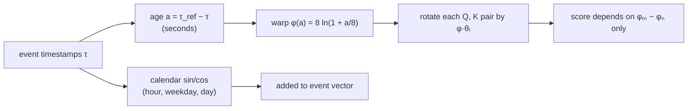

In a text model, position 41 and position 42 are neighbours, and that is all there is to
know. In an event history, two consecutive transactions can be 5 seconds apart (a card
retried after a decline, a classic fraud signal) or 5 months apart (a dormant account
waking up). An integer position index treats both pairs identically. The model needs
attention scores that know how much **real time** separates two events. This lesson takes
the rotary position encoding (RoPE) from the E3 lesson, feeds it timestamps instead of
indices, and works out what that buys and what it costs. PRAGMA encodes time in exactly this
way, applying RoPE to log-seconds in its history and profile encoders<FN n="1" />.

## RoPE in one derivation

Recall the setup<FN n="2" />. A query $q \in \mathbb{R}^d$ (with $d$ even) is split into $d/2$
two-dimensional pairs. Pair $i$ is rotated by the angle $p\,\theta_i$, where $p$ is the
token's position and the **frequencies** are

$$
\theta_i = b^{-2i/d}, \qquad i = 0, 1, \dots, d/2 - 1,
$$

with **base** $b$ (10,000 in the original paper). Keys are rotated the same way using their
own position $s$. The claim that makes RoPE useful: the score between a rotated query and a
rotated key depends on the positions only through $p - s$.

**Step 1: Use complex numbers for each pair.** Write pair $i$ of $q$ as the complex number
$\tilde q_i = q_{2i} + \mathrm{i}\, q_{2i+1}$, and likewise $\tilde k_i$. Rotating a 2D vector
by angle $\alpha$ is multiplication by $e^{\mathrm{i}\alpha}$.

**Step 2: Write the real dot product in complex form.** For two 2D vectors represented as
complex numbers $z, w$, the dot product is $\mathrm{Re}(z\,\bar w)$. So the score sums over
pairs:

$$
\langle R_p q, R_s k\rangle = \sum_i \mathrm{Re}\!\left( \tilde q_i e^{\mathrm{i} p \theta_i} \cdot \overline{\tilde k_i e^{\mathrm{i} s \theta_i}} \right).
$$

**Step 3: Combine the exponentials.** Since $\overline{e^{\mathrm{i}s\theta_i}} = e^{-\mathrm{i}s\theta_i}$,

$$
\langle R_p q, R_s k\rangle = \sum_i \mathrm{Re}\!\left( \tilde q_i \bar{\tilde k}_i \, e^{\mathrm{i}(p - s)\theta_i} \right).
$$

Only $p - s$ appears. Nothing in Steps 1 to 3 used the fact that $p$ and $s$ are integers.
They can be any real numbers.

## Replace positions with timestamps

Let each event carry a real **time coordinate** $c$, and rotate its query and key by
$c\,\theta_i$ in place of $p\,\theta_i$. The derivation above goes through unchanged, so

$$
\text{score}(m, n) = \sum_i \mathrm{Re}\!\left( \tilde q_i \bar{\tilde k}_i \, e^{\mathrm{i}(c_m - c_n)\theta_i} \right),
$$

which depends on the two events' times only through $c_m - c_n$. Two consequences follow
directly.

- **Shift invariance.** If $c$ is the raw timestamp in seconds, adding a constant to every
  timestamp leaves every score unchanged. The model cannot tell March from October from
  position alone. That is usually what you want (a history should not be judged by its
  calendar date), and calendar effects are fed separately: PRAGMA adds sine/cosine features
  of hour-of-day, day-of-week, and day-of-month to each event's vector<FN n="1" />.
- **Gaps, not order, set the score.** Two events 5 seconds apart get rotations that differ
  by $5\theta_i$; two events 5 months apart get rotations that differ by about
  $1.3 \times 10^7 \theta_i$. The integer-position ambiguity is gone.

## Raw seconds are the wrong coordinate

A 25-month history spans about $6.6 \times 10^7$ seconds. The difference between 1 second
and 61 seconds matters for fraud; the difference between 300 days and 300 days plus a minute
does not. Raw seconds give both pairs the same 60-unit gap. The fix is to warp time so that
resolution is fine for recent events and coarse for old ones.

PRAGMA's history encoder uses each event's **age** $a$, the seconds back from the most recent
event, passed through a soft logarithm<FN n="1" />:

$$
\varphi(a) = 8 \ln\!\left(1 + \frac{a}{8}\right).
$$

Its two regimes follow from the Taylor series $\ln(1 + x) = x - x^2/2 + \dots$.

**Step 1: Recent events are linear.** For $a \ll 8$, $\ln(1 + a/8) \approx a/8$, so
$\varphi(a) \approx a$. Within a few seconds of "now", one warped unit is one second.

**Step 2: Old events are logarithmic.** For $a \gg 8$, $1 + a/8 \approx a/8$, so
$\varphi(a) \approx 8\ln a - 8\ln 8$.

**Step 3: Differences become ratios.** For two old events,
$\varphi(a_m) - \varphi(a_n) \approx 8 \ln(a_m / a_n)$. The warped gap depends on the
*ratio* of ages, not their difference.

A contrasting pair makes the effect concrete. Two events 1 day and 2 days ago are
$8 \ln 2 = 5.54$ warped units apart. Two events 100 days and 101 days ago, also 1 day apart,
are $0.08$ warped units apart: the model sees them as practically simultaneous. A magnitude
scale of warped coordinates:

| age | 1 s | 1 min | 1 h | 1 day | 1 week | 30 days | 25 months |
|---|---|---|---|---|---|---|---|
| $\varphi(a)$ | 0.94 | 17.1 | 48.9 | 74.3 | 89.9 | 101.5 | 127.4 |

The whole 25-month history fits in about 127 warped units, and half of that range is spent
on the most recent hour.

A named confusion is worth stating here. "RoPE is a relative encoding" means relative **in
whatever coordinate drives it**. With warped age, scores depend on $\varphi(a_m) - \varphi(a_n)$,
which is not a function of the raw gap $a_m - a_n$. Shifting all events by a day changes
their ages, and so their scores. The encoding is shift-invariant in $\varphi$, not in seconds,
and that is a deliberate recency bias.



## Choosing the base for a warped range

The frequencies $\theta_i = b^{-2i/d}$ fall geometrically from $\theta_0 = 1$ to
$\theta_{\min} = b^{-(d-2)/d}$. Over a coordinate range $[0, R]$, pair $i$ turns through at
most $\theta_i R$ radians. Two failure modes sit at the ends.

- **Blur.** A pair with $\theta_i R \ll 1$ barely rotates anywhere in the history, so it
  carries no time information. It still matches content, but as a time channel it is wasted.
- **Aliasing.** A pair with $\theta_i R \gg 2\pi$ wraps around many times, so coordinates
  $c$ and $c + 2\pi/\theta_i$ look identical to it. High-frequency pairs resolve small gaps
  and are ambiguous about large ones; the low-frequency pairs must disambiguate.

A simple design rule is to make the slowest pair turn through a quarter circle over the full
range: $\theta_{\min} R = \pi/2$.

**Step 1.** Substitute $\theta_{\min} = b^{-(d-2)/d}$: $b^{-(d-2)/d} = \pi / (2R)$.

**Step 2.** Invert: $b^{(d-2)/d} = 2R/\pi$, so

$$
b^\star = \left(\frac{2R}{\pi}\right)^{d/(d-2)}.
$$

For $R = 127.4$ and head dimension $d = 64$, $b^\star \approx 93$. With the text default
$b = 10{,}000$, only 16 of the 32 pairs ever reach a quarter turn over the history; the
other half are blurred. The right panel below shows the consequence: with base 10,000 the
average score stays high across the whole range, while the range-matched base decorrelates
smoothly from "just now" to "two years ago".


The same logic runs in the opposite direction for long-context LLMs. Qwen3 raised its RoPE
base from 10,000 to 1,000,000 during long-context training so that its slowest pairs
stay unambiguous over tens of thousands of token positions<FN n="3" />, and the shipped
Qwen3 configs carry `rope_theta = 1000000`. A longer range calls for a larger base; a short
warped range calls for a small one.

## Several clocks at once: multi-axis RoPE

An event has more than one coordinate: its warped age, its calendar day, and the position of
a value inside its field. Qwen2-VL's **M-RoPE** handles images and video by splitting the
rotary pairs into three groups, rotated by temporal, height, and width coordinates
respectively<FN n="4" />. The same split works for events.

**Step 1.** Partition the pair indices into groups $G_1, \dots, G_A$, one per axis, and give
each event coordinates $c^{(1)}, \dots, c^{(A)}$.

**Step 2.** Rotate pair $i \in G_\alpha$ by $c^{(\alpha)}\theta_i$. The score is still a sum
over pairs, so it splits by group:

$$
\text{score}(m, n) = \sum_{\alpha=1}^{A} \sum_{i \in G_\alpha} \mathrm{Re}\!\left( \tilde q_i \bar{\tilde k}_i \, e^{\mathrm{i}(c^{(\alpha)}_m - c^{(\alpha)}_n)\theta_i} \right).
$$

**Step 3.** Each group depends only on its own coordinate difference, so the score is
relative along every axis at once. When all coordinates are equal (plain text), it reduces
to ordinary 1D RoPE, which is how Qwen2-VL keeps text behaviour unchanged.

Other production models chose differently, which is a useful contrast. nuFormer uses no
positional encoding at all and represents time with month, day, and weekday tokens inside
each transaction<FN n="5" />. TREASURE likewise drops positional encodings and feeds
log-scaled time differences as a numeric feature<FN n="6" />. Time2Vec adds learned
sinusoids of the timestamp to the input, which is an absolute rather than relative
encoding<FN n="7" />.

## Check it on arrays

```python
import numpy as np

rng = np.random.default_rng(0)
d = 64

def rope(x, c, base):
    """Rotate each 2D pair of x (shape n x d) by c * theta_i (c: n real coordinates)."""
    theta = base ** (-2 * np.arange(d // 2) / d)
    ang = np.outer(c, theta)
    x2 = x.reshape(len(x), d // 2, 2)
    cos, sin = np.cos(ang), np.sin(ang)
    out = np.stack([x2[..., 0] * cos - x2[..., 1] * sin,
                    x2[..., 0] * sin + x2[..., 1] * cos], axis=-1)
    return out.reshape(len(x), d)

q = rng.normal(size=(5, d)); k = rng.normal(size=(5, d))
t = np.sort(rng.uniform(0, 6.6e7, 5))          # raw timestamps in seconds

# 1) real-valued coordinates: scores invariant to a global time shift
S1 = rope(q, t, 1e4) @ rope(k, t, 1e4).T
S2 = rope(q, t + 12345.6, 1e4) @ rope(k, t + 12345.6, 1e4).T
assert np.allclose(S1, S2)

# 2) the warp and its two regimes
phi = lambda a: 8 * np.log1p(a / 8)
for name, a in [("1 s", 1), ("1 min", 60), ("1 h", 3600), ("1 day", 86400),
                ("1 week", 604800), ("30 days", 2.592e6), ("25 months", 6.57e7)]:
    print(f"{name:>9}: phi = {phi(a):6.1f}")
day = 86400
print("1 vs 2 days ago:", round(phi(2 * day) - phi(day), 2),
      " 100 vs 101 days ago:", round(phi(101 * day) - phi(100 * day), 2))

# 3) range-matched base and how many pairs a base wastes
R = phi(6.57e7)
b_star = (2 * R / np.pi) ** (d / (d - 2))
theta = 1e4 ** (-2 * np.arange(d // 2) / d)
print(f"R = {R:.1f}, b* = {b_star:.0f}, pairs turning >= pi/2 at base 1e4: "
      f"{(theta * R >= np.pi / 2).sum()} of {d // 2}")
assert 90 < b_star < 97 and (theta * R >= np.pi / 2).sum() == 16

# 4) M-RoPE style: two axes on disjoint pair groups = sum of per-axis scores
ages, fieldpos = phi(rng.uniform(0, 1e6, 5)), rng.integers(0, 8, 5).astype(float)
half = d // 2
def rope_half(x, c, base=100.0):
    dh = x.shape[1]
    th = base ** (-2 * np.arange(dh // 2) / dh)
    ang = np.outer(c, th); x2 = x.reshape(len(x), dh // 2, 2)
    return np.stack([x2[..., 0] * np.cos(ang) - x2[..., 1] * np.sin(ang),
                     x2[..., 0] * np.sin(ang) + x2[..., 1] * np.cos(ang)], -1).reshape(len(x), dh)
def mrope(x, c_age, c_pos):
    # first half of the pairs follow warped age, second half follow field position
    return np.concatenate([rope_half(x[:, :half], c_age), rope_half(x[:, half:], c_pos)], axis=1)
full = mrope(q, ages, fieldpos) @ mrope(k, ages, fieldpos).T
parts = (rope_half(q[:, :half], ages) @ rope_half(k[:, :half], ages).T
         + rope_half(q[:, half:], fieldpos) @ rope_half(k[:, half:], fieldpos).T)
assert np.allclose(full, parts)
shifted = mrope(q, ages + 3.0, fieldpos) @ mrope(k, ages + 3.0, fieldpos).T
assert np.allclose(full, shifted)   # relative along the age axis
print("M-RoPE score splits by axis and is shift-invariant per axis")
```

The checks confirm the derivations: real-valued coordinates keep RoPE's relative property,
the warp compresses 25 months into about 127 units with a 5.54 vs 0.08 contrast between
recent and old one-day gaps, base 10,000 leaves half of the 32 pairs blurred, and a
two-axis M-RoPE score is the sum of its per-axis scores.

## Exercises

**Exercise 1.** Two card payments happened 10 minutes and 20 minutes before the most recent
event. Compute their warped gap $\varphi(1200) - \varphi(600)$ and compare it with the
large-age approximation $8 \ln 2$.

<details>
<summary>Solution</summary>

**Step 1.** $\varphi(600) = 8 \ln(1 + 75) = 8 \ln 76 = 8 \times 4.3307 = 34.646$.

**Step 2.** $\varphi(1200) = 8 \ln(1 + 150) = 8 \ln 151 = 8 \times 5.0173 = 40.138$.

**Step 3.** The gap is $5.49$. The approximation $8\ln 2 = 5.545$ is within 1%, because
600 and 1200 seconds are both far into the logarithmic regime ($a \gg 8$).

</details>

**Exercise 2.** A lender keeps five years of history and uses head dimension $d = 128$.
Using $\varphi$ above, find the range-matched base $b^\star$.

<details>
<summary>Solution</summary>

**Step 1.** Five years is about $5 \times 365.25 \times 86400 = 1.578 \times 10^8$ seconds,
so $R = 8 \ln(1 + 1.578 \times 10^8 / 8) = 8 \ln(1.972 \times 10^7) = 8 \times 16.797 = 134.4$.

**Step 2.** $b^\star = (2R/\pi)^{128/126} = (85.55)^{1.01587}$. Taking logs,
$\ln b^\star = 1.01587 \times 4.449 = 4.520$, so $b^\star \approx 91.8$.

Doubling the history barely moves $R$ (the warp is logarithmic), so the base barely moves
either.

</details>

**Exercise 3 (code).** Show numerically that warping breaks shift invariance in raw seconds:
build scores with coordinates $\varphi(a)$ for five ages, then add one day to every age and
compare. Then show that shifting the warped coordinates themselves by a constant preserves
the scores.

<details>
<summary>Solution</summary>

```python
import numpy as np

rng = np.random.default_rng(1)
d = 16
def rope(x, c, base=100.0):
    th = base ** (-2 * np.arange(d // 2) / d)
    ang = np.outer(c, th); x2 = x.reshape(len(x), d // 2, 2)
    return np.stack([x2[..., 0] * np.cos(ang) - x2[..., 1] * np.sin(ang),
                     x2[..., 0] * np.sin(ang) + x2[..., 1] * np.cos(ang)], -1).reshape(len(x), d)
phi = lambda a: 8 * np.log1p(a / 8)
q, k = rng.normal(size=(5, d)), rng.normal(size=(5, d))
ages = np.array([30.0, 600, 3600, 86400, 864000])

S = rope(q, phi(ages)) @ rope(k, phi(ages)).T
S_day = rope(q, phi(ages + 86400)) @ rope(k, phi(ages + 86400)).T
S_shift = rope(q, phi(ages) + 7.0) @ rope(k, phi(ages) + 7.0).T

print("max change after +1 day of age:", np.abs(S - S_day).max())
assert not np.allclose(S, S_day)       # raw-time shift changes scores
assert np.allclose(S, S_shift)         # warped-coordinate shift does not
```

Adding a day to every age changes the warped gaps (recent events get compressed toward the
old ones), so scores move; a constant shift in $\varphi$ leaves every difference intact.

</details>

The next lesson asks what the model should be trained to predict about these tokens:
masked fields and events (encoder style) or the next event (decoder style).

<Footnotes>
  <FNItem n="1">**Ostroukhov, M., Mikhailov, R., Iashin, V., Sokolov, A., et al.** (2026). "PRAGMA: Revolut Foundation Model". [arXiv:2604.08649](https://arxiv.org/abs/2604.08649)</FNItem>
  <FNItem n="2">**Su, J., Lu, Y., Pan, S., Murtadha, A., Wen, B., Liu, Y.** (2021). "RoFormer: Enhanced Transformer with Rotary Position Embedding". *Neurocomputing* (2024). [arXiv:2104.09864](https://arxiv.org/abs/2104.09864)</FNItem>
  <FNItem n="3">**Yang, A., Li, A., Yang, B., et al.** (2025). "Qwen3 Technical Report". [arXiv:2505.09388](https://arxiv.org/abs/2505.09388)</FNItem>
  <FNItem n="4">**Wang, P., Bai, S., Tan, S., et al.** (2024). "Qwen2-VL: Enhancing Vision-Language Model's Perception of the World at Any Resolution". [arXiv:2409.12191](https://arxiv.org/abs/2409.12191)</FNItem>
  <FNItem n="5">**Braithwaite, D. T., Cavalcanti, M., McEver, R. A., et al.** (2025). "Your Spending Needs Attention: Modeling Financial Habits with Transformers". [arXiv:2507.23267](https://arxiv.org/abs/2507.23267)</FNItem>
  <FNItem n="6">**Yeh, C.-C. M., et al.** (2025). "TREASURE: The Visa Payment Foundation Model for High-Volume Transaction Understanding". [arXiv:2511.19693](https://arxiv.org/abs/2511.19693)</FNItem>
  <FNItem n="7">**Kazemi, S. M., Goel, R., Eghbali, S., et al.** (2019). "Time2Vec: Learning a Vector Representation of Time". [arXiv:1907.05321](https://arxiv.org/abs/1907.05321)</FNItem>
</Footnotes>
