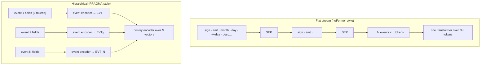

A bank sees each customer as a long list of events: a card payment of 12.50 EUR at a
coffee shop at 09:32, a salary credit, a transfer to a friend, a login from a new device.
For years the standard way to model this was to hand-build hundreds of aggregate features
("spend in the last 30 days", "number of distinct merchants this week") and feed them to a
gradient-boosted tree. A **transaction foundation model** instead reads the raw event history
with a transformer, pretrained on billions of events, and produces an embedding of the
customer that downstream models reuse. Revolut's PRAGMA<FN n="1" />, Nubank's
nuFormer<FN n="2" />, and Visa's TREASURE<FN n="3" /> are recent examples. Before any of that
can happen, an event has to become tokens. This lesson is about that step, because the
choices made here bound what every later layer can learn.

## What an event is

An **event** is a record of typed fields. Write it as a set of key/value pairs

$$
e = \{(k_1, v_1), (k_2, v_2), \dots, (k_F, v_F)\}, \qquad \text{plus a timestamp } \tau(e),
$$

where each **key** $k_j$ names a field (amount, currency, merchant category code, merchant
name, channel, free-text description) and each **value** $v_j$ has a type: a real number,
a categorical symbol, or a string. A **history** is the time-ordered list of a user's events
$e_1, \dots, e_N$. A tokenizer is a map from values to integer ids in a finite vocabulary,
so the three value types need three treatments.

- **Categorical, low cardinality** (currency, channel, merchant category code): one token
  per distinct value. A vocabulary of a few hundred symbols is cheap.
- **Text** (merchant descriptor, transfer reference): ordinary subword tokenization (BPE,
  from the tokenization lesson), producing a variable number of tokens.
- **Numeric** (amount, balance): the hard case, covered next.

PRAGMA embeds each field as the sum of a key embedding and a value embedding from one shared
table, $x = E(k) + E(v)$, plus a positional term for the value's index inside the field, so
the model always knows *which* field a value belongs to<FN n="1" />.

## Numeric values: three ways to bucket an amount

A transformer's input layer is an embedding lookup, so a real amount is usually converted to
a **bucket id**: choose boundaries $b_0 \lt b_1 \lt \dots \lt b_B$ and emit token $i$ when
$b_i \le v \lt b_{i+1}$. The Thoughtworks/NVIDIA guidance is blunt: bucket with log-spaced or
decile thresholds and never feed raw values<FN n="4" />. Two properties decide between
schemes: how much information a bucket token carries, and how precisely the bucket pins
down the amount.

### Uniform-width buckets waste the vocabulary

Card amounts are close to **log-normal**: many small payments, a long right tail of rent,
travel, and transfers. Put $B = 16$ equal-width buckets between 0 and the largest amount and
the first bucket swallows almost everything. On 100,000 log-normal amounts with median 20
and log-scale spread $\sigma = 1.2$ (the closing code), the first bucket holds **99.2%** of
transactions. The other 15 tokens are almost never used.

### Quantile buckets maximize information per token

The information a bucket token carries is its entropy $H = -\sum_i p_i \log_2 p_i$, where
$p_i$ is the fraction of values that land in bucket $i$.

**Claim.** Over $B$ buckets, $H \le \log_2 B$, with equality exactly when every $p_i = 1/B$.

**Step 1: Write the gap to the bound as a divergence.** Let $u_i = 1/B$ be the uniform
distribution. Then

$$
\log_2 B - H = \sum_i p_i \log_2 B + \sum_i p_i \log_2 p_i = \sum_i p_i \log_2 \frac{p_i}{u_i} = D_{\mathrm{KL}}(p \,\|\, u).
$$

**Step 2: Use Gibbs' inequality.** The KL divergence is non-negative and zero only when the
two distributions are equal (proved in the KL lesson of pillar A). Hence
$H \le \log_2 B$, with equality iff $p = u$.

**Step 3: Choose boundaries that make $p$ uniform.** If $F$ is the cumulative distribution
of amounts, set $b_i = F^{-1}(i/B)$, the $i/B$ quantile. Then each bucket holds probability
$F(b_{i+1}) - F(b_i) = 1/B$, so quantile buckets attain the bound.

With $B = 16$ the quantile scheme carries $\log_2 16 = 4$ bits per amount token, against
**0.07 bits** for the uniform scheme on the same data. PRAGMA uses exactly this: percentile
buckets whose boundaries are learned from the training data, plus a dedicated bucket for
zero<FN n="1" />.


### Log-spaced buckets bound the relative error

Quantile buckets are uneven in width: the top bucket may span 300 to 50,000. When the
*precision* of the amount matters (a 4,999 vs 5,000 transfer limit), log spacing gives a
guarantee instead. Set $b_i = b_0 r^i$ for a ratio $r \gt 1$, and decode bucket $i$ to its
geometric midpoint $\hat v = \sqrt{b_i b_{i+1}} = b_i \sqrt r$.

**Claim.** Every amount in the bucket is recovered within relative error $\sqrt r - 1$.

**Step 1: Bound the ratio.** For $b_i \le v \lt b_i r$, divide by $\hat v = b_i\sqrt r$:
$1/\sqrt r \le v/\hat v \lt \sqrt r$.

**Step 2: Convert to relative error.** The relative error $|\hat v - v|/v = |\hat v/v - 1|$
is largest at the ends of that interval: $\sqrt r - 1$ when $v = b_i$, and $1 - 1/\sqrt r$
(which is smaller) at the upper end. So the error never exceeds $\sqrt r - 1$.

A ratio of $r = 2$ (one bucket per doubling) gives at most 41.4% error; $r = 1.25$ gives at
most 11.8%, at the cost of $\log_{1.25} 2 \approx 3.1$ times as many buckets per decade. The
trade is resolution against vocabulary size, and the bound tells you exactly what you buy.

## High-cardinality fields: top-K, hashing, or learned tables

Merchant ids can number in the millions; TREASURE handles categorical attributes with up to
100 million values<FN n="3" />. Three standard options:

- **Top-K plus UNK.** Keep the $K$ most frequent merchants, map the rest to one unknown token.
  Rare merchants lose their identity entirely.
- **Hashing.** Map each id to $h(\text{id}) \bmod m$. Nothing is dropped, but distinct
  merchants collide.
- **Sampled-softmax embedding tables.** Keep one row per merchant and train the output side
  with negative sampling (TREASURE uses InfoNCE for high-cardinality outputs, covered in the
  objectives lesson).

How bad are hash collisions? Hash $n$ distinct merchants uniformly into $m$ buckets and fix
one merchant.

**Step 1.** Each of the other $n - 1$ merchants misses its bucket with probability
$1 - 1/m$, independently.

**Step 2.** So the probability it shares a bucket with at least one other is
$P = 1 - (1 - 1/m)^{n-1}$.

**Step 3.** Using $\ln(1 - x) \approx -x$ for small $x$: $P \approx 1 - e^{-(n-1)/m}$.

With $n = 50{,}000$ merchants and $m = 2^{16} = 65{,}536$ buckets, $P \approx 53\%$: most
merchants share an embedding. With $m = 2^{20}$, $P \approx 4.7\%$. The load factor $n/m$,
not $m$ alone, is the number to watch.

## Layout: one flat stream or an event encoder

Once fields are tokens, they must be arranged into sequences. Two designs dominate.

**Flat stream.** Concatenate every event's tokens with a separator and let one transformer
read the whole thing. nuFormer does this: each transaction becomes special tokens for sign,
amount bucket (21 bins), month, day, and weekday, followed by the BPE-tokenized description,
and transactions are joined with a separator<FN n="2" />. It is simple and reuses any
LLM-style stack, but the sequence length is (events) $\times$ (tokens per event).

**Hierarchical.** A small **event encoder** reads one event's field tokens and outputs a
single vector (an `[EVT]` summary token); a **history encoder** then attends over the $N$
event vectors. PRAGMA uses this split, plus a third encoder for the user's profile state, and
truncates each event to 24 tokens<FN n="1" />.



The cost difference follows from the quadratic cost of self-attention. Full attention over a
sequence of length $S$ computes $S^2$ scores per head.

**Step 1: Flat.** $S = NL$, so the cost is $(NL)^2 = N^2 L^2$.

**Step 2: Hierarchical.** The event encoder runs $N$ times on length $L$ ($N L^2$ scores),
and the history encoder runs once on length $N$ ($N^2$ scores): total $N L^2 + N^2$.

**Step 3: Ratio.** $\dfrac{N^2 L^2}{N L^2 + N^2} = \dfrac{N L^2}{L^2 + N}$. When $N \gg L^2$
this is about $L^2$; when $N \ll L^2$ it is about $N$.

For a long history, $N = 6{,}500$ events (PRAGMA's cap) of $L = 24$ tokens, the flat layout
costs about **529 times** as many attention scores. The price of the hierarchy is that
tokens of different events never attend to each other directly; they interact only through
their summary vectors.

## Check it on arrays

```python
import numpy as np

rng = np.random.default_rng(0)
amounts = rng.lognormal(mean=np.log(20.0), sigma=1.2, size=100_000)
B = 16

def entropy_bits(counts):
    p = counts / counts.sum()
    p = p[p > 0]
    return -(p * np.log2(p)).sum()

# 1) uniform-width vs quantile buckets
uni = np.histogram(amounts, np.linspace(0, amounts.max(), B + 1))[0]
qnt = np.histogram(amounts, np.quantile(amounts, np.linspace(0, 1, B + 1)))[0]
print(f"uniform: first bucket {uni[0]/uni.sum():.3f}, H = {entropy_bits(uni):.2f} bits")
print(f"quantile: H = {entropy_bits(qnt):.2f} bits (bound log2 B = {np.log2(B):.0f})")
assert np.isclose(entropy_bits(qnt), np.log2(B), atol=1e-3)

# 2) log-spaced buckets: relative error never exceeds sqrt(r) - 1
r, b0 = 2.0, 0.01
idx = np.floor(np.log(amounts / b0) / np.log(r))
decoded = b0 * r**idx * np.sqrt(r)
rel_err = np.abs(decoded - amounts) / amounts
print(f"max relative error {rel_err.max():.4f} vs bound {np.sqrt(r) - 1:.4f}")
assert rel_err.max() <= np.sqrt(r) - 1 + 1e-12

# 3) hash collisions: simulated vs 1 - exp(-(n-1)/m)
n, m = 50_000, 2**16
buckets = rng.integers(0, m, n)
load = np.bincount(buckets, minlength=m)
share = (load[buckets] > 1).mean()
print(f"collision rate {share:.3f} vs formula {1 - np.exp(-(n - 1) / m):.3f}")
assert abs(share - (1 - np.exp(-(n - 1) / m))) < 0.01

# 4) attention cost: flat vs hierarchical
N, L = 6500, 24
ratio = (N * L) ** 2 / (N * L**2 + N**2)
print(f"flat / hierarchical attention scores = {ratio:.0f}")
assert 500 < ratio < 560
```

The output reproduces each derivation: 0.07 bits for uniform bins against the 4-bit bound
for quantile bins, a worst-case relative error just under $\sqrt 2 - 1$, a simulated
collision rate matching $1 - e^{-(n-1)/m}$, and a 529-fold attention saving for the
hierarchical layout.

## Exercises

**Exercise 1.** An amount field uses $B = 32$ quantile buckets. How many bits does one amount
token carry, and how many would it carry if a bug made two adjacent buckets always merge
(so one bucket has mass $2/32$ and one has mass 0)?

<details>
<summary>Solution</summary>

**Step 1.** Quantile buckets are uniform, so $H = \log_2 32 = 5$ bits.

**Step 2.** After the merge, 30 buckets have mass $1/32$ and one has mass $1/16$:

$$
H = 30 \cdot \tfrac{1}{32} \log_2 32 + \tfrac{1}{16} \log_2 16 = \tfrac{30 \cdot 5}{32} + \tfrac{4}{16} = 4.6875 + 0.25 = 4.9375 \text{ bits}.
$$

The loss is only 0.0625 bits, which is why entropy alone will not catch a broken bucket;
check bucket counts directly.

</details>

**Exercise 2.** You need every amount decoded within 5% relative error using log-spaced
buckets. What is the largest ratio $r$, and how many buckets cover amounts from 0.01 to
1,000,000?

<details>
<summary>Solution</summary>

**Step 1.** Require $\sqrt r - 1 \le 0.05$, so $r \le 1.05^2 = 1.1025$.

**Step 2.** The range spans a factor of $10^8$. The number of buckets is
$\lceil \ln(10^8) / \ln(1.1025) \rceil = \lceil 18.42 / 0.09758 \rceil = \lceil 188.8 \rceil = 189$.

189 tokens is a modest vocabulary, so tight relative precision is cheap with log spacing.

</details>

**Exercise 3 (code).** For the hierarchical layout, find the history length $N$ at which the
flat layout costs exactly 100 times more attention scores when $L = 24$. Solve by hand from
the ratio formula, then confirm numerically.

<details>
<summary>Solution</summary>

**Step 1.** Set $\dfrac{N L^2}{L^2 + N} = 100$ with $L^2 = 576$: $576N = 100(576 + N)$, so
$476 N = 57{,}600$ and $N = 121.0$ (to one decimal).

**Step 2.** Confirm:

```python
import numpy as np
L = 24
N = 57600 / 476
ratio = N * L**2 / (L**2 + N)
print(N, ratio)
assert np.isclose(ratio, 100.0)
```

Even a history of about 121 events makes the flat stream 100 times more expensive.

</details>

The next lesson gives these tokens a sense of *when* they happened, by driving rotary
position encodings with real timestamps instead of integer positions.

<Footnotes>
  <FNItem n="1">**Ostroukhov, M., Mikhailov, R., Iashin, V., Sokolov, A., et al.** (2026). "PRAGMA: Revolut Foundation Model". [arXiv:2604.08649](https://arxiv.org/abs/2604.08649)</FNItem>
  <FNItem n="2">**Braithwaite, D. T., Cavalcanti, M., McEver, R. A., et al.** (2025). "Your Spending Needs Attention: Modeling Financial Habits with Transformers". KDD Workshop on Machine Learning in Finance. [arXiv:2507.23267](https://arxiv.org/abs/2507.23267)</FNItem>
  <FNItem n="3">**Yeh, C.-C. M., et al.** (2025). "TREASURE: The Visa Payment Foundation Model for High-Volume Transaction Understanding". KDD 2026. [arXiv:2511.19693](https://arxiv.org/abs/2511.19693)</FNItem>
  <FNItem n="4">**Gancz, A., Blanchard, B., Troyanovsky, A., et al.** (2026). "How to build transaction foundation models in banking and payments". Thoughtworks Insights. [thoughtworks.com](https://www.thoughtworks.com/insights/articles/how-to-build-transaction-foundation-models-in-banking-and-payments)</FNItem>
</Footnotes>
