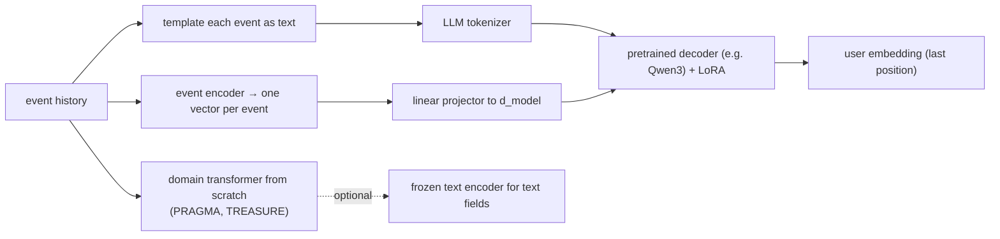

A model trained from scratch on transactions has to discover from co-occurrence alone that
"UBER *TRIP" is transport, that "TESCO STORES" is groceries, and that a reference reading
"rent march" is a housing payment. A pretrained open-weight LLM such as Qwen<FN n="1" />
already knows all of that. The appeal of using one as the backbone of a transaction
foundation model is to inherit that world knowledge and spend the bank's data on what the
LLM cannot know: the statistics of amounts, timing, and individual behaviour. This lesson
works through the two ways to get events into a pretrained decoder, what each costs in
context and parameters, and how to read a user embedding out of a causal model.

## Three routes



- **Route A, textualize.** Render each event as a line of text and feed the LLM its own
  tokens. The Open Banking model does this with a BERT-style encoder and templates such as
  `[TYPE] DEBIT [AMT] <bucket> [NAME] <description>`<FN n="2" />.
- **Route B, event embeddings as soft tokens.** A small event encoder (as in the tokenization
  lesson) turns each event into a vector; a linear **projector** maps it to the decoder's
  hidden size, and the sequence of projected vectors is fed in place of token embeddings.
  This is the recipe vision-language models use to feed image patches to an LLM.
- **Route C, domain model from scratch.** No LLM weights at all. PRAGMA offers a middle
  ground: a frozen pretrained text encoder maps each text value to one vector, and the
  model regresses that vector instead of predicting subwords<FN n="3" />.

## Route A: what text costs

Take one card payment rendered as `2026-03-14 09:32 | -12.50 EUR | MCC 5812 | PRET A MANGER`.
Qwen's tokenizer splits numbers into single digits<FN n="4" />, so `-12.50` alone costs six
tokens (`-`, `1`, `2`, `.`, `5`, `0`) and the timestamp about sixteen. With separators,
currency, category code, and the merchant name, a compact template lands near 25 tokens per
event. Two budgets follow.

**Context.** The Qwen3-0.6B config sets `max_position_embeddings = 40960`<FN n="5" />. At 25
tokens per event that is $40{,}960 / 25 = 1{,}638$ events, far short of the 6,500-event
histories PRAGMA handles.

**Attention.** Self-attention costs grow with the square of sequence length, so 25 tokens per
event costs $25^2 = 625$ times the attention scores of one token per event over the same
history.


Digit-level tokenization has a second cost: the magnitude of an amount is only implicit in
the number of digits before the decimal point, which the model must learn to count. The
usual fix is to **add special tokens**, as nuFormer does with its 21 amount-bin tokens and
its sign, month, day, and weekday tokens<FN n="6" />. Adding tokens means resizing the
embedding table and the output head, and the new rows need an initialization (the mean of
the existing embeddings is a common neutral choice) because they have no pretraining
behind them.

## Route B: soft tokens

Let the event encoder produce $z_n \in \mathbb{R}^{d_e}$ for event $n$. A projector
$W \in \mathbb{R}^{d_{\text{model}} \times d_e}$ maps it to $W z_n \in \mathbb{R}^{d_{\text{model}}}$
(1,024 for Qwen3-0.6B<FN n="5" />), and the decoder receives the sequence
$W z_1, \dots, W z_N$ through its input-embedding path instead of looking up token ids.

- **Cost.** One position per event, so the full 40,960 positions hold 40,960 events.
- **Text knowledge.** The decoder never sees the merchant string, so its world knowledge
  enters only if the event encoder itself embeds the text (for example with the LLM's own
  embedding table averaged over the description's tokens).
- **Objective.** The LLM's vocabulary head no longer applies, because the targets are events,
  not tokens. Training uses event-level heads on the hidden states, such as the per-field
  cross-entropy, Gaussian, and InfoNCE losses from the previous lesson, applied to the next
  event.
- **Time.** The decoder's RoPE still rotates by position index. Hugging Face implementations
  compute the rotary angles from a `position_ids` tensor, so time-derived positions (for
  example a monotone integer warp of event age) can replace $0, 1, \dots, N-1$. Whether a
  pretrained model tolerates that change is an empirical question to validate, not a
  documented feature.

## The LoRA budget

Fine-tuning every weight of the backbone would let the bank data overwrite what makes it
useful. LoRA from the E4 lesson freezes $W_0$ and learns a low-rank update
$\Delta W = BA$ with $B \in \mathbb{R}^{d_{\text{out}} \times r}$ and
$A \in \mathbb{R}^{r \times d_{\text{in}}}$, adding $r(d_{\text{in}} + d_{\text{out}})$
parameters per adapted matrix. For Qwen3-0.6B the config gives hidden size 1,024, 16 query
heads and 8 key/value heads of dimension 128, FFN width 3,072, and 28 layers<FN n="5" />.

**Step 1: Shapes per layer.** Query projection $1024 \to 2048$ ($16 \times 128$); key and value
$1024 \to 1024$ each ($8 \times 128$, grouped-query attention); output $2048 \to 1024$; gate and
up $1024 \to 3072$; down $3072 \to 1024$.

**Step 2: Sum $d_{\text{in}} + d_{\text{out}}$.** Attention: $3072 + 2048 + 2048 + 3072 = 10{,}240$.
FFN: $4096 \times 3 = 12{,}288$. Total $22{,}528$ per layer.

**Step 3: Scale.** $22{,}528 \times 28 = 630{,}784$ parameters per unit of rank. At $r = 8$,
LoRA on every projection adds $5{,}046{,}272$ parameters, about $0.85\%$ of the model's
$\approx 596$ million (dense weights plus the tied 151,936-row embedding table).

PRAGMA's LoRA setting, rank 8 on the QKV and MLP projections, amounts to about 2 to 4% of its
parameters because its models are smaller and narrower<FN n="3" />. The relative budget
shrinks as the backbone grows, because a layer's weights grow with $d^2$ while LoRA's
parameters grow with $d$.

## Reading out the user embedding

A causal decoder's attention mask lets position $t$ attend only to positions $\le t$. Follow
the dependency through the layers.

**Step 1.** After one layer, hidden state $h^{(1)}_t$ is a function of inputs $x_1, \dots, x_t$ only.

**Step 2.** By induction, after any number of layers $h^{(\ell)}_t$ still depends only on
$x_{\le t}$, because each layer mixes position $t$ only with positions at or before $t$, whose
states depend on even earlier inputs.

**Step 3.** So the last position $S$ is the only one whose final state depends on the whole
history. A mean over positions averages in states that never saw the recent events, which are
usually the most predictive.

The last real (non-padding) position is therefore the default user embedding for a decoder;
an encoder such as PRAGMA instead reads a dedicated `[USR]` output that attends in both
directions<FN n="3" />.

The shape of a Route B training step in PyTorch, using the Hugging Face and PEFT libraries
(not runnable in the browser, since Pyodide has no torch):

```python-static
import torch
from transformers import AutoModelForCausalLM
from peft import LoraConfig, get_peft_model

base = AutoModelForCausalLM.from_pretrained("Qwen/Qwen3-0.6B", torch_dtype=torch.bfloat16)
model = get_peft_model(base, LoraConfig(
    r=8, lora_alpha=8,
    target_modules=["q_proj", "k_proj", "v_proj", "o_proj", "gate_proj", "up_proj", "down_proj"],
))
proj = torch.nn.Linear(256, base.config.hidden_size)      # event encoder dim -> 1024

z = event_encoder(batch)                                   # (B, N, 256), one vector per event
out = model(inputs_embeds=proj(z).to(torch.bfloat16),
            attention_mask=mask, output_hidden_states=True)
h = out.hidden_states[-1]                                  # (B, N, 1024)
loss = next_event_loss(event_heads(h[:, :-1]), batch, shift=1)   # per-field losses
last = mask.sum(dim=1) - 1                                 # last real position (right padding)
user_embedding = h[torch.arange(h.size(0)), last]
```

## What transfers, and what does not

Pretrained language knowledge helps exactly where events carry language: merchant
descriptors, transfer references, product names. It does not help with amount
distributions, inter-event timing, or the habits of one customer, which have to come from
the bank's data either way. PRAGMA's frozen text-encoder variant illustrates the mixed
result: it improved credit-scoring PR-AUC by 16.1% relative to the LoRA baseline but lowered
product-recommendation mAP by 6.4%, and added about 18% training latency, so the authors
made it opt-in<FN n="3" />. Plan to measure transfer per task rather than assume it.

## Check it on arrays

```python
import numpy as np

# 1) Digit-split token counts for amounts (Qwen-style: every digit is one token)
def digit_tokens(s):
    return len([ch for ch in s if ch.isdigit() or ch in "-.,"])
for s in ["-0.99", "-12.50", "-1,234.00", "+12,345.67"]:
    print(f"{s:>11}: {digit_tokens(s)} tokens")
assert digit_tokens("-12.50") == 6

# 2) Context and attention budgets
ctx, per_event = 40960, 25
print("events that fit as text:", ctx // per_event, "| attention ratio:", per_event**2)
assert ctx // per_event == 1638

# 3) LoRA parameters for Qwen3-0.6B shapes
mats = {"q": (1024, 2048), "k": (1024, 1024), "v": (1024, 1024), "o": (2048, 1024),
        "gate": (1024, 3072), "up": (1024, 3072), "down": (3072, 1024)}
layers, r = 28, 8
lora = r * layers * sum(a + b for a, b in mats.values())
dense = layers * sum(a * b for a, b in mats.values()) + 151936 * 1024
print(f"LoRA r=8: {lora:,} params = {100 * lora / dense:.2f}% of {dense / 1e6:.0f}M")
assert lora == 5_046_272

# 4) Causal dependency: only the last position depends on every input
rng = np.random.default_rng(0)
S, d = 6, 8
Wq, Wk, Wv = (rng.normal(size=(d, d)) for _ in range(3))
def causal_layer(x):
    q, k, v = x @ Wq, x @ Wk, x @ Wv
    s = q @ k.T / np.sqrt(d)
    s = np.where(np.tril(np.ones((S, S))) == 1, s, -np.inf)
    a = np.exp(s - s.max(1, keepdims=True)); a /= a.sum(1, keepdims=True)
    return x + a @ v
x = rng.normal(size=(S, d))
h = causal_layer(causal_layer(x))
x2 = x.copy(); x2[-1] += 1.0                     # perturb the most recent event only
changed = np.abs(causal_layer(causal_layer(x2)) - h).max(axis=1) > 1e-12
print("positions affected by the last event:", np.flatnonzero(changed))
assert changed.tolist() == [False] * (S - 1) + [True]
```

The checks reproduce the lesson's numbers: six tokens for `-12.50`, 1,638 textualized events
in a 40,960 context with a 625-fold attention cost, 5,046,272 LoRA parameters at rank 8, and
a two-layer causal stack in which only the final position responds to the most recent event.

## Exercises

**Exercise 1.** Count the LoRA parameters for Qwen3-0.6B at rank 16 when only the four
attention projections (q, k, v, o) are adapted.

<details>
<summary>Solution</summary>

**Step 1.** Per layer, $d_{\text{in}} + d_{\text{out}}$ over attention projections is
$3072 + 2048 + 2048 + 3072 = 10{,}240$.

**Step 2.** Multiply by rank and layers: $10{,}240 \times 16 \times 28 = 4{,}587{,}520$.

Attention-only at rank 16 costs slightly less than all-projection at rank 8 (5,046,272).

</details>

**Exercise 2.** A 32,768-position backbone reads textualized events at 30 tokens each. How
many events fit, and by what factor does attention cost exceed a soft-token design holding the
same events?

<details>
<summary>Solution</summary>

**Step 1.** $\lfloor 32{,}768 / 30 \rfloor = 1{,}092$ events.

**Step 2.** Text uses $30N$ positions against $N$ for soft tokens, so attention scores are
$(30N)^2 / N^2 = 900$ times more.

</details>

**Exercise 3 (code).** Show numerically that mean pooling a causal model's final states is
less sensitive to the most recent event than last-position pooling. Perturb the last input of
the two-layer causal stack and compare the change in both pooled vectors.

<details>
<summary>Solution</summary>

```python
import numpy as np

rng = np.random.default_rng(0)
S, d = 6, 8
Wq, Wk, Wv = (rng.normal(size=(d, d)) for _ in range(3))
def causal_layer(x):
    q, k, v = x @ Wq, x @ Wk, x @ Wv
    s = np.where(np.tril(np.ones((S, S))) == 1, q @ k.T / np.sqrt(d), -np.inf)
    a = np.exp(s - s.max(1, keepdims=True)); a /= a.sum(1, keepdims=True)
    return x + a @ v
x = rng.normal(size=(S, d))
x2 = x.copy(); x2[-1] += 1.0
h, h2 = causal_layer(causal_layer(x)), causal_layer(causal_layer(x2))
d_last = np.linalg.norm(h2[-1] - h[-1])
d_mean = np.linalg.norm(h2.mean(0) - h.mean(0))
print(d_last, d_mean, d_last / d_mean)
assert np.isclose(d_mean, d_last / S)
```

Only the last row changes, so the mean moves by exactly $1/S$ of the last-position change:
mean pooling dilutes the newest event by the history length.

</details>

The next lesson takes the embeddings produced by any of these routes and asks how to
evaluate them on real downstream tasks without fooling yourself.

<Footnotes>
  <FNItem n="1">**Yang, A., Li, A., Yang, B., et al.** (2025). "Qwen3 Technical Report". [arXiv:2505.09388](https://arxiv.org/abs/2505.09388)</FNItem>
  <FNItem n="2">**Polleti, G., Santana, M., Fontes, E.** (2025). "Open Banking Foundational Model: Learning Language Representations from Few Financial Transactions". [arXiv:2511.12154](https://arxiv.org/abs/2511.12154)</FNItem>
  <FNItem n="3">**Ostroukhov, M., Mikhailov, R., Iashin, V., Sokolov, A., et al.** (2026). "PRAGMA: Revolut Foundation Model". [arXiv:2604.08649](https://arxiv.org/abs/2604.08649)</FNItem>
  <FNItem n="4">**Bai, J., Bai, S., Chu, Y., et al.** (2023). "Qwen Technical Report". [arXiv:2309.16609](https://arxiv.org/abs/2309.16609)</FNItem>
  <FNItem n="5">**Qwen Team** (2025). Qwen3-0.6B model configuration (`config.json`). Hugging Face. [huggingface.co/Qwen/Qwen3-0.6B](https://huggingface.co/Qwen/Qwen3-0.6B)</FNItem>
  <FNItem n="6">**Braithwaite, D. T., Cavalcanti, M., McEver, R. A., et al.** (2025). "Your Spending Needs Attention: Modeling Financial Habits with Transformers". [arXiv:2507.23267](https://arxiv.org/abs/2507.23267)</FNItem>
</Footnotes>
