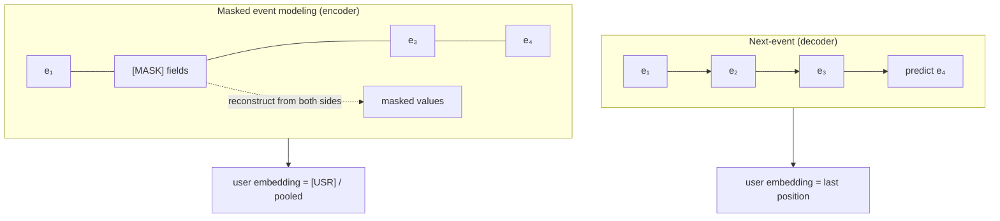

A bank has billions of transactions and almost no labels: defaults take a year to
materialize, fraud is confirmed for a tiny fraction of events, and every product team wants
a different target. Pretraining therefore has to invent its own targets from the event
stream. Two recipes are in production. **Masked event modeling** hides parts of the history
and asks a bidirectional encoder to fill them in (PRAGMA<FN n="1" />, and the Open Banking
model of Polleti et al.<FN n="2" />). **Next-event prediction** asks a causal decoder to
predict what comes next (nuFormer<FN n="3" />, TREASURE<FN n="4" />, and NVIDIA's reference
recipe<FN n="5" />). This lesson derives both objectives, the loss used for each field type,
and the masking design that keeps the encoder from cheating.

## Two factorizations of the same history

Write the tokenized history as $x = (x_1, \dots, x_S)$, grouped into events.

**Causal (decoder).** The chain rule of probability gives an exact factorization,

$$
\log p(x) = \sum_{t=1}^{S} \log p(x_t \mid x_{\lt t}),
$$

so training a causal model to minimize $-\sum_t \log p_\theta(x_t \mid x_{\lt t})$ is maximum
likelihood on the full joint distribution of histories. Each token sees only the past, which
nuFormer's authors argue matches the forward-looking nature of credit risk<FN n="3" />.

**Masked (encoder).** Choose a random set $M$ of positions, replace them with a mask token,
and minimize

$$
\mathcal{L}_{\text{MLM}} = -\sum_{j \in M} \log p_\theta(x_j \mid x_{\setminus M}),
$$

where $x_{\setminus M}$ is the history with the masked positions hidden. Every position sees
both past and future. The sum of conditionals is not the log of any single joint
distribution, so a masked model cannot generate histories, but generation is not the goal:
the goal is a representation of the user *as of now*, and bidirectional context is what
makes that representation rich.



## The within-event shortcut, and why event-level masking fixes it

Masking single tokens, as in BERT, is too easy on event data. The fields of one transaction
are strongly dependent: the merchant name almost determines the merchant category code
(MCC), the currency is fixed by the card, the description repeats the merchant. Information
theory makes the problem precise.

**Step 1: Conditioning cannot increase entropy.** For any variables,
$H(X \mid Y, Z) \le H(X \mid Z)$, with equality iff $X$ and $Y$ are conditionally
independent given $Z$ (this is the non-negativity of conditional mutual information).

**Step 2: Apply it to a masked field.** Let $X$ be the masked MCC, $Y$ the other fields of
the *same* event, and $Z$ the rest of the history. The best achievable expected loss under
token masking is $H(X \mid Y, Z)$, and under event masking (all of the event's fields hidden)
it is $H(X \mid Z)$.

**Step 3: Read off the shortcut.** If the merchant determines the MCC, $H(X \mid Y, Z) = 0$:
the model reaches zero loss by learning a merchant-to-MCC lookup and never needs the history.
Under event masking the floor is $H(X \mid Z)$, which is positive and can only be lowered by
learning what the *history* says about this user's next purchase.

A second shortcut lives across events: a field whose value is constant for a user (home
currency, card type) can be copied from any other event. Hiding every value of one key in the
history closes that route.

PRAGMA uses all three granularities at once: token-level masking at 15%, event-level at 10%
(the whole event is reconstructed), and key-level at 10% (all values of the selected keys are
masked)<FN n="1" />. Some selected positions are replaced with an unknown token instead of
the mask token and excluded from the loss, which acts as input dropout and reduces the
model's reliance on a mask token that never appears at inference<FN n="1" />, the same
concern behind BERT's 80/10/10 replacement rule from the masked language modeling lesson.


## One loss per field type

Each field type gets the loss that matches its distribution.

### Categorical and bucketed fields: cross-entropy, often smoothed

For a field with vocabulary size $V$ and model probabilities $p_v$, cross-entropy with the
true value $y$ is $-\log p_y$. PRAGMA uses a single cross-entropy with **label smoothing**
over its shared value vocabulary<FN n="1" />. Label smoothing replaces the one-hot target
with the mixture $(1 - \varepsilon)\,\mathbb{1}[v = y] + \varepsilon / V$:

$$
\mathcal{L}_{\text{LS}} = -\sum_v \left[(1-\varepsilon)\mathbb{1}[v = y] + \frac{\varepsilon}{V}\right]\log p_v
= (1-\varepsilon)(-\log p_y) + \varepsilon \cdot \frac{1}{V}\sum_v (-\log p_v).
$$

The second term penalizes any $p_v$ near zero, so the model never becomes infinitely
confident, which helps when buckets near a boundary are genuinely ambiguous.

### Continuous amounts: Gaussian NLL on the log

TREASURE predicts a mean and a standard deviation for the logarithm of each numeric
attribute, a log-normal model<FN n="4" />. For $u = \log v$ and a predicted
$(\mu, \sigma)$, the negative log-likelihood of a Gaussian is

$$
\ell(\mu, \sigma) = \tfrac{1}{2}\log(2\pi\sigma^2) + \frac{(u - \mu)^2}{2\sigma^2}.
$$

What does minimizing it learn? Average over a set of targets $u_1, \dots, u_n$.

**Step 1: Minimize over $\mu$.** $\partial_\mu \bar\ell = -\frac{1}{n\sigma^2}\sum_i (u_i - \mu) = 0$
gives $\mu^\star = \bar u$, the sample mean of the log amounts.

**Step 2: Minimize over $\sigma^2$.** Write $s = \sigma^2$. Then
$\partial_s \bar\ell = \frac{1}{2s} - \frac{1}{2s^2}\cdot\frac{1}{n}\sum_i (u_i - \mu)^2 = 0$, so
$s^\star = \frac{1}{n}\sum_i (u_i - \bar u)^2$, the sample variance.

The model learns a calibrated center *and* spread for each prediction, so a predicted
$\sigma$ doubles as an uncertainty score: a large observed deviation from $\mu$ in units of
$\sigma$ is an anomaly signal.

### High-cardinality outputs: InfoNCE

A softmax over 100 million merchants costs 100 million dot products per prediction.
TREASURE instead uses InfoNCE with sampled negatives for high-cardinality
fields<FN n="4" />. With hidden state $h$, the true item's embedding $w_+$, and $K$ sampled
negatives $w_1, \dots, w_K$,

$$
\mathcal{L}_{\text{NCE}} = -\log \frac{e^{h \cdot w_+}}{e^{h \cdot w_+} + \sum_{k=1}^{K} e^{h \cdot w_k}}.
$$

This is ordinary cross-entropy over a candidate set of size $K + 1$ in which the true item
sits at index 0, so the cost drops from $O(V)$ to $O(K)$ per prediction. The same trick is the
in-batch negatives method from recommender two-tower models.

## Which objective to pick

- **Masked encoder** when the downstream tasks score a user *at a point in time* (credit,
  churn, propensity) and you want both directions of context in the embedding. PRAGMA reports
  that linear probes on its frozen embeddings already beat task-specific baselines on several
  tasks<FN n="1" />.
- **Causal decoder** when you need forecasting or generation (next merchant, next amount), want
  a single exact likelihood, or plan to start from a pretrained LLM decoder, which is the
  subject of the next lesson.

## Check it on arrays

```python
import numpy as np

rng = np.random.default_rng(0)

# Synthetic histories: each user favours one category; merchant determines MCC.
n_users, n_events, n_merch, n_cat = 2000, 40, 200, 8
mcc_of = rng.integers(0, n_cat, n_merch)              # merchant -> MCC (deterministic)
fav = rng.integers(0, n_cat, n_users)
merch = np.empty((n_users, n_events), dtype=int)
for u in range(n_users):
    in_fav = np.flatnonzero(mcc_of == fav[u])
    pick_fav = rng.random(n_events) < 0.7
    merch[u] = np.where(pick_fav, rng.choice(in_fav, n_events), rng.integers(0, n_merch, n_events))
mcc = mcc_of[merch]

# Token masking: hide MCC of event 0, merchant visible -> lookup gives exact answer.
loss_token = -np.mean(np.log(np.where(mcc_of[merch[:, 0]] == mcc[:, 0], 1.0, 1e-12)))

# Event masking: hide the whole event 0; best guess is the user's empirical MCC mix.
counts = np.stack([np.bincount(m[1:], minlength=n_cat) for m in mcc]) + 0.5
p_hist = counts / counts.sum(1, keepdims=True)
loss_event = -np.mean(np.log(p_hist[np.arange(n_users), mcc[:, 0]]))
loss_uniform = np.log(n_cat)
print(f"token-mask loss {abs(loss_token):.3f}, event-mask loss {loss_event:.3f}, "
      f"no-history loss {loss_uniform:.3f} nats")
assert loss_token < 1e-6 < loss_event < loss_uniform

# Label smoothing: direct formula vs expanded form
p = np.array([0.7, 0.2, 0.05, 0.05]); y, eps, V = 0, 0.1, 4
target = (1 - eps) * np.eye(V)[y] + eps / V
assert np.isclose(-(target * np.log(p)).sum(),
                  (1 - eps) * -np.log(p[y]) + eps * np.mean(-np.log(p)))

# Gaussian NLL on log-amounts is minimized at the sample mean and variance
u = np.log(rng.lognormal(np.log(20), 1.2, 5000))
nll = lambda mu, s: np.mean(0.5 * np.log(2 * np.pi * s) + (u - mu) ** 2 / (2 * s))
mus = np.linspace(2, 4, 401); ss = np.linspace(0.8, 2.2, 401)
best_mu = mus[np.argmin([nll(m, u.var()) for m in mus])]
best_s = ss[np.argmin([nll(u.mean(), s) for s in ss])]
print(f"argmin mu {best_mu:.3f} vs mean {u.mean():.3f}; argmin s {best_s:.3f} vs var {u.var():.3f}")
assert abs(best_mu - u.mean()) < 0.01 and abs(best_s - u.var()) < 0.01

# InfoNCE equals cross-entropy over [positive, negatives]
h = rng.normal(size=16); w_pos = rng.normal(size=16); W_neg = rng.normal(size=(31, 16))
logits = np.concatenate([[h @ w_pos], W_neg @ h])
infonce = -(logits[0] - np.log(np.exp(logits).sum()))
ce = -np.log(np.exp(logits - logits.max())[0] / np.exp(logits - logits.max()).sum())
assert np.isclose(infonce, ce)
```

The synthetic run shows the shortcut in numbers: with the merchant visible, the masked MCC
costs essentially 0 nats; with the whole event hidden, the history-based guess costs more
than 0 but well under the $\ln 8 = 2.08$ nats of a guess with no history. The other checks
confirm the label-smoothing expansion, the Gaussian NLL minimizers, and InfoNCE as
cross-entropy over $K + 1$ candidates.

## Exercises

**Exercise 1.** A bucketed amount field has $V = 4$ buckets and the model predicts
$p = (0.6, 0.3, 0.05, 0.05)$ with true bucket 0. Compute the cross-entropy and the
label-smoothed loss with $\varepsilon = 0.1$.

<details>
<summary>Solution</summary>

**Step 1.** Plain cross-entropy: $-\ln 0.6 = 0.5108$ nats.

**Step 2.** The uniform term: $\frac{1}{4}(-\ln 0.6 - \ln 0.3 - 2\ln 0.05) = \frac{1}{4}(0.5108 + 1.2040 + 5.9915) = 1.9266$.

**Step 3.** Combine: $0.9 \times 0.5108 + 0.1 \times 1.9266 = 0.4597 + 0.1927 = 0.6524$ nats.

The smoothed loss is larger because it charges for the two buckets the model nearly ruled out.

</details>

**Exercise 2.** A decoder predicts $\mu = \ln 20$ and $\sigma = 1$ for the log of the next
amount. Compare the Gaussian NLL of a 20 EUR payment with that of a 2,000 EUR payment. How
many standard deviations away is the large one?

<details>
<summary>Solution</summary>

**Step 1.** For 20 EUR, $u - \mu = 0$, so $\ell = \tfrac12 \ln(2\pi) = 0.919$ nats.

**Step 2.** For 2,000 EUR, $u - \mu = \ln 100 = 4.605$, so
$\ell = 0.919 + 4.605^2 / 2 = 0.919 + 10.604 = 11.523$ nats.

**Step 3.** The payment is $4.605 / 1 = 4.6$ standard deviations above the prediction on the
log scale, an outlier worth a fraud check, and the loss grows quadratically with that
distance.

</details>

**Exercise 3 (code).** Give each synthetic user a fixed home currency (one of 5). Show that
token-level masking of the currency of event 0 is trivially solved by copying from the user's
other events, while key-level masking (currency hidden in *every* event) forces a loss near
$\ln 5$.

<details>
<summary>Solution</summary>

```python
import numpy as np

rng = np.random.default_rng(2)
n_users, n_events = 3000, 30
home = rng.integers(0, 5, n_users)
cur = np.repeat(home[:, None], n_events, axis=1)

# token-level: other events reveal the currency, copy the majority
guess = np.array([np.bincount(c[1:], minlength=5).argmax() for c in cur])
loss_token = -np.mean(np.log(np.where(guess == cur[:, 0], 1 - 1e-9, 1e-9)))

# key-level: no event shows currency; best guess is the population marginal
marg = np.bincount(home, minlength=5) / n_users
loss_key = -np.mean(np.log(marg[cur[:, 0]]))
print(loss_token, loss_key, np.log(5))
assert loss_token < 1e-6 and abs(loss_key - np.log(5)) < 0.01
```

Copying makes the token-level loss essentially zero; with the key hidden everywhere, the
loss sits at the entropy of the currency marginal, about $\ln 5 = 1.609$ nats, so the model
must infer currency from other evidence (merchant names, amounts) in the history.

</details>

The next lesson swaps the from-scratch encoder for a pretrained LLM decoder such as Qwen and
works out how events get into it.

<Footnotes>
  <FNItem n="1">**Ostroukhov, M., Mikhailov, R., Iashin, V., Sokolov, A., et al.** (2026). "PRAGMA: Revolut Foundation Model". [arXiv:2604.08649](https://arxiv.org/abs/2604.08649)</FNItem>
  <FNItem n="2">**Polleti, G., Santana, M., Fontes, E.** (2025). "Open Banking Foundational Model: Learning Language Representations from Few Financial Transactions". [arXiv:2511.12154](https://arxiv.org/abs/2511.12154)</FNItem>
  <FNItem n="3">**Braithwaite, D. T., Cavalcanti, M., McEver, R. A., et al.** (2025). "Your Spending Needs Attention: Modeling Financial Habits with Transformers". [arXiv:2507.23267](https://arxiv.org/abs/2507.23267)</FNItem>
  <FNItem n="4">**Yeh, C.-C. M., et al.** (2025). "TREASURE: The Visa Payment Foundation Model for High-Volume Transaction Understanding". KDD 2026. [arXiv:2511.19693](https://arxiv.org/abs/2511.19693)</FNItem>
  <FNItem n="5">**Gancz, A., Blanchard, B., Troyanovsky, A., et al.** (2026). "How to build transaction foundation models in banking and payments". Thoughtworks Insights. [thoughtworks.com](https://www.thoughtworks.com/insights/articles/how-to-build-transaction-foundation-models-in-banking-and-payments)</FNItem>
</Footnotes>
