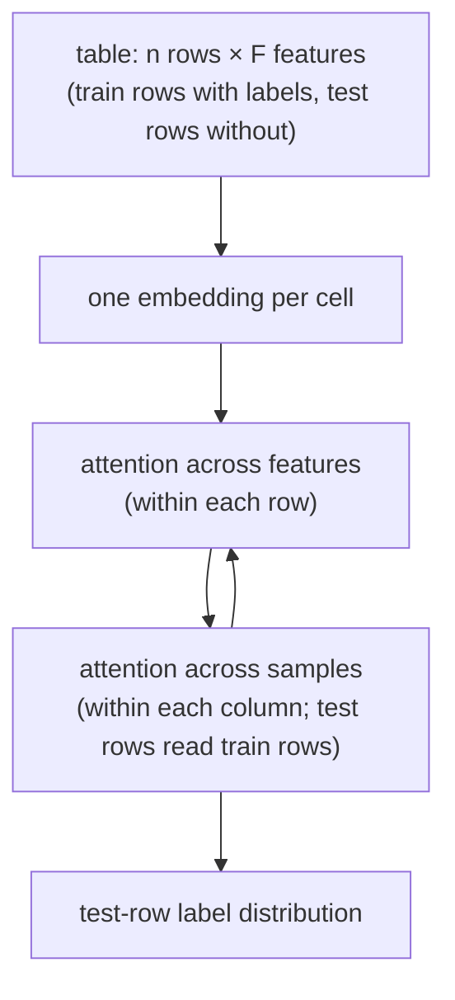

Most real prediction problems are small tables: a few hundred to a few thousand rows, a few
dozen columns, one label. For a decade the answer has been a gradient-boosted tree with a
careful hyperparameter search, which takes minutes to hours per dataset. TabPFN takes a
different route. It is a transformer pretrained once, on millions of *synthetic* datasets,
that receives a new dataset's training rows and test rows together and outputs predictions
in a single forward pass, with no gradient step on the new data. The Nature version reports
that in 2.8 seconds it outperforms an ensemble of the strongest baselines tuned for 4
hours<FN n="1" />. This lesson derives why that works, then covers the architecture and its
limits.

## The prior-fitted network idea

A **prior over datasets** $p(\mathcal{D})$ is a program that generates whole datasets: draw a
random data-generating mechanism, then draw rows from it. A **prior-fitted network (PFN)** is
a model $q_\theta(y \mid x, D)$ that takes a training set $D$ and a query input $x$ and
outputs a distribution over the label $y$. It is trained by repeatedly sampling a synthetic
dataset, holding out one point $(x, y)$, and minimizing the **prior-data negative
log-likelihood**<FN n="2" />

$$
\ell_\theta = \mathbb{E}_{D \cup \{(x, y)\} \sim p(\mathcal{D})}\left[ -\log q_\theta(y \mid x, D) \right].
$$

**Claim.** The minimizer of $\ell_\theta$ over all conditional distributions is the posterior
predictive distribution $p(y \mid x, D)$ of the prior, the Bayes-optimal prediction from the
B2 lesson.

**Step 1: Condition on the inputs.** The sampled point $y$, given $x$ and $D$, is distributed
according to exactly $p(y \mid x, D)$, because that is how the generating process produced it.
So the expectation splits into an outer average over $(x, D)$ and an inner average over $y$:

$$
\ell_\theta = \mathbb{E}_{x, D}\left[ \sum_y p(y \mid x, D) \left(-\log q_\theta(y \mid x, D)\right) \right].
$$

**Step 2: Recognize cross-entropy.** The inner sum is the cross-entropy
$H(p, q) = H(p) + D_{\mathrm{KL}}(p \,\|\, q)$, with both distributions taken at the same
$(x, D)$.

**Step 3: Drop the constant.** $H(p(\cdot \mid x, D))$ does not depend on $\theta$, so

$$
\ell_\theta = \text{const} + \mathbb{E}_{x, D}\left[ D_{\mathrm{KL}}\!\left(p(\cdot \mid x, D) \,\|\, q_\theta(\cdot \mid x, D)\right) \right].
$$

**Step 4: Minimize.** KL divergence is non-negative and zero only when its arguments agree, so
$\ell_\theta$ is minimized exactly when $q_\theta(\cdot \mid x, D) = p(\cdot \mid x, D)$ for
(almost) every $(x, D)$ the prior produces.

The network never sees a posterior, a likelihood, or an MCMC chain. Fitting a flexible model
to predict held-out points of prior samples *is* approximate Bayesian inference, amortized
over every dataset the prior can produce. Müller et al. state this as the PFN's core
insight<FN n="2" />, and it is the training objective of TabPFN<FN n="3" />.

## The idea in miniature: a coin

Take the simplest possible prior: a coin bias $\theta \sim \mathrm{Uniform}(0, 1)$, a dataset
of $n$ flips with $h$ heads, and one held-out flip.

**Step 1: The exact posterior predictive.** The uniform prior is $\mathrm{Beta}(1, 1)$, and by
conjugacy the posterior after $h$ heads in $n$ flips is $\mathrm{Beta}(1 + h, 1 + n - h)$. The
probability that the next flip is heads is the posterior mean,
$\frac{h + 1}{n + 2}$, Laplace's rule of succession.

**Step 2: A family of "networks".** Let the model be $q_a(\text{heads}) = \frac{h + a}{n + 2a}$
with a single trainable pseudo-count $a$. The family contains the posterior predictive at
$a = 1$ and the maximum-likelihood estimate $h/n$ as $a \to 0$.

**Step 3: Train on the prior.** Sample many coins and datasets, compute the average NLL of the
held-out flip as a function of $a$, and minimize. The derivation above predicts the minimizer
$a = 1$, and the closing code finds it at $a \approx 1$ by Monte Carlo without ever being told
about Beta distributions.


TabPFN replaces the coin with a prior over tabular problems and the one-parameter family with
a transformer.

## The prior: structural causal models

TabPFN's prior is built from **structural causal models** (SCMs)<FN ns="1, 3" />. Each synthetic
dataset samples a random directed acyclic graph, attaches random functions and noise to its
edges, runs the graph forward to produce node values, and designates some nodes as features
and one as the label. Varying graph size, function types, noise, and how features are
discretized produces tables that look like real ones: correlated features, irrelevant
columns, nonlinear effects, categorical columns. The Nature model was trained on around 100
million such synthetic datasets<FN n="1" />. The prior encodes a preference for simple
structures, the same Occam bias a Bayesian would put in by hand<FN n="3" />.

## The architecture



**The original TabPFN** (2022) made each row, features plus label, a single token. Test rows
attended only to training rows, and the model used no positional encodings<FN n="3" />. It was
limited to 1,000 training points, 100 numerical features without missing values, and 10
classes, and it was trained once for 20 hours on 8 GPUs<FN n="3" />.

**TabPFN v2** (Nature, 2025) assigns a separate representation to each cell. Each layer lets a
cell attend to the other features in its row and then to the same feature across all other
samples in its column<FN n="1" />. This two-way attention handles datasets with up to 10,000
samples and 500 features<FN n="1" />. **TabPFN-2.5** extends that to 50,000 data points and
2,000 features and reports a 100% win rate against default XGBoost on classification datasets
up to 10,000 points and 500 features<FN n="4" />.

### Why row order cannot matter

A dataset is a *set* of rows, so the prediction should not depend on how the rows are listed.
Attention without positional encodings delivers this for free.

**Step 1: Equivariance.** For a permutation matrix $P$, attention computes
$\mathrm{softmax}(PQ(PK)^\top / \sqrt d)\,PV = P\,\mathrm{softmax}(QK^\top / \sqrt d)\,P^\top P V = P\,\mathrm{Attn}(Q, K, V)$,
because permuting rows and columns of the score matrix permutes the softmax output the same
way, and $P^\top P = I$.

**Step 2: Invariance for test rows.** A test row's query attends to the training rows'
keys and values. Permuting the training rows permutes the keys and values together, which
reorders the terms of the weighted sum without changing it. So the test prediction is
unchanged.

### What it costs

Per layer, feature attention costs about $n F^2$ scores ($F^2$ per row, $n$ rows) and sample
attention about $F n^2$ ($n^2$ per column, $F$ columns). Sample attention dominates for tall
tables: at $n = 10{,}000$ and $F = 500$, $F n^2 = 5 \times 10^{10}$ against
$n F^2 = 2.5 \times 10^9$. That quadratic dependence on rows is why the limits are stated in
rows, and why every prediction must process the training set as context (caching the training
rows' states helps). TabPFN-2.5 adds a distillation engine that converts the model into a
compact MLP or tree ensemble when inference latency matters<FN n="4" />.

## When to reach for it, and when not to

- **Use it** for small to medium tabular tasks where tuning time or label scarcity hurts: a
  new product with a few thousand labelled customers, a quick baseline before a full GBDT
  search, or as a strong reference point to beat.
- **Do not assume it** beyond its size limits, for very high-cardinality categoricals or free
  text (a weak match to the synthetic prior), or when rows are **not exchangeable**. The PFN
  objective treats rows as independent draws given the dataset. A table of one customer's
  transactions over time violates that, which is why event histories need the sequence
  models of the previous lessons, with TabPFN at most as a head on per-customer snapshot
  features.

## Check it on arrays

```python
import numpy as np

rng = np.random.default_rng(0)

# 1) A PFN in miniature: fit q_a = (h + a) / (n + 2a) by minimizing prior-data NLL
S = 200_000
theta = rng.random(S)                        # prior: coin bias ~ Uniform(0, 1)
n = rng.integers(0, 11, S)                   # dataset sizes 0..10
h = rng.binomial(n, theta)                   # observed heads
y = rng.random(S) < theta                    # held-out flip
def prior_nll(a):
    q = (h + a) / (n + 2 * a)
    return -np.mean(np.where(y, np.log(q), np.log(1 - q)))
grid = np.linspace(0.05, 4, 160)
a_star = grid[np.argmin([prior_nll(a) for a in grid])]
print(f"learned pseudo-count a* = {a_star:.2f} (posterior predictive: a = 1)")
assert abs(a_star - 1.0) < 0.1

# Bayes beats plug-in estimates on held-out NLL
mle = np.clip(np.where(n > 0, h / np.maximum(n, 1), 0.5), 1e-3, 1 - 1e-3)
nll_mle = -np.mean(np.where(y, np.log(mle), np.log(1 - mle)))
print(f"NLL: posterior predictive {prior_nll(1.0):.4f} vs clipped MLE {nll_mle:.4f}")
assert prior_nll(1.0) < nll_mle

# 2) Test predictions are invariant to the order of training rows
d = 8
Xtr, Xte = rng.normal(size=(50, d)), rng.normal(size=(5, d))
Wq, Wk, Wv = (rng.normal(size=(d, d)) for _ in range(3))
def test_attend(Xtr, Xte):
    s = (Xte @ Wq) @ (Xtr @ Wk).T / np.sqrt(d)
    a = np.exp(s - s.max(1, keepdims=True)); a /= a.sum(1, keepdims=True)
    return a @ (Xtr @ Wv)
perm = rng.permutation(len(Xtr))
assert np.allclose(test_attend(Xtr, Xte), test_attend(Xtr[perm], Xte))
print("test outputs unchanged under a shuffle of the training rows")

# 3) Attention cost: rows dominate for tall tables
nrow, F = 10_000, 500
print(f"sample attention {F * nrow**2:.1e} vs feature attention {nrow * F**2:.1e}")
```

The miniature PFN finds $a^\star \approx 1$, the Bayesian pseudo-count, purely by minimizing
held-out NLL on prior samples, and its predictions beat the plug-in estimate; the attention
check confirms that shuffling training rows leaves test predictions untouched, and the cost
line shows the $F n^2$ term dominating at the v2 size limit.

## Exercises

**Exercise 1.** Change the coin prior to $\theta \sim \mathrm{Beta}(2, 2)$. Derive the posterior
predictive and the pseudo-count $a$ that the miniature PFN should learn.

<details>
<summary>Solution</summary>

**Step 1.** With prior $\mathrm{Beta}(2, 2)$ and $h$ heads in $n$ flips, the posterior is
$\mathrm{Beta}(2 + h, 2 + n - h)$.

**Step 2.** The posterior predictive for heads is its mean,
$\frac{2 + h}{(2 + h) + (2 + n - h)} = \frac{h + 2}{n + 4}$.

**Step 3.** Matching $\frac{h + a}{n + 2a}$ gives $a = 2$. A prior concentrated near
$\theta = 1/2$ is equivalent to two imaginary heads and two imaginary tails.

</details>

**Exercise 2.** At the TabPFN-2.5 limits ($n = 50{,}000$ rows, $F = 2{,}000$ features), compute
the per-layer sample-attention and feature-attention score counts and their ratio.

<details>
<summary>Solution</summary>

**Step 1.** Sample attention: $F n^2 = 2{,}000 \times 2.5 \times 10^9 = 5 \times 10^{12}$.

**Step 2.** Feature attention: $n F^2 = 50{,}000 \times 4 \times 10^6 = 2 \times 10^{11}$.

**Step 3.** Ratio $= n / F = 25$. Sample attention still dominates, by the ratio of rows to
columns.

</details>

**Exercise 3 (code).** Confirm Exercise 1 by Monte Carlo: sample coins from
$\mathrm{Beta}(2, 2)$ and minimize the prior-data NLL over $a$.

<details>
<summary>Solution</summary>

```python
import numpy as np

rng = np.random.default_rng(3)
S = 200_000
theta = rng.beta(2, 2, S)
n = rng.integers(0, 11, S)
h = rng.binomial(n, theta)
y = rng.random(S) < theta
def prior_nll(a):
    q = (h + a) / (n + 2 * a)
    return -np.mean(np.where(y, np.log(q), np.log(1 - q)))
grid = np.linspace(0.2, 6, 291)
a_star = grid[np.argmin([prior_nll(a) for a in grid])]
print(a_star)
assert abs(a_star - 2.0) < 0.25
```

The minimizer lands near $a = 2$: change the prior, and the network trained on it changes its
answer to the new Bayes-optimal one.

</details>

This closes the D8 track: event histories become tokens, tokens get continuous time, a
pretraining objective turns them into embeddings, an LLM backbone can supply language
knowledge, careful evaluation measures what the embeddings add, and TabPFN covers the
small-table end where a prior-trained transformer replaces hyperparameter search.

<Footnotes>
  <FNItem n="1">**Hollmann, N., Müller, S., Purucker, L., Krishnakumar, A., Körfer, M., Hoo, S. B., Schirrmeister, R. T., Hutter, F.** (2025). "Accurate predictions on small data with a tabular foundation model". *Nature* 637, 319–326. [doi:10.1038/s41586-024-08328-6](https://doi.org/10.1038/s41586-024-08328-6)</FNItem>
  <FNItem n="2">**Müller, S., Hollmann, N., Pineda Arango, S., Grabocka, J., Hutter, F.** (2022). "Transformers Can Do Bayesian Inference". *ICLR*. [arXiv:2112.10510](https://arxiv.org/abs/2112.10510)</FNItem>
  <FNItem n="3">**Hollmann, N., Müller, S., Eggensperger, K., Hutter, F.** (2023). "TabPFN: A Transformer That Solves Small Tabular Classification Problems in a Second". *ICLR*. [arXiv:2207.01848](https://arxiv.org/abs/2207.01848)</FNItem>
  <FNItem n="4">**Grinsztajn, L., Flöge, K., Key, O., Birkel, F., Jund, P., et al.** (2025). "TabPFN-2.5: Advancing the State of the Art in Tabular Foundation Models". [arXiv:2511.08667](https://arxiv.org/abs/2511.08667)</FNItem>
</Footnotes>
