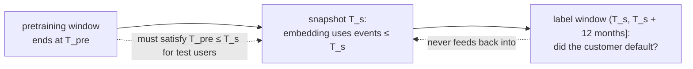

A pretrained transaction model is worth exactly what it adds to the decisions a bank already
makes: who gets credit, which payment is blocked, which customer receives an offer. Those
decisions already run on gradient-boosted trees over hand-built features, and the trees are
good. This lesson covers how embeddings are plugged into downstream models, how to build an
evaluation that cannot be fooled by leakage, and how to read the relative-lift numbers that
papers in this area report.

## Three ways to adapt

- **Frozen embedding plus linear probe.** Compute the user embedding once, standardize each
  dimension, and fit a logistic or linear regression on top. PRAGMA evaluates its frozen
  embeddings this way, with L-BFGS-fitted logistic regression<FN n="1" />. A probe measures
  how much task information is *linearly* readable from the embedding, so it is the cleanest
  test of the representation itself.
- **LoRA fine-tuning.** Unfreeze low-rank adapters and train with a task head. In PRAGMA's
  experiments this beat the probe on every task, with LoRA training taking about one
  eighth of the pretraining time<FN n="1" />.
- **Fusion with tabular features.** Banks hold features the event stream does not contain
  (bureau scores, declared income, account age). nuFormer compares three ways to combine them:
  early fusion (pretrained embeddings fed into a gradient-boosted tree), late fusion, and
  **joint fusion**, in which a DCNv2 tabular network and the LoRA-adapted transformer are
  trained end to end and their outputs concatenated before the prediction layer; joint fusion
  is the method the paper adopts<FN n="2" />.

The Thoughtworks/NVIDIA guidance makes one evaluation design non-negotiable: a three-way
comparison of **raw features only**, **embeddings only**, and **raw features plus
embeddings**, with the same downstream learner (XGBoost in NVIDIA's example)<FN n="3" />. The
third column is the one that matters for a business case, because it measures what the
embedding adds on top of what the bank already has.

## Time is the whole evaluation

Every quantity in the pipeline has a timestamp, and leakage enters wherever a later timestamp
sneaks into an earlier decision.



Three rules follow, each closing one leak.

1. **As-of embeddings.** The embedding used for a decision at $T_s$ must be computed only from
   events with timestamp at most $T_s$. Recomputing a test user's embedding on a later date
   lets post-decision events (collection calls, missed payments) into the input.
2. **Pretraining cut-off.** Pretraining must not include events from the test label window. A
   model pretrained on those events has seen the outcome in its weights even if the
   downstream probe never does.
3. **Out-of-time test.** Split by time, not by random users: train on early periods,
   validate and test on later ones. TREASURE trains on the first 24 months of its data,
   validates on month 25, and tests on the final month<FN n="4" />.

A subtler cousin of leakage is **staleness**. In production, events reach the feature store
with a delay, so the embedding at decision time is missing the newest few. PRAGMA tested this
by dropping events inside the 99.9th-percentile propagation delay and found at most 0.2%
relative degradation on fraud and 0.9% on credit scoring<FN n="1" />. Run the same test before
trusting a real-time use case.

## Reading relative lifts: PR-AUC is not ROC-AUC

Papers in this area often report only relative changes, $(x/x_{\text{base}} - 1) \times 100\%$;
PRAGMA does so for every task<FN n="1" />. Relative lifts on different metrics are not on the
same scale, and the reason is what a *useless* model scores.

**Claim.** A classifier whose scores are independent of the label has expected ROC-AUC $1/2$
and expected PR-AUC (average precision) equal to the prevalence $\pi$.

**Step 1: ROC-AUC.** ROC-AUC is the probability that a random positive outranks a random
negative. If scores are independent of labels, each ordering is equally likely, so the
probability is $1/2$ at any prevalence.

**Step 2: Precision at any cut-off.** Take the top $k$ scored examples. Under independence,
each is positive with probability $\pi$, so the expected precision at every $k$ is $\pi$.

**Step 3: Average precision.** Average precision is the mean of precision at the ranks of the
positives, so its expectation is (approximately, for large samples) $\pi$ as well.

The floor of PR-AUC moves with prevalence, and for rare outcomes it sits near zero, so a
modest absolute gain becomes a large ratio. A contrasting pair on one credit model at 2%
default rate: PR-AUC rising from 0.05 to 0.10 is a **+100%** lift, while ROC-AUC rising
from 0.76 to 0.80 on the same models is **+5.3%**. Both describe one improvement.

PRAGMA's credit-scoring results show the pattern at three model sizes: relative to the
task-specific baseline, PR-AUC lifts of +70.3%, +98.0%, and +130.2% sit next to ROC-AUC lifts
of +6.2%, +10.1%, and +12.4%<FN n="1" />. Compare lifts within a metric, prefer absolute
numbers when they are available, and translate a claimed lift into the absolute metric with
your own base rate before quoting it.


## Where per-user embeddings stop working

A user embedding summarizes one person's history. Some problems live in the links *between*
people: anti-money-laundering rings move funds through chains of accounts that each look
normal alone. PRAGMA reports this as a limitation: a linear probe on its largest model scored
47.1% *below* the production anti-money-laundering baseline on F0.5, which the authors
attribute to cross-record relational structure that per-record embeddings cannot
capture<FN n="1" />. Those problems call for graph models (pillar D6) over the transaction
network, with per-user embeddings as node features.

## Check it on arrays

```python
import numpy as np

rng = np.random.default_rng(0)
n, d, n_pre, n_post = 6000, 8, 30, 10
z = rng.normal(size=n)          # risk visible in raw tabular features (e.g. income)
w = rng.normal(size=n)          # risk visible only in behaviour (event mix)
y = (rng.random(n) < 1 / (1 + np.exp(-(z + w - 3.0)))).astype(float)
u_dir, v_dir = rng.normal(size=d), rng.normal(size=d)
pre = w[:, None, None] * u_dir + rng.normal(scale=3.0, size=(n, n_pre, d))
post = (w[:, None, None] * u_dir + 2.0 * y[:, None, None] * v_dir    # collections after default
        + rng.normal(scale=3.0, size=(n, n_post, d)))
raw = (-z + rng.normal(scale=0.5, size=n))[:, None]
emb = pre.mean(1)                                        # as-of embedding (events <= T_s)
emb_leak = np.concatenate([pre, post], 1).mean(1)        # recomputed later: leaks the label

def fit_logreg(X, y, steps=500, lr=0.5):
    mu, sd = X.mean(0), X.std(0)
    A = np.column_stack([np.ones(len(X)), (X - mu) / sd])
    beta = np.zeros(A.shape[1])
    for _ in range(steps):
        beta -= lr * A.T @ (1 / (1 + np.exp(-A @ beta)) - y) / len(y)
    return lambda Xn: np.column_stack([np.ones(len(Xn)), (Xn - mu) / sd]) @ beta

def roc_auc(s, y):
    r = np.argsort(np.argsort(s)) + 1.0
    npos, nneg = y.sum(), len(y) - y.sum()
    return (r[y == 1].sum() - npos * (npos + 1) / 2) / (npos * nneg)

def avg_precision(s, y):
    yy = y[np.argsort(-s)]
    return (np.cumsum(yy) / np.arange(1, len(yy) + 1))[yy == 1].mean()

tr, te = slice(0, 4000), slice(4000, None)
res = {}
for name, X in [("raw only", raw), ("embedding only", emb),
                ("raw + embedding", np.column_stack([raw, emb])), ("leaky embedding", emb_leak)]:
    s = fit_logreg(X[tr], y[tr])(X[te])
    res[name] = (roc_auc(s, y[te]), avg_precision(s, y[te]))
    print(f"{name:>16}: ROC-AUC {res[name][0]:.3f}  PR-AUC {res[name][1]:.3f}")

assert res["raw + embedding"][0] > max(res["raw only"][0], res["embedding only"][0]) + 0.03
assert res["leaky embedding"][0] > res["embedding only"][0] + 0.1      # leakage inflates

# A useless scorer: ROC-AUC near 0.5, PR-AUC near the prevalence
prev = y[te].mean()
rand = np.array([[roc_auc(s, y[te]), avg_precision(s, y[te])]
                 for s in rng.random((200, len(y[te])))]).mean(0)
print(f"random scorer: ROC-AUC {rand[0]:.3f}, PR-AUC {rand[1]:.3f}, prevalence {prev:.3f}")
assert abs(rand[0] - 0.5) < 0.01 and abs(rand[1] - prev) < 0.01
```

The fused model beats both single sources because raw income and behavioural embedding
carry different parts of the risk, the leaky embedding looks spectacular only because it saw
post-default collection events, and the random scorer lands at ROC-AUC 0.5 and PR-AUC equal to
the test prevalence, the two floors that make relative lifts on these metrics incomparable.

## Exercises

**Exercise 1.** A baseline scores PR-AUC 0.040 and ROC-AUC 0.720 on a fraud task with 0.5%
prevalence; the new model scores 0.092 and 0.755. Compute both relative lifts, and each
model's PR-AUC as a multiple of the random floor.

<details>
<summary>Solution</summary>

**Step 1.** PR-AUC lift: $0.092 / 0.040 - 1 = 1.30$, so **+130%**.

**Step 2.** ROC-AUC lift: $0.755 / 0.720 - 1 = 0.0486$, so **+4.9%**.

**Step 3.** The random PR-AUC floor is the prevalence, 0.005, so the baseline is $8\times$ the
floor and the new model $18.4\times$. The same improvement reads as +130% or +4.9% depending
only on the metric.

</details>

**Exercise 2.** A team computes test users' embeddings once, on the day the model ships, six
months after the snapshot $T_s$ used for labels. Name the leak, and state the one-line fix.

<details>
<summary>Solution</summary>

**Step 1.** The embeddings include six months of post-snapshot events, which overlap the label
window. Customers heading into default show missed-payment and collection events in that
period, so the embedding partly encodes the label.

**Step 2.** The fix is as-of computation: build every training and test embedding from events
with timestamps at most that example's $T_s$, and check that the pretraining window also ends
before the test label window.

</details>

**Exercise 3 (code).** Using the closing code's data, measure how much of the fusion gain
survives if the embedding is built from only the last 5 pre-snapshot events instead of all 30.
Report the "raw + embedding" ROC-AUC for both.

<details>
<summary>Solution</summary>

```python
import numpy as np

rng = np.random.default_rng(0)
n, d, n_pre = 6000, 8, 30
z, w = rng.normal(size=n), rng.normal(size=n)
y = (rng.random(n) < 1 / (1 + np.exp(-(z + w - 3.0)))).astype(float)
u_dir = rng.normal(size=d); rng.normal(size=d)
pre = w[:, None, None] * u_dir + rng.normal(scale=3.0, size=(n, n_pre, d))
raw = (-z + rng.normal(scale=0.5, size=n))[:, None]

def fit_logreg(X, y, steps=500, lr=0.5):
    mu, sd = X.mean(0), X.std(0)
    A = np.column_stack([np.ones(len(X)), (X - mu) / sd]); beta = np.zeros(A.shape[1])
    for _ in range(steps):
        beta -= lr * A.T @ (1 / (1 + np.exp(-A @ beta)) - y) / len(y)
    return lambda Xn: np.column_stack([np.ones(len(Xn)), (Xn - mu) / sd]) @ beta
def roc_auc(s, y):
    r = np.argsort(np.argsort(s)) + 1.0; npos = y.sum()
    return (r[y == 1].sum() - npos * (npos + 1) / 2) / (npos * (len(y) - npos))

out = {}
for k in (30, 5):
    X = np.column_stack([raw, pre[:, -k:].mean(1)])
    out[k] = roc_auc(fit_logreg(X[:4000], y[:4000])(X[4000:]), y[4000:])
    print(k, round(out[k], 3))
assert out[30] > out[5]
```

With 5 events the embedding's estimate of the behavioural risk is noisier (the noise in a mean
of $k$ events shrinks like $1/\sqrt k$), so the fused ROC-AUC drops (about 0.83 to 0.81 here).
History length is a lever on embedding quality, which is one reason PRAGMA keeps thousands of
events per user.

</details>

The next lesson turns from event sequences to plain tables and to TabPFN, a foundation model
that learns to do Bayesian prediction for any small tabular dataset in context.

<Footnotes>
  <FNItem n="1">**Ostroukhov, M., Mikhailov, R., Iashin, V., Sokolov, A., et al.** (2026). "PRAGMA: Revolut Foundation Model". [arXiv:2604.08649](https://arxiv.org/abs/2604.08649)</FNItem>
  <FNItem n="2">**Braithwaite, D. T., Cavalcanti, M., McEver, R. A., et al.** (2025). "Your Spending Needs Attention: Modeling Financial Habits with Transformers". [arXiv:2507.23267](https://arxiv.org/abs/2507.23267)</FNItem>
  <FNItem n="3">**Gancz, A., Blanchard, B., Troyanovsky, A., et al.** (2026). "How to build transaction foundation models in banking and payments". Thoughtworks Insights. [thoughtworks.com](https://www.thoughtworks.com/insights/articles/how-to-build-transaction-foundation-models-in-banking-and-payments)</FNItem>
  <FNItem n="4">**Yeh, C.-C. M., et al.** (2025). "TREASURE: The Visa Payment Foundation Model for High-Volume Transaction Understanding". KDD 2026. [arXiv:2511.19693](https://arxiv.org/abs/2511.19693)</FNItem>
</Footnotes>
