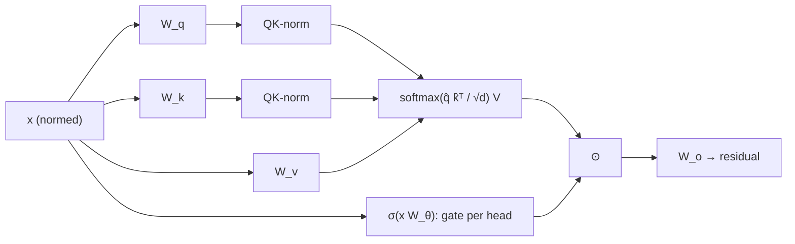

Two odd behaviours show up in every large transformer. First, a large share of attention
goes to the very first token of the sequence, whatever that token is; in the baseline models
of Qiu et al., an average of **46.7%** of attention across layers lands on token one<FN n="1" />.
Second, as models grow, attention logits drift upward until training diverges: the ViT-22B
team saw the loss blow up after a few thousand steps at around 8 billion parameters, traced
to extremely large attention logits that made attention almost one-hot<FN n="2" />. Both come
from the same place, the softmax, and the fixes now standard in models such as Qwen3 and
Qwen3-Next are small edits to the attention block. This lesson derives why the problems arise
and what each fix guarantees.

## The sink: softmax must put its mass somewhere

For one query, attention outputs $y = \sum_j a_j v_j$ with weights
$a_j = e^{s_j} / \sum_l e^{s_l}$, so the weights are positive and sum to 1. A head that finds
nothing relevant in the context still has to spend that unit of mass. Xiao et al. put it
directly: the model "still needs to allocate these unneeded attention values somewhere so it
sums up to one"<FN n="3" />.

**Step 1: Ask for a no-op.** Suppose the right output for this query is $y = 0$ (the head
should contribute nothing).

**Step 2: See what softmax allows.** Since $y$ is a convex combination of the values, it can
be near zero only if the weight concentrates on tokens whose values are near zero.

**Step 3: Learn a dump.** The cheapest way to provide such a token is to make one position,
visible to every query under the causal mask, carry a near-zero value and a key that every
query scores highly. The first token is the only position all queries can see, so it becomes
the **attention sink**.

The sink is not harmless. StreamingLLM showed that evicting the first tokens from the KV
cache wrecks a model's output, and that keeping just **4 initial tokens** plus a rolling
window of recent ones restores it, enabling stable generation over millions of
tokens<FN n="3" />. A model whose correctness depends on four arbitrary tokens is a model
whose attention mechanism lacks a way to say "nothing here".

## Logit growth and the one-hot collapse

The logit is $s_j = q^\top k_j / \sqrt{d}$ with $q = W_q x$ and $k_j = W_k x_j$. Nothing
bounds it: if the weight norms grow during training, logits grow with their product. As the
scale grows, softmax approaches a one-hot vector, its entropy goes to zero, and gradients
through all but one key vanish. That is the near-zero-entropy attention ViT-22B observed
before divergence<FN n="2" />.


## QK-norm: bound the logits by construction

ViT-22B's fix, adopted from Gilmer et al., normalizes queries and keys before the dot
product<FN n="2" />:

$$
s_j = \frac{1}{\sqrt d}\, \mathrm{LN}(q)^\top \mathrm{LN}(k_j).
$$

Take RMSNorm with unit gain, $\mathrm{RMSNorm}(x) = x / \mathrm{rms}(x)$ with
$\mathrm{rms}(x) = \sqrt{\tfrac1d \sum_i x_i^2}$.

**Step 1: The norm of a normalized vector is fixed.**
$\|x / \mathrm{rms}(x)\|_2 = \|x\|_2 / (\|x\|_2/\sqrt d) = \sqrt d$.

**Step 2: Apply Cauchy-Schwarz.** $|\hat q^\top \hat k| \le \|\hat q\|\,\|\hat k\| = d$.

**Step 3: Bound the logit.** $|s_j| \le d / \sqrt d = \sqrt d$. With learned gains $g$ the
bound becomes $\sqrt d \cdot \max|g_q| \max|g_k|$, still independent of $W_q$ and $W_k$.

For a head dimension of 128 the logits stay within $\pm 11.3$ (times the gains) no matter how
large the projection weights become. Qwen3 introduced QK-Norm "to ensure stable training",
replacing the QKV bias used in Qwen2<FN n="4" />. Kimi K2 takes a different route to the same
end, QK-Clip, which rescales $W_q$ and $W_k$ whenever a head's maximum logit exceeds a
threshold; that method belongs with [the Muon optimizer](/pillar/D/D1/muon-optimizer) it was built for.

## Gated attention: give the head an off switch

QK-norm bounds the logits but does nothing about the sink, because the outputs are still
convex combinations. Qiu et al. (Qwen team) tested 30 placements of gates in the attention
block and found the most effective to be a head-specific sigmoid gate right after
scaled dot-product attention<FN n="1" />:

$$
y' = y \odot \sigma(x W_\theta),
$$

where $x$ is the block's normalized input and $y$ the attention output. In the "headwise"
variant each head gets one scalar gate.

**Step 1: The no-op becomes free.** To output nothing, the head drives its gate toward 0. It
no longer needs a token with a zero value vector to dump mass on.

**Step 2: The sink loses its job.** With the incentive gone, the model stops routing mass to
the first token. In Qiu et al.'s measurements the average share of attention on the first
token fell from **46.7% to 4.8%**<FN n="1" />.

**Step 3: A side benefit.** The gate adds a nonlinearity between the value projection and the
output projection, which otherwise compose into a single low-rank linear map.

The reported effects go beyond sinks<FN n="1" />. On a 15B-parameter MoE trained on 400B
tokens, perplexity improved from 6.026 to 5.761. On a 1.7B dense model, a learning rate of
$8 \times 10^{-3}$ made the baseline diverge while the gated model trained normally, so the
gate also widens the range of stable learning rates. Qwen3-Next uses gated attention for its
full-attention layers<FN n="5" />.



## Check it on arrays

```python
import numpy as np

rng = np.random.default_rng(0)
softmax = lambda z: np.exp(z - z.max(-1, keepdims=True)) / np.exp(z - z.max(-1, keepdims=True)).sum(-1, keepdims=True)
d, n = 64, 32

# 1) Softmax outputs are convex combinations: no zero output without a zero-value "sink"
V = rng.normal(size=(n, d))
y = softmax(rng.normal(size=n)) @ V
print(f"output norm without a sink: {np.linalg.norm(y):.3f}")
V_sink = V.copy(); V_sink[0] = 0.0                     # token 0 carries a zero value
s = rng.normal(size=n); s[0] += 8.0                    # every query scores it highly
print(f"output norm with a sink: {np.linalg.norm(softmax(s) @ V_sink):.3f}, "
      f"mass on token 0: {softmax(s)[0]:.3f}")
gate = 1 / (1 + np.exp(8.0))                           # a closed sigmoid gate
print(f"gated output norm, no sink needed: {np.linalg.norm(gate * y):.4f}")
assert np.linalg.norm(gate * y) < 0.01 * np.linalg.norm(y)

# 2) Logits grow with weight scale; QK-norm makes them scale-free and bounded by sqrt(d)
x = rng.normal(size=(n, d))
Wq, Wk = rng.normal(size=(d, d)) / np.sqrt(d), rng.normal(size=(d, d)) / np.sqrt(d)
rms = lambda z: z / np.sqrt((z**2).mean(-1, keepdims=True))
for c in (1, 10, 100):
    raw = (x @ (c * Wq)) @ (x @ (c * Wk)).T / np.sqrt(d)
    qk = rms(x @ (c * Wq)) @ rms(x @ (c * Wk)).T / np.sqrt(d)
    print(f"weight scale {c:>3}: max |raw logit| {np.abs(raw).max():9.1f}, "
          f"max |QK-norm logit| {np.abs(qk).max():5.2f} (bound {np.sqrt(d):.1f})")
    assert np.abs(qk).max() <= np.sqrt(d) + 1e-9

# 3) Entropy collapse as logits grow
z = rng.normal(size=(200, 512))
H = lambda c: -(softmax(c * z) * np.log(softmax(c * z) + 1e-300)).sum(1).mean()
print(f"entropy at scale 0.1: {H(0.1):.2f} nats, at 30: {H(30):.2f} nats")
assert H(0.1) > 6.0 and H(30) < 1.0
```

The first block shows the dilemma: a softmax head can only output near zero by piling mass on
a zero-value token, while a closed gate does it directly. The second shows raw logits growing
with the square of the weight scale while QK-normalized logits stay identical and under
$\sqrt{64} = 8$, and the third shows attention entropy falling from near $\ln 512$ to under
one nat as logits grow.

## Exercises

**Exercise 1.** A head has dimension $d = 256$ (as in Qwen3-Next's gated attention layers) and
RMSNorm gains of at most 1.5 on both queries and keys. Bound the attention logit.

<details>
<summary>Solution</summary>

**Step 1.** Each normalized vector has norm at most $1.5\sqrt{256} = 24$.

**Step 2.** By Cauchy-Schwarz the dot product is at most $24^2 = 576$, and dividing by
$\sqrt{256} = 16$ gives $|s| \le 36$.

Equivalently, $\sqrt d \cdot g_q g_k = 16 \times 2.25 = 36$.

</details>

**Exercise 2.** A query scores the first token 8 points higher than each of 31 other tokens,
which all have equal scores. What fraction of its attention goes to the first token? How large
must the gap be for 99%?

<details>
<summary>Solution</summary>

**Step 1.** $a_0 = e^8 / (e^8 + 31) = 2981.0 / 3012.0 = 0.9897$.

**Step 2.** For 99%, require $e^g / (e^g + 31) = 0.99$, so $e^g = 0.99 \times 31 / 0.01 = 3069$
and $g = \ln 3069 = 8.03$.

An 8-point logit gap, a modest number, is enough to make one token absorb nearly all the
mass, which is why sinks form easily.

</details>

**Exercise 3 (code).** Show that a headwise gate can reproduce any scaled version of the
attention output, including zero, while plain attention over values with a fixed nonzero mean
cannot get below the smallest norm of a convex combination. Estimate that minimum by sampling
many random weight vectors.

<details>
<summary>Solution</summary>

```python
import numpy as np

rng = np.random.default_rng(1)
n, d = 16, 8
V = rng.normal(loc=1.0, size=(n, d))                   # values share a nonzero mean
W = rng.dirichlet(np.ones(n) * 0.3, size=20000)        # random attention distributions
min_norm = np.linalg.norm(W @ V, axis=1).min()
y = W[0] @ V
gated = [np.linalg.norm(g * y) for g in (1.0, 0.5, 0.0)]
print(round(min_norm, 3), [round(v, 3) for v in gated])
assert min_norm > 0.5 and gated[-1] == 0.0
```

Every convex combination of these values stays well away from the origin, so plain attention
cannot output "nothing" unless some token's value is near zero; the gate scales the output
continuously down to exactly zero.

</details>

The next lesson turns from attention to the feed-forward side of the block: how modern
mixture-of-experts layers split and balance their experts.

<Footnotes>
  <FNItem n="1">**Qiu, Z., Wang, Z., Zheng, B., Huang, Z., et al.** (2025). "Gated Attention for Large Language Models: Non-linearity, Sparsity, and Attention-Sink-Free". [arXiv:2505.06708](https://arxiv.org/abs/2505.06708)</FNItem>
  <FNItem n="2">**Dehghani, M., Djolonga, J., Mustafa, B., Padlewski, P., et al.** (2023). "Scaling Vision Transformers to 22 Billion Parameters". [arXiv:2302.05442](https://arxiv.org/abs/2302.05442)</FNItem>
  <FNItem n="3">**Xiao, G., Tian, Y., Chen, B., Han, S., Lewis, M.** (2024). "Efficient Streaming Language Models with Attention Sinks". *ICLR*. [arXiv:2309.17453](https://arxiv.org/abs/2309.17453)</FNItem>
  <FNItem n="4">**Yang, A., Li, A., Yang, B., et al.** (2025). "Qwen3 Technical Report". [arXiv:2505.09388](https://arxiv.org/abs/2505.09388)</FNItem>
  <FNItem n="5">**Qwen Team** (2025). Qwen3-Next-80B-A3B-Instruct model card. Hugging Face. [huggingface.co/Qwen/Qwen3-Next-80B-A3B-Instruct](https://huggingface.co/Qwen/Qwen3-Next-80B-A3B-Instruct)</FNItem>
</Footnotes>
