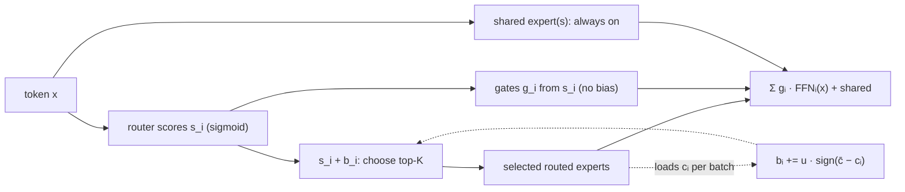

The GQA/MoE lesson built a mixture-of-experts layer in the style of Mixtral: a handful of
large experts, each token routed to the top 2. The open models of 2025 look different.
DeepSeek-V3 has 256 routed experts plus 1 shared expert and activates 8 routed experts per
token, for 671B total and 37B active parameters<FN n="1" />. Qwen3-Next-80B-A3B has 512
experts, routes each token to 10 of them plus 1 shared expert, and activates about 3B of its
80B parameters<FN n="2" />. Three ideas account for the change: **fine-grained** experts,
**shared** experts, and a way to balance load across hundreds of experts without the
auxiliary loss that used to fight the language-modeling objective. This lesson derives each.

## Fine-grained experts: same FLOPs, far more combinations

DeepSeekMoE splits every expert into $m$ smaller experts, each with $1/m$ of the original
intermediate width, and activates $m$ times as many<FN n="3" />.

**Step 1: Compute is unchanged.** An FFN expert with model width $d$ and intermediate width
$w$ costs about $c \cdot d w$ FLOPs per token for some constant $c$. Activating $K$ such
experts costs $c K d w$. After splitting, each expert costs $c\, d (w/m)$ and $mK$ are
activated: $mK \cdot c\, d\, w/m = c K d w$, the same.

**Step 2: Expressiveness grows combinatorially.** The number of distinct expert sets a token
can be routed to is $\binom{N}{K}$. DeepSeekMoE's example: 16 experts with top-2 routing give
$\binom{16}{2} = 120$ combinations, while splitting each expert in 4 (64 experts, top-8) gives
$\binom{64}{8} = 4{,}426{,}165{,}368$<FN n="3" />. Each token can assemble a far more specific
mixture of narrow specialists at no extra compute.

## Shared experts: stop relearning common knowledge

With many narrow experts, every routed expert would otherwise need its own copy of knowledge
that every token uses (common syntax, frequent words). DeepSeekMoE isolates $K_s$ **shared
experts** that every token always passes through, and routes only the rest<FN n="3" />. The
layer computes

$$
h = x + \sum_{i=1}^{K_s} \mathrm{FFN}^{\text{shared}}_i(x) + \sum_{i \in \text{TopK}} g_i(x)\, \mathrm{FFN}^{\text{routed}}_i(x).
$$

The routed experts are then free to specialize. In DeepSeek-V3, each token's 8 routed experts
plus the shared expert make 9 expert FFNs per token<FN n="1" />.

## Balancing load: the auxiliary-loss tension

A router left alone collapses: a few experts win early, get more gradient, get better, and
win more. Unused experts waste memory and overloaded ones become a bottleneck. The classic fix
adds an auxiliary loss

$$
\mathcal{L}_{\text{bal}} = \alpha \sum_{i=1}^{N} f_i P_i,
$$

where $f_i$ is the fraction of tokens routed to expert $i$ and $P_i$ the average router
probability it receives. Minimizing it pushes routing toward uniform. The tension is in the
gradient: $\mathcal{L}_{\text{bal}}$ pushes the router's scores toward balance whether or not
a token suits an expert, so a large $\alpha$ balances load but hurts the language model, and a
small $\alpha$ keeps quality but lets load drift<FN n="4" />.

## Loss-free balancing: a bias that only routes

Wang et al. remove the tension by moving balancing out of the loss<FN n="4" />. Keep a bias
$b_i$ per expert, use it **only to choose** experts, and leave the gating weights untouched.

**Step 1: Biased selection.** Expert $i$ is selected for token $t$ if $s_{i,t} + b_i$ is among
the top-$K$ biased scores.

**Step 2: Unbiased weights.** The selected expert's output is weighted by $g_{i,t}$ computed
from the original $s_{i,t}$, not from $s_{i,t} + b_i$, so the bias changes *which* experts
run but never *how much* they contribute.

**Step 3: Update by sign.** After each batch, with $c_i$ the load of expert $i$ and $\bar c$
the mean load,

$$
b_i \leftarrow b_i + u \cdot \mathrm{sign}(\bar c - c_i).
$$

Underloaded experts get a higher bias and attract more tokens; overloaded ones get a lower
bias. The paper finds $u = 0.001$ a good choice<FN n="4" />.

The bias receives no gradient, so balancing exerts no pressure on the language-modeling
objective. DeepSeek-V3 uses this strategy with sigmoid affinity scores, adding only a
sequence-wise balance loss with an extremely small weight as a safeguard<FN n="1" />.




## Check it on arrays

```python
import numpy as np
from math import comb

# 1) Fine-grained combinations at equal compute
print(comb(16, 2), comb(64, 8))
assert comb(16, 2) == 120 and comb(64, 8) == 4_426_165_368

# 2) Loss-free balancing on skewed router scores
rng = np.random.default_rng(0)
E, K, T, dim = 16, 2, 1024, 8
W = rng.normal(scale=0.5, size=(dim, E))
skew = np.linspace(-1.5, 1.5, E)                    # some experts are intrinsically favoured
def batch_scores():
    return 1 / (1 + np.exp(-(rng.normal(size=(T, dim)) @ W + skew)))
def route(s, bias):
    top = np.argsort(-(s + bias), axis=1)[:, :K]     # bias used only for selection
    gates = np.take_along_axis(s, top, axis=1)       # weights from unbiased scores
    gates = gates / gates.sum(1, keepdims=True)
    return top, gates, np.bincount(top.ravel(), minlength=E) / (T * K)

s = batch_scores()
_, _, load0 = route(s, np.zeros(E))
bias = np.zeros(E)
for _ in range(1000):
    _, _, c = route(batch_scores(), bias)
    bias += 0.001 * np.sign(c.mean() - c)
s = batch_scores()
top, gates, load1 = route(s, bias)
print(f"max load / fair share: before {load0.max() * E:.2f}, after {load1.max() * E:.2f}")
assert load0.max() * E > 3 and load1.max() * E < 1.3

# 3) The bias never enters the gate weights
recomputed = np.take_along_axis(s, top, axis=1)
assert np.allclose(gates, recomputed / recomputed.sum(1, keepdims=True))
print("gates depend only on the unbiased scores")
```

The run confirms the combinatorics, then shows the loss-free rule taking a router whose
favourite expert receives 3.3 times its fair share down to 1.19 times, while the gate weights
remain exactly those of the unbiased scores.

## Exercises

**Exercise 1.** A layer has 8 experts with top-2 routing and intermediate width 14,336.
Redesign it as fine-grained with $m = 8$ and one of the resulting experts made shared. State
the expert width, the number of routed experts and activated routed experts, and check that
per-token FFN compute is unchanged.

<details>
<summary>Solution</summary>

**Step 1.** Splitting by 8 gives $64$ experts of width $14{,}336 / 8 = 1{,}792$, with
$mK = 16$ activated.

**Step 2.** Making 1 shared leaves 63 routed experts with 15 routed activations plus the shared
one, still 16 active experts of width 1,792.

**Step 3.** Active width $16 \times 1{,}792 = 28{,}672 = 2 \times 14{,}336$, the same as top-2
of the original experts, so compute is unchanged.

</details>

**Exercise 2.** Under the sign rule with $u = 0.001$, an expert is overloaded on every one of
300 consecutive batches. How far has its bias moved, and why is a sign update safer than a
proportional one, $b_i \leftarrow b_i + u(\bar c - c_i)$?

<details>
<summary>Solution</summary>

**Step 1.** Each step subtracts $u$, so the bias has fallen by $300 \times 0.001 = 0.3$, a
known, bounded amount.

**Step 2.** The sign update moves every expert at the same rate regardless of how extreme its
load is, so one batch with an outlier load cannot cause a large jump in the bias. A
proportional rule would make step sizes depend on the load scale (which changes with batch
size and $K$), so its learning rate would need retuning whenever those change.

</details>

**Exercise 3 (code).** Show what goes wrong if the bias is also used in the gate weights: run
the closing code's balancing loop, then compare the gates computed from $s + b$ with those from
$s$ for the same selected experts, and report the mean absolute difference.

<details>
<summary>Solution</summary>

```python
import numpy as np

rng = np.random.default_rng(0)
E, K, T, dim = 16, 2, 1024, 8
W = rng.normal(scale=0.5, size=(dim, E)); skew = np.linspace(-1.5, 1.5, E)
scores = lambda: 1 / (1 + np.exp(-(rng.normal(size=(T, dim)) @ W + skew)))
bias = np.zeros(E)
for _ in range(1000):
    top = np.argsort(-(scores() + bias), axis=1)[:, :K]
    c = np.bincount(top.ravel(), minlength=E) / (T * K)
    bias += 0.001 * np.sign(c.mean() - c)
s = scores()
top = np.argsort(-(s + bias), axis=1)[:, :K]
g_clean = np.take_along_axis(s, top, 1); g_clean /= g_clean.sum(1, keepdims=True)
g_bias = np.take_along_axis(s + bias, top, 1); g_bias /= g_bias.sum(1, keepdims=True)
diff = np.abs(g_clean - g_bias).mean()
print(round(diff, 4), bias.min().round(3), bias.max().round(3))
assert diff > 0.01
```

Putting the bias into the weights changes how much each expert contributes to every token,
an output change the language-modeling loss never asked for, which is precisely the
interference the auxiliary loss had and the loss-free method avoids.

</details>

The next lesson attacks the other cost that grows with context: attention itself, by letting
each query read only a few selected keys.

<Footnotes>
  <FNItem n="1">**DeepSeek-AI, Liu, A., Feng, B., Xue, B., et al.** (2024). "DeepSeek-V3 Technical Report". [arXiv:2412.19437](https://arxiv.org/abs/2412.19437)</FNItem>
  <FNItem n="2">**Qwen Team** (2025). Qwen3-Next-80B-A3B-Instruct model card. Hugging Face. [huggingface.co/Qwen/Qwen3-Next-80B-A3B-Instruct](https://huggingface.co/Qwen/Qwen3-Next-80B-A3B-Instruct)</FNItem>
  <FNItem n="3">**Dai, D., Deng, C., Zhao, C., Xu, R. X., et al.** (2024). "DeepSeekMoE: Towards Ultimate Expert Specialization in Mixture-of-Experts Language Models". [arXiv:2401.06066](https://arxiv.org/abs/2401.06066)</FNItem>
  <FNItem n="4">**Wang, L., Gao, H., Zhao, C., et al.** (2024). "Auxiliary-Loss-Free Load Balancing Strategy for Mixture-of-Experts". [arXiv:2408.15664](https://arxiv.org/abs/2408.15664)</FNItem>
</Footnotes>
