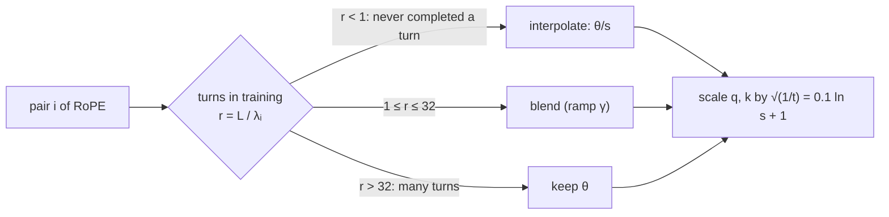

A model pretrained with a 4,096-token context does not degrade gracefully at token 4,097:
perplexity explodes within a few hundred tokens past the boundary. Yet the open models people
use today advertise windows of 128K tokens and more, and Qwen3-Next's model card lists
262,144 tokens natively, extensible to about one million with YaRN<FN n="1" />. Pretraining
at those lengths from the start would be ruinously expensive. Instead, models are pretrained
short and **extended** with a cheap fine-tune that rescales the rotary frequencies. This
lesson derives the three methods that made that work: position interpolation, the NTK-aware
base change, and YaRN.

## Why RoPE breaks past the training length

From the positional-encodings lesson, RoPE rotates pair $i$ of each query and key by the
angle $m\theta_i$ at position $m$, with $\theta_i = b^{-2i/d}$ for $i = 0, \dots, d/2 - 1$.
The **wavelength** of pair $i$ is the number of positions it takes to complete one turn:

$$
\lambda_i = \frac{2\pi}{\theta_i} = 2\pi\, b^{2i/d}.
$$

Fast pairs (small $i$) have wavelengths of a few tokens; slow pairs have wavelengths far
longer than any training sequence. Take a LLaMA-style model with head dimension $d = 128$,
base $b = 10{,}000$, and training length $L = 4{,}096$. Solving $\lambda_i \gt L$ gives
$i \ge 46$: **18 of the 64 pairs** never complete a single rotation during training.

That split explains the failure. A fast pair has seen every angle in $[0, 2\pi)$ many times,
so a position beyond $L$ produces an angle it already knows. A slow pair has only ever seen
angles in $[0, L\theta_i)$, a fraction of a circle. At position $m \gt L$ it produces an angle
the attention weights were never trained on, which is **extrapolation**, and that is where
the scores go wrong.

## Position interpolation: squeeze positions into the trained range

Chen et al.'s fix is to never extrapolate<FN n="2" />. To run at a new length $L' = sL$, with
scale factor $s \gt 1$, divide every position by $s$:

$$
f'(x, m) = f\!\left(x, \frac{mL}{L'}\right) = f\!\left(x, \frac{m}{s}\right).
$$

**Step 1: The angle range is restored.** The largest position $m = L'$ now maps to angle
$(L'/s)\theta_i = L\theta_i$, so every pair stays inside the angle range it saw in training.

**Step 2: The price is resolution.** Adjacent tokens now differ by $\theta_i / s$ instead of
$\theta_i$. For the fastest pair ($\theta_0 = 1$) and $s = 8$, neighbouring tokens are 0.125
radians apart instead of 1: the pair that told the model "these two tokens are adjacent" has
been blurred eightfold.

Chen et al. show the interpolated attention scores are far better behaved than extrapolated
ones (their bound is at least about 600 times smaller) and extended LLaMA to 32,768 tokens
with about 1,000 fine-tuning steps<FN n="2" />. The blurring of fast pairs is the remaining
cost, and the next two methods target it.

## NTK-aware scaling: change the base instead

Interpolate the slow pairs, which need it, and leave the fast pairs alone, which do not. A
single base change does this. Replace $b$ with

$$
b' = b \cdot s^{d/(d-2)}.
$$

**Step 1: The fastest pair is unchanged.** $\theta'_0 = b'^{0} = 1 = \theta_0$.

**Step 2: The slowest pair is interpolated by exactly $s$.** With $i = d/2 - 1$, the exponent
is $-2i/d = -(d-2)/d$, so

$$
\theta'_{\min} = b'^{-(d-2)/d} = b^{-(d-2)/d} \cdot \left(s^{d/(d-2)}\right)^{-(d-2)/d} = \frac{\theta_{\min}}{s}.
$$

**Step 3: Pairs in between are scaled smoothly.** For general $i$,
$\theta'_i / \theta_i = s^{-2i/(d-2)}$, which runs from 1 at $i = 0$ to $1/s$ at the slowest
pair.

For $s = 8$ and $d = 128$ the new base is $10{,}000 \times 8^{128/126} \approx 82{,}700$. The
idea is the same one Qwen3 used when it raised its base from 10,000 to 1,000,000 for its
long-context stage<FN n="3" />: a larger base stretches the slow wavelengths to cover the
longer range.

## YaRN: decide per pair, then fix the temperature

NTK-aware scaling still slightly interpolates pairs that already completed many rotations.
YaRN ("NTK-by-parts") makes the decision per pair from how many full turns it completes in
the training window<FN n="4" />.

**Step 1: Count turns.** Define $r_i = L / \lambda_i$, the number of rotations pair $i$
completes over the training length.

**Step 2: Ramp between the two regimes.** With thresholds $\alpha \lt \beta$, set

$$
\gamma(r) = \begin{cases} 0 & r \lt \alpha \\ 1 & r \gt \beta \\ \dfrac{r - \alpha}{\beta - \alpha} & \text{otherwise} \end{cases},
\qquad
\theta'_i = \big(1 - \gamma(r_i)\big)\frac{\theta_i}{s} + \gamma(r_i)\,\theta_i.
$$

Pairs that never finished a turn ($r \lt \alpha$) are fully interpolated, like PI. Pairs that
turned many times ($r \gt \beta$) keep their frequency exactly. The paper recommends
$\alpha = 1$ and $\beta = 32$ for the Llama family<FN n="4" />; for the $d = 128$,
$L = 4{,}096$ model above that leaves 21 fast pairs untouched and fully interpolates the 18
slow ones.

**Step 3: Correct the attention temperature.** Stretching positions makes attention scores
over a long context flatter than in training. YaRN rescales the logits,
$\mathrm{softmax}\!\left(q^\top k / (t\sqrt{d})\right)$, with the recommended
$\sqrt{1/t} = 0.1 \ln s + 1$ for LLaMA models<FN n="4" />, implemented by scaling both $q$ and
$k$ by $\sqrt{1/t}$. At $s = 8$ that factor is $1.208$.

YaRN reports reaching its extended windows with about 10 times fewer tokens and 2.5 times
fewer training steps than earlier methods<FN n="4" />.




## Check it on arrays

```python
import numpy as np

d, b, L, s = 128, 1e4, 4096, 8.0
i = np.arange(d // 2)
theta = b ** (-2 * i / d)
lam = 2 * np.pi / theta

# 1) which pairs never complete a turn in training
slow = lam > L
print(f"pairs with wavelength > L: {slow.sum()} (first index {i[slow][0]})")
assert slow.sum() == 18

# 2) PI keeps every angle inside the trained range at the new length
m_new = s * L
assert np.all((m_new / s) * theta <= L * theta + 1e-9)
print("PI: adjacent-token angle of the fastest pair", theta[0] / s)

# 3) NTK-aware base: fastest pair unchanged, slowest pair scaled by exactly 1/s
b_ntk = b * s ** (d / (d - 2))
theta_ntk = b_ntk ** (-2 * i / d)
print(f"NTK base {b_ntk:,.0f}")
assert np.isclose(theta_ntk[0], theta[0]) and np.isclose(theta_ntk[-1], theta[-1] / s)
assert np.allclose(theta_ntk / theta, s ** (-2 * i / (d - 2)))

# 4) YaRN ramp with alpha = 1, beta = 32, and the temperature factor
r = L / lam
gamma = np.clip((r - 1) / (32 - 1), 0, 1)
theta_yarn = (1 - gamma) * theta / s + gamma * theta
print(f"YaRN: {np.sum(gamma == 1)} pairs kept, {np.sum(gamma == 0)} fully interpolated")
print(f"YaRN q/k scale sqrt(1/t) = {0.1 * np.log(s) + 1:.3f}")
assert np.sum(gamma == 1) == 21 and np.sum(gamma == 0) == 18
```

The checks reproduce the lesson: 18 slow pairs never complete a turn at $L = 4{,}096$, PI
keeps every angle in range at the cost of an eightfold blur on the fastest pair, the
NTK-aware base of about 82,700 leaves $\theta_0$ fixed while dividing $\theta_{\min}$ by
exactly 8, and YaRN's ramp keeps 21 fast pairs and interpolates the 18 slow ones.

## Exercises

**Exercise 1.** For $d = 128$, $b = 10{,}000$, and $L = 8{,}192$, how many pairs have a
wavelength longer than the training length?

<details>
<summary>Solution</summary>

**Step 1.** Require $2\pi b^{2i/d} \gt 8192$, so $b^{2i/d} \gt 1303.8$ and
$2i/d \gt \ln 1303.8 / \ln 10^4 = 7.173 / 9.210 = 0.7788$.

**Step 2.** So $i \gt 0.7788 \times 64 = 49.8$, giving $i = 50, \dots, 63$: **14 pairs**.

Doubling the training length removes 4 pairs from the "never turned" group, because
wavelengths grow geometrically with $i$.

</details>

**Exercise 2.** Show that the NTK-aware base change multiplies the wavelength of pair $i$ by
$s^{2i/(d-2)}$, and evaluate it for the slowest pair.

<details>
<summary>Solution</summary>

**Step 1.** $\lambda'_i / \lambda_i = \theta_i / \theta'_i = (b'/b)^{2i/d} = \left(s^{d/(d-2)}\right)^{2i/d} = s^{2i/(d-2)}$.

**Step 2.** For the slowest pair, $i = d/2 - 1$, so $2i/(d-2) = 1$ and the wavelength grows by
exactly $s$. The fastest pair ($i = 0$) keeps its wavelength.

</details>

**Exercise 3 (code).** Compute YaRN's frequencies for $s = 16$ (from 4,096 to 65,536 tokens)
and report how many pairs are kept, blended, and fully interpolated, plus the $q/k$ scale.

<details>
<summary>Solution</summary>

```python
import numpy as np

d, b, L, s = 128, 1e4, 4096, 16.0
i = np.arange(d // 2)
theta = b ** (-2 * i / d)
r = L / (2 * np.pi / theta)
gamma = np.clip((r - 1) / 31, 0, 1)
kept, interp = int(np.sum(gamma == 1)), int(np.sum(gamma == 0))
print(kept, d // 2 - kept - interp, interp, round(0.1 * np.log(s) + 1, 3))
assert kept + interp + (d // 2 - kept - interp) == 64
assert np.isclose(0.1 * np.log(16) + 1, 1.277, atol=1e-3)
```

The ramp depends only on $r_i = L/\lambda_i$, not on $s$, so the same 21 pairs are kept and
the same 18 are interpolated; $s$ changes how far the interpolated pairs are squeezed and
raises the temperature factor to 1.277.

</details>

The next lesson stays inside the attention block and asks why its logits blow up and why it
dumps attention on the first token, and how QK-norm and gating fix both.

<Footnotes>
  <FNItem n="1">**Qwen Team** (2025). Qwen3-Next-80B-A3B-Instruct model card. Hugging Face. [huggingface.co/Qwen/Qwen3-Next-80B-A3B-Instruct](https://huggingface.co/Qwen/Qwen3-Next-80B-A3B-Instruct)</FNItem>
  <FNItem n="2">**Chen, S., Wong, S., Chen, L., Tian, Y.** (2023). "Extending Context Window of Large Language Models via Positional Interpolation". [arXiv:2306.15595](https://arxiv.org/abs/2306.15595)</FNItem>
  <FNItem n="3">**Yang, A., Li, A., Yang, B., et al.** (2025). "Qwen3 Technical Report". [arXiv:2505.09388](https://arxiv.org/abs/2505.09388)</FNItem>
  <FNItem n="4">**Peng, B., Quesnelle, J., Fan, H., Shippole, E.** (2023). "YaRN: Efficient Context Window Extension of Large Language Models". [arXiv:2309.00071](https://arxiv.org/abs/2309.00071)</FNItem>
</Footnotes>
