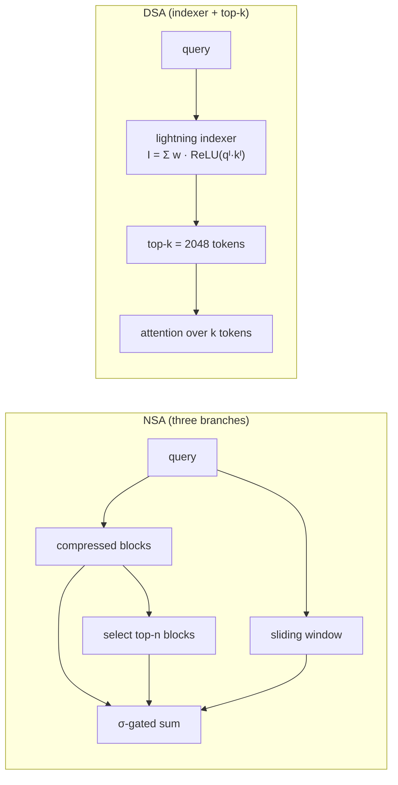

MLA and GQA shrink what each cached token costs; they do not change how many tokens each query
reads. At a 128K-token context every new token still attends to 128K keys, in every layer.
Most of those weights are tiny: attention over a long context is usually concentrated on a
small set of relevant positions. **Sparse attention** exploits that by letting each query read
only a selected subset of keys. Older sparse schemes fixed the pattern in advance (local
windows, strided blocks); the 2025 generation **learns** which keys to read and is trained with
the sparsity in place. This lesson covers DeepSeek's two designs, Native Sparse Attention (NSA)
and DeepSeek Sparse Attention (DSA), and the error bound that says when sparsity is safe.

## When is dropping keys safe?

Let a query have attention weights $a_1, \dots, a_L$ over values $v_1, \dots, v_L$, and let
$S$ be the $k$ kept keys, holding total mass $M = \sum_{j \in S} a_j$. Sparse attention
renormalizes over $S$ and outputs $y_S = \sum_{j \in S} (a_j/M) v_j$.

**Step 1: Split the dense output.** With $y_{\bar S} = \sum_{j \notin S} a_j v_j / (1 - M)$ the
normalized output over dropped keys,
$y = \sum_j a_j v_j = M\, y_S + (1 - M)\, y_{\bar S}$.

**Step 2: Subtract.** $y - y_S = (1 - M)(y_{\bar S} - y_S)$.

**Step 3: Bound.** Both $y_S$ and $y_{\bar S}$ are convex combinations of values, so each has
norm at most $V_{\max} = \max_j \|v_j\|$. Therefore

$$
\|y - y_S\| \le 2(1 - M)\, V_{\max}.
$$

Sparse attention is nearly exact when the kept keys hold nearly all the mass, and the whole
design problem is choosing $S$ cheaply so that $M$ is close to 1. A contrasting pair over 8,192
keys makes the dependence concrete: with peaked scores (standard deviation 3) the top 2,048 keys
hold almost all the mass, while with flat scores (standard deviation 0.5) the same 2,048 keys
hold well under half of it.


## Native Sparse Attention: three branches and a gate

NSA gives every query three views of the past and mixes them with learned gates<FN n="1" />:

$$
o_t = \sum_{c \in \{\text{cmp}, \text{slc}, \text{win}\}} g_t^c \cdot \mathrm{Attn}\!\left(q_t, \tilde K_t^c, \tilde V_t^c\right),
\qquad g_t^c \in [0, 1],
$$

with the gates produced from the input by an MLP and a sigmoid.

- **Compression.** Slide over the keys in blocks of length $l = 32$ with stride $16$, and map each
  block to one compressed key and value with a small learned MLP. This branch is a coarse
  summary of the entire past.
- **Selection.** Use the query's attention probabilities over the compressed keys to score
  blocks, and keep the top $n = 16$ blocks of 64 tokens at full resolution (including the
  initial block and 2 local blocks). Under GQA the scores are summed over the heads in a group
  so all of them read the same blocks, which keeps memory access contiguous.
- **Sliding window.** The most recent $w = 512$ tokens, always attended in full.

At a context of $L = 65{,}536$ tokens a query reads about
$(65{,}536 - 32)/16 + 1 = 4{,}095$ compressed keys, $16 \times 64 = 1{,}024$ selected tokens, and
512 window tokens: 5,631 in all, about 11.6 times fewer than dense attention. Because selection
is driven by the compressed branch, which is itself trained end to end, the whole mechanism is
trainable without a separate selection loss; that is the "native" in the name.

## DeepSeek Sparse Attention: a lightning indexer and top-k

DSA, introduced with DeepSeek-V3.2, separates *choosing* keys from *attending* to
them<FN n="2" />. A small **lightning indexer** scores every past token $s$ for the current
token $t$:

$$
I_{t,s} = \sum_{j=1}^{H^I} w^I_{t,j}\, \mathrm{ReLU}\!\left(q^I_{t,j} \cdot k^I_s\right),
$$

using a few indexer heads $j$ with their own small queries $q^I_{t,j}$, a shared indexer key
$k^I_s$ per token, and per-head weights $w^I_{t,j}$. The ReLU is chosen for throughput, and the
indexer can run in FP8<FN n="2" />. The main attention then reads only the top-$k$ tokens by
indexer score:

$$
u_t = \mathrm{Attn}\!\left(h_t, \{c_s : I_{t,s} \in \text{Top-}k(I_{t,:})\}\right),
$$

with $k = 2{,}048$ in DeepSeek-V3.2's sparse training stage<FN n="2" />.

**What it saves.** The core attention drops from $O(L^2)$ to $O(Lk)$ over a sequence. At a
128K context ($L = 131{,}072$) with $k = 2{,}048$, each query's main attention reads 64 times
fewer keys.

**What it does not save.** The indexer still scores every pair, so it remains $O(L^2)$, as
the paper states<FN n="2" />. It is affordable because it has few heads, small dimensions, a
ReLU instead of a softmax, and FP8 arithmetic, so its per-pair cost is a small fraction of
the main attention's.

**How it is trained.** The indexer is first warmed up to imitate the dense model's attention
distribution with a KL-divergence loss (1,000 steps), and then the whole model is trained with
sparse attention switched on (15,000 steps)<FN n="2" />. The warm-up matters because a randomly
initialized indexer would pick keys with no relation to where attention mass actually is,
making $M$ small and the error bound above useless.



## Check it on arrays

```python
import numpy as np

rng = np.random.default_rng(0)
softmax = lambda z: np.exp(z - z.max()) / np.exp(z - z.max()).sum()
L, d, k = 8192, 32, 2048
V = rng.normal(size=(L, d))
Vmax = np.linalg.norm(V, axis=1).max()

def sparse_vs_dense(scores, keep):
    a = softmax(scores)
    y = a @ V
    M = a[keep].sum()
    y_s = (a[keep] / M) @ V[keep]
    return M, np.linalg.norm(y - y_s), 2 * (1 - M) * Vmax

# 1) Exact top-k on peaked vs flat scores, with the error bound
for sd in (3.0, 0.5):
    s = rng.normal(scale=sd, size=L)
    M, err, bound = sparse_vs_dense(s, np.argsort(-s)[:k])
    print(f"score std {sd}: mass kept {M:.3f}, error {err:.4f} <= bound {bound:.4f}")
    assert err <= bound + 1e-12

# 2) An approximate indexer: noisy scores still pick most of the mass
s = rng.normal(scale=3.0, size=L)
indexer = s + rng.normal(scale=1.0, size=L)          # cheap, imperfect relevance scores
M_idx, err_idx, _ = sparse_vs_dense(s, np.argsort(-indexer)[:k])
M_opt, _, _ = sparse_vs_dense(s, np.argsort(-s)[:k])
print(f"indexer keeps {M_idx:.3f} of the mass vs {M_opt:.3f} for exact top-k")
assert M_idx > 0.9

# 3) Token budgets
L64 = 65_536
nsa = (L64 - 32) // 16 + 1 + 16 * 64 + 512
print(f"NSA reads {nsa} of {L64} keys ({L64 / nsa:.1f}x fewer); "
      f"DSA at 128K reads {131_072 // 2048}x fewer in the main attention")
assert nsa == 5631
```

The first block shows the bound at work: with peaked scores the top 2,048 keys keep almost all
the mass and the error is tiny, while flat scores leave a large share behind. The second shows
that an indexer whose scores are only correlated with the true ones still captures most of the
mass, and the third reproduces the NSA and DSA token budgets.

## Exercises

**Exercise 1.** With NSA's settings ($l = 32$, stride 16, $n = 16$ blocks of 64, window 512),
how many keys does a query read at $L = 131{,}072$, and what is the reduction over dense?

<details>
<summary>Solution</summary>

**Step 1.** Compressed keys: $(131{,}072 - 32)/16 + 1 = 8{,}191$.

**Step 2.** Selected and window tokens: $1{,}024 + 512 = 1{,}536$.

**Step 3.** Total $9{,}727$, a reduction of $131{,}072 / 9{,}727 = 13.5$ times. The
compressed branch grows linearly with $L$ and dominates the budget at long contexts.

</details>

**Exercise 2.** The kept keys hold 97% of the attention mass and the largest value vector has
norm 4. Bound the sparse attention error. What mass is needed to guarantee an error below 0.05?

<details>
<summary>Solution</summary>

**Step 1.** $\|y - y_S\| \le 2(1 - 0.97) \times 4 = 0.24$.

**Step 2.** Require $2(1 - M) \times 4 \le 0.05$, so $1 - M \le 0.00625$ and $M \ge 0.99375$.

The bound is worst-case; actual errors are usually much smaller because dropped values point in
varied directions and partly cancel.

</details>

**Exercise 3 (code).** Measure how the indexer's noise level controls the mass it captures:
for noise standard deviations 0, 0.5, 1, 2, and 4 on peaked scores (std 3), report the kept mass
with $k = 2048$ of 8,192 keys and confirm that it decreases as noise grows.

<details>
<summary>Solution</summary>

```python
import numpy as np

rng = np.random.default_rng(1)
L, k = 8192, 2048
s = rng.normal(scale=3.0, size=L)
a = np.exp(s - s.max()); a /= a.sum()
masses = []
for noise in (0, 0.5, 1, 2, 4):
    keep = np.argsort(-(s + rng.normal(scale=noise, size=L)))[:k]
    masses.append(a[keep].sum())
print([round(m, 3) for m in masses])
assert all(m1 >= m2 for m1, m2 in zip(masses, masses[1:]))
```

As the indexer's scores decorrelate from the true scores, the kept mass falls and the error
bound loosens, which is why DSA warms the indexer up against the dense attention distribution
before switching sparsity on.

</details>

This closes the E3 architecture track: the next pillar step is training these models, starting
with the data they are pretrained on.

<Footnotes>
  <FNItem n="1">**Yuan, J., Gao, H., Dai, D., Luo, J., et al.** (2025). "Native Sparse Attention: Hardware-Aligned and Natively Trainable Sparse Attention". [arXiv:2502.11089](https://arxiv.org/abs/2502.11089)</FNItem>
  <FNItem n="2">**DeepSeek-AI** (2025). "DeepSeek-V3.2: Pushing the Frontier of Open Large Language Models". [arXiv:2512.02556](https://arxiv.org/abs/2512.02556)</FNItem>
</Footnotes>
