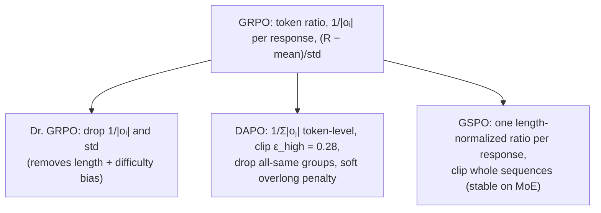

GRPO made reinforcement learning on verifiable rewards cheap enough to train reasoning models,
and within months of DeepSeek-R1 several groups found that its small normalization choices
had large side effects. Responses grew longer without getting more correct; entropy collapsed;
batches filled with prompts that produced no gradient at all; and on mixture-of-experts models
training became unstable. Three follow-ups each fixed a subset: **Dr. GRPO** removed two
normalizations<FN n="1" />, **DAPO** changed the loss aggregation and the clipping and added
dynamic sampling<FN n="2" />, and **GSPO** moved the importance ratio from tokens to whole
sequences<FN n="3" />. This lesson derives what each normalization does to the gradient.

## GRPO at token level

The GRPO lesson wrote the objective with one ratio per response. The original implementation
applies the clipped surrogate per token<FN n="4" />. For a prompt, sample $G$ responses
$o_1, \dots, o_G$ with rewards $R_i$; define the token ratio
$r_{i,t} = \pi_\theta(o_{i,t} \mid q, o_{i,\lt t}) / \pi_{\text{old}}(o_{i,t} \mid q, o_{i,\lt t})$ and
the group-normalized advantage $\hat A_i = (R_i - \mathrm{mean}(R)) / \mathrm{std}(R)$, shared by
every token of response $i$. Then

$$
\mathcal{J}_{\text{GRPO}} = \frac{1}{G} \sum_{i=1}^{G} \frac{1}{|o_i|} \sum_{t=1}^{|o_i|} \min\!\Big(r_{i,t} \hat A_i,\ \mathrm{clip}(r_{i,t}, 1 - \varepsilon, 1 + \varepsilon)\, \hat A_i\Big),
$$

usually with a KL penalty to a reference model. Two normalizations are hidden in this formula:
the $1/|o_i|$ inside, and the $\mathrm{std}(R)$ inside $\hat A_i$.

## The length bias

Look at the gradient weight a single token receives. Near $r_{i,t} = 1$ (no clipping), token
$t$ of response $i$ contributes with weight

$$
w_{i,t} = \frac{\hat A_i}{G\, |o_i|}.
$$

**Step 1: Each response gets the same total push.** Summing over its tokens,
$\sum_t w_{i,t} = \hat A_i / G$, independent of length.

**Step 2: So each token of a long response gets less.** The per-token weight is inversely
proportional to $|o_i|$.

**Step 3: Read the incentive.** For a correct answer ($\hat A_i \gt 0$), short responses get
stronger per-token reinforcement, which favours brevity among correct answers. For a wrong
answer ($\hat A_i \lt 0$), each token of a *long* response is penalized less than each token of
a short one, so long wrong answers are the cheapest kind of wrong answer. Liu et al. identify
this as the source of the steady growth of incorrect responses' length during R1-style
training<FN n="1" />.


## The difficulty bias

The $\mathrm{std}(R)$ in the advantage rescales each prompt's gradient by $1/\mathrm{std}(R)$.
With binary rewards and a fraction $p$ of correct responses, $\mathrm{std}(R) = \sqrt{p(1-p)}$,
which is small when $p$ is near 0 or 1.

**Step 1: A balanced prompt.** With 4 of 8 correct, $p = 0.5$ and $\mathrm{std} = 0.5$, so the
advantages are $\pm 1$.

**Step 2: A nearly solved prompt.** With 7 of 8 correct, $p = 0.875$ and
$\mathrm{std} = \sqrt{0.875 \times 0.125} = 0.331$; the one failure gets
$\hat A = -0.875/0.331 = -2.65$.

**Step 3: Read the incentive.** Prompts the model already almost always solves, or almost
never solves, are upweighted relative to the prompts where learning is most informative. Liu et
al. call this the question-level difficulty bias<FN n="1" />.

**Dr. GRPO's fix** is to remove both normalizations: use $R_i - \mathrm{mean}(R)$ as the
advantage and replace the per-response $1/|o_i|$ with a constant (in practice the generation
budget), which recovers an unbiased policy-gradient objective. The authors report that this
keeps reasoning performance while improving token efficiency, mostly by stopping the growth of
incorrect responses<FN n="1" />.

## DAPO: four changes for long chain-of-thought

DAPO keeps the std normalization but changes three other things and adds a fourth<FN n="2" />.

- **Token-level loss.** Normalize by the total number of tokens in the group,
  $\frac{1}{\sum_j |o_j|} \sum_i \sum_t (\dots)$, so every token in the group carries the same
  weight $\hat A_i / \sum_j |o_j|$. Long responses no longer dilute their tokens' gradient, so
  long low-quality patterns (repetition, gibberish) are penalized in proportion to their length.
- **Clip-higher.** Use separate bounds, $\varepsilon_{\text{low}} = 0.2$ and
  $\varepsilon_{\text{high}} = 0.28$. Under a symmetric clip a token with old probability $p$ can
  rise only to $(1 + \varepsilon) p$ per update: a token at $p = 0.01$ can reach 0.012, while a
  token at $p = 0.9$ is effectively unconstrained. Low-probability exploratory tokens can barely
  grow, so entropy collapses. Raising only the upper bound lets them reach 0.0128.
- **Dynamic sampling.** If every response in a group gets the same reward, every advantage is
  zero and the group contributes no gradient. DAPO over-samples and drops prompts whose accuracy
  is exactly 0 or 1, so each batch is full of prompts that teach something.
- **Overlong reward shaping.** Responses truncated at the length limit get a soft length-based
  penalty instead of a hard failure, reducing reward noise.

With these changes DAPO reports 50 points on AIME 2024 from the Qwen2.5-32B base model,
compared with 47 for DeepSeek-R1-Zero-Qwen-32B, using half the training steps<FN n="2" />.

## GSPO: a ratio per sequence

Token-level ratios are noisy: each one is a single-sample estimate, and the noise accumulates
over thousands of tokens. On MoE models it is worse, because a small parameter change can route
the same token to different experts, so token probabilities jump. Zheng et al. (Qwen team)
define the importance ratio on the whole response, normalized by length<FN n="3" />:

$$
s_i(\theta) = \left(\frac{\pi_\theta(o_i \mid q)}{\pi_{\text{old}}(o_i \mid q)}\right)^{1/|o_i|} = \exp\!\left(\frac{1}{|o_i|}\sum_{t=1}^{|o_i|} \log r_{i,t}\right),
$$

the geometric mean of the token ratios, and clip whole responses:

$$
\mathcal{J}_{\text{GSPO}} = \frac{1}{G}\sum_{i=1}^{G} \min\!\Big(s_i \hat A_i,\ \mathrm{clip}(s_i, 1 - \varepsilon, 1 + \varepsilon)\, \hat A_i\Big).
$$

Because $s_i$ averages log-ratios, its fluctuations are much smaller than a single token's, so
the clip ranges are tiny: $3 \times 10^{-4}$ below and $4 \times 10^{-4}$ above in the paper's
experiments. On Qwen3-30B-A3B, GRPO needed a "Routing Replay" trick that pins expert routing
between rollout and update to stay stable; GSPO trained stably without it<FN n="3" />.



## Check it on arrays

```python
import numpy as np

rng = np.random.default_rng(0)
G = 8
R = np.array([1, 1, 0, 0, 0, 0, 0, 0], dtype=float)          # 2 of 8 correct
lens = np.array([300, 500, 200, 400, 600, 900, 1200, 1800])

A = (R - R.mean()) / R.std()
w_grpo = A / (G * lens)                    # per-token weight
w_dapo = A / lens.sum()
w_dr = (R - R.mean()) / (G * 4096)         # constant normalizer, no std

# 1) GRPO: same total push per response, smaller per-token penalty for long wrong answers
assert np.allclose(w_grpo * lens, A / G)
print("GRPO per-token penalty, 200-token vs 1800-token wrong answer:",
      f"{w_grpo[2]:.2e} vs {w_grpo[-1]:.2e}")
assert abs(w_grpo[-1]) < abs(w_grpo[2]) and np.isclose(w_dapo[2], w_dapo[-1])

# 2) Difficulty bias: std normalization upweights nearly-solved prompts
for k in (4, 7):
    r = np.r_[np.ones(k), np.zeros(G - k)]
    print(f"{k}/8 correct: |A| of the minority answer with std = {abs((r - r.mean()) / r.std())[-1]:.2f}, "
          f"without std = {abs(r - r.mean())[-1]:.3f}")

# 3) All-same groups give zero advantage, hence zero gradient (DAPO drops them)
r_same = np.ones(G)
assert np.all(r_same - r_same.mean() == 0)

# 4) Clip-higher: how far a token's probability can rise in one update
for p in (0.01, 0.9):
    print(f"p_old = {p}: max new p {min(1, 1.2 * p):.4f} (eps 0.2), {min(1, 1.28 * p):.4f} (eps_high 0.28)")

# 5) GSPO: a length-normalized sequence ratio is far less noisy than token ratios
log_r = rng.normal(scale=0.05, size=(1000, 800))           # per-token log-ratios
s = np.exp(log_r.mean(axis=1))
print(f"token ratio std {np.exp(log_r).std():.4f} vs sequence ratio std {s.std():.5f}")
assert s.std() < np.exp(log_r).std() / 10
```

The run reproduces the derivations: under GRPO every response gets the same total push, so a
1,800-token wrong answer's tokens are each penalized 9 times less than a 200-token one's, while
DAPO's weights are equal; the minority answer's advantage grows from 1 to 2.65 as a prompt goes
from 4/8 to 7/8 solved; an all-correct group has zero advantage; clip-higher raises the ceiling
for a 1% token from 0.012 to 0.0128; and the length-normalized sequence ratio is roughly
$\sqrt{800} \approx 28$ times less noisy than a single token's ratio.

## Exercises

**Exercise 1.** A group of $G = 4$ has rewards $(1, 0, 0, 0)$ and lengths $(100, 100, 400, 1600)$.
Compute the GRPO per-token weight on each wrong response, and the DAPO per-token weight.

<details>
<summary>Solution</summary>

**Step 1.** Mean $= 0.25$, std $= \sqrt{0.25 \times 0.75} = 0.433$, so the wrong responses have
$\hat A = -0.25 / 0.433 = -0.577$.

**Step 2.** GRPO: $w = \hat A / (G |o_i|)$, giving $-0.577/400 = -1.44 \times 10^{-3}$,
$-0.577/1600 = -3.61 \times 10^{-4}$, and $-0.577/6400 = -9.0 \times 10^{-5}$ for lengths 100,
400, 1600.

**Step 3.** DAPO: $w = \hat A / \sum_j |o_j| = -0.577 / 2200 = -2.62 \times 10^{-4}$ for every
token of every wrong response. Under GRPO the 1,600-token wrong answer's tokens are penalized 16
times less than the 100-token one's; under DAPO equally.

</details>

**Exercise 2.** With binary rewards, show that the GRPO advantage of the single wrong answer in
a group with $G - 1$ correct answers is $-\sqrt{G - 1}$, and evaluate it for $G = 16$.

<details>
<summary>Solution</summary>

**Step 1.** $p = (G-1)/G$, so the mean is $p$ and the std is $\sqrt{p(1-p)} = \sqrt{(G-1)}/G$.

**Step 2.** The wrong answer has $R - \text{mean} = -p = -(G-1)/G$. Dividing,
$\hat A = -\dfrac{(G-1)/G}{\sqrt{G-1}/G} = -\sqrt{G-1}$.

**Step 3.** For $G = 16$, $\hat A = -\sqrt{15} = -3.87$. The advantage grows without bound as the
prompt approaches always-solved, which is the difficulty bias in closed form.

</details>

**Exercise 3 (code).** Simulate dynamic sampling: draw prompt difficulties $p \sim \mathrm{Uniform}(0, 1)$,
sample 8 binary rewards per prompt, and estimate the fraction of prompts that would be dropped
for zero advantage. Compare with the exact value $\int_0^1 (p^8 + (1-p)^8)\, dp = 2/9$.

<details>
<summary>Solution</summary>

```python
import numpy as np

rng = np.random.default_rng(3)
p = rng.random(200_000)
k = rng.binomial(8, p)
dropped = np.mean((k == 0) | (k == 8))
print(round(dropped, 4), round(2 / 9, 4))
assert abs(dropped - 2 / 9) < 0.005
```

About 22% of prompts produce a group with identical rewards and no gradient; without dynamic
sampling, nearly a quarter of each batch would be wasted compute.

</details>

This closes the E4 training track; E5 turns to serving the trained model efficiently.

<Footnotes>
  <FNItem n="1">**Liu, Z., Chen, C., Li, W., Qi, P., et al.** (2025). "Understanding R1-Zero-Like Training: A Critical Perspective". [arXiv:2503.20783](https://arxiv.org/abs/2503.20783)</FNItem>
  <FNItem n="2">**Yu, Q., Zhang, Z., Zhu, R., Yuan, Y., et al.** (2025). "DAPO: An Open-Source LLM Reinforcement Learning System at Scale". [arXiv:2503.14476](https://arxiv.org/abs/2503.14476)</FNItem>
  <FNItem n="3">**Zheng, C., Liu, S., Li, M., Chen, X.-H., et al.** (2025). "Group Sequence Policy Optimization". [arXiv:2507.18071](https://arxiv.org/abs/2507.18071)</FNItem>
  <FNItem n="4">**Shao, Z., Wang, P., Zhu, Q., Xu, R., et al.** (2024). "DeepSeekMath: Pushing the Limits of Mathematical Reasoning in Open Language Models". [arXiv:2402.03300](https://arxiv.org/abs/2402.03300)</FNItem>
</Footnotes>
