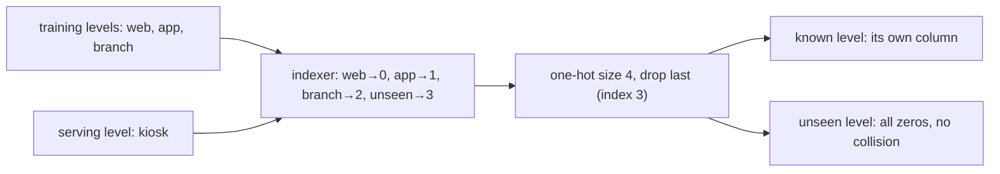

[Feature engineering](/pillar/I/I1/feature-engineering) introduced one-hot
encoding on a column whose levels were fixed and known. Production columns are
not like that. A new payment method launches, a new country opens, a merchant id
appears that the training data never saw. The encoder was fitted on the training
levels, so at serving time it meets an input outside its domain, and the default
behavior of many encoders is to raise. A second problem comes with size: a column
with a hundred thousand merchant ids cannot be one-hot encoded into a hundred
thousand columns. This lesson covers the three tools that handle both problems:
a defined vector for unseen levels, the hashing trick, and target encoding fitted
out of fold.

## Unseen levels and the reference category

One-hot encoding maps a column with $K$ known levels to $K$ indicator columns
$e_1, \dots, e_K$, where $e_k = 1$ for rows at level $k$ and $0$ otherwise. Every
training row has exactly one $1$, so

$$
\sum_{k=1}^{K} e_k = 1 \quad \text{on every row}.
$$

**Step 1. The dummy-variable trap.** A linear model with an intercept already has
a constant column $\mathbf{1}$. The identity above says $\mathbf{1}$ is a linear
combination of $e_1, \dots, e_K$, so the design matrix loses one rank and
$X^\top X$ is singular: the intercept and the $K$ level weights are not jointly
identifiable (adding $c$ to every level weight and subtracting $c$ from the
intercept leaves every prediction unchanged). The standard fix is to **drop one
column**. The dropped level becomes the **reference category**: its rows have the
all-zero vector, and every other level's weight is read as an offset from it.

**Step 2. What an unseen level becomes.** At serving time a row arrives with a
level outside the $K$ known ones. Three policies exist:

- **Error.** Fail the request. Safe for a batch job you can rerun, fatal for an
  online endpoint.
- **Ignore.** Emit the all-zero vector. The model then predicts as if the row
  had no level-specific offset at all.
- **Bucket.** Map every unseen level to one reserved extra index, an explicit
  "other" level.

The **named confusion** sits between Steps 1 and 2. If you drop the *first*
known level as the reference *and* map unseen levels to the all-zero vector, the
two collide: an unseen level and the reference level produce the same features,
so the model silently scores a brand-new payment method as if it were the
reference method, `web`, say. The two encodings below differ only in which column
is dropped:

| Level | drop first, ignore unseen | reserve unseen slot, drop it |
|---|---|---|
| `web` | (0, 0) | (1, 0, 0) |
| `app` | (1, 0) | (0, 1, 0) |
| `branch` | (0, 1) | (0, 0, 1) |
| `kiosk` (unseen) | (0, 0), same as `web` | (0, 0, 0), unique |

In the right-hand scheme the reserved unseen slot is the one dropped, so every
known level keeps its own column and the unseen level gets a vector no training
row had. That is what Spark ML produces with
`StringIndexer(handleInvalid="keep")` followed by `OneHotEncoder(dropLast=True)`:
the indexer assigns unseen levels the extra index $K$, and `dropLast` removes
that column. scikit-learn's `OneHotEncoder(handle_unknown="ignore")`
also returns all zeros for an unseen level, and it keeps all $K$ known columns
unless you also ask it to drop one.

One honest caveat: in the right-hand scheme the $K$ known columns still sum to
$1$ on every *training* row (no training row is unseen), so an unregularized
linear model with an intercept meets the dummy trap of Step 1 again. Regularized
linear models and tree ensembles are unaffected, which is why the scheme is the
common default.



## The hashing trick and its collision rate

For a column with very many levels, the **hashing trick** skips the vocabulary
entirely: pick $m$ buckets, map each level $c$ to bucket $h(c) \bmod m$ with a
fixed hash function $h$, and one-hot encode the bucket<FN n="1" />. Unseen levels
need no special case, since every string hashes somewhere, and the encoder has no
fitted state to store. The cost is **collisions**: two levels sharing a bucket
share a weight.

Model the hash as assigning each of $K$ distinct levels to a bucket uniformly and
independently.

**Step 1. One level against one other.** A fixed level $c$ shares its bucket with
a specific other level with probability $1/m$, so it avoids that level with
probability $1 - 1/m$.

**Step 2. One level against all the others.** The other $K - 1$ levels are
independent, so

$$
P(c \text{ collides with no one}) = \Big(1 - \frac{1}{m}\Big)^{K-1}.
$$

**Step 3. The collision probability.** Take the complement and use
$\ln(1 - 1/m) \approx -1/m$ for large $m$:

$$
P(c \text{ collides}) = 1 - \Big(1 - \frac{1}{m}\Big)^{K-1} \approx 1 - e^{-(K-1)/m}.
$$

By linearity of expectation this is also the expected **fraction of levels** that
share a bucket. The load factor $K/m$ is the only number that matters:

- $K/m = 0.01$ (1,000 levels in 100,000 buckets): about $1\%$ of levels collide.
- $K/m = 0.25$ (1,000 levels in 4,096 buckets): about $22\%$.
- $K/m = 1$: about $63\%$, so most levels share a weight with someone.

A collision is cheap when the two levels behave alike and costly when a
high-signal level shares a bucket with a large noisy one. Frequent levels can
also be kept as explicit columns, with only the long tail hashed.


## Target encoding and its leak

**Target encoding** replaces a level by a statistic of the target for that level,
usually the mean: for level $c$ with $n_c$ training rows and target sum $S_c$, the
encoding is $\bar{y}_c = S_c / n_c$. One column carries the level's effect, however
many levels there are<FN n="2" />.

The leak is in where $\bar{y}_c$ comes from. If a row's own label is part of the
mean used to encode it, a rare level encodes its own answer. Take a level seen
once: $n_c = 1$, so $\bar{y}_c = y_i$, and the feature *is* the label. With many
rare levels, a column of pure noise looks highly predictive in training and is
useless at serving time, where the label is not yet known.

Two fixes are used together.

**Smoothing.** Shrink rare levels toward the global mean $\bar{y}$ with a pseudo-count $a$:

$$
\hat{y}_c = \frac{S_c + a\,\bar{y}}{n_c + a}
= \frac{n_c}{n_c + a}\,\bar{y}_c + \frac{a}{n_c + a}\,\bar{y}.
$$

The second form shows it is a weighted average whose weight on the level's own
mean grows with $n_c$: a level seen once with $a = 10$ keeps only $1/11$ of its own
label. An unseen level has $n_c = 0$ and gets $\bar{y}$, which is the defined
fallback that one-hot needed a reserved slot for.

**Out-of-fold fitting.** Split the training rows into $k$ folds. Encode the rows of
fold $j$ with statistics computed on the other $k - 1$ folds only, so no row's
label enters its own encoding. At serving time use statistics from the full
training set, which never contain the serving row's label either. This is the
same leakage rule as fitting a scaler on train only, applied row by row.

## Worked example

The block checks the unseen-level table, simulates hash collisions against the
derived rate, and shows target encoding inventing signal from pure noise unless
it is fitted out of fold.

```python
import numpy as np
rng = np.random.default_rng(0)

# 1. Unseen levels: which scheme collides with the reference?
levels = ["web", "app", "branch"]
idx = {c: i for i, c in enumerate(levels)}

def reserve_slot_drop_it(c):           # Spark: handleInvalid="keep" + dropLast
    v = np.zeros(len(levels) + 1)
    v[idx.get(c, len(levels))] = 1
    return v[:-1]

def drop_first_ignore(c):              # reference = first level, unseen -> zeros
    v = np.zeros(len(levels))
    if c in idx:
        v[idx[c]] = 1
    return v[1:]

assert np.array_equal(drop_first_ignore("kiosk"), drop_first_ignore("web"))          # collision
assert not np.array_equal(reserve_slot_drop_it("kiosk"), reserve_slot_drop_it("web"))
print("kiosk vs web, drop-first:", drop_first_ignore("kiosk"), drop_first_ignore("web"))

# 2. Hashing: simulated collision share vs 1 - (1 - 1/m)^(K-1)
K, m = 1000, 4096
shares = []
for _ in range(200):
    b = rng.integers(0, m, K)                      # a uniform hash of K levels
    counts = np.bincount(b, minlength=m)
    shares.append((counts[b] > 1).mean())
theory = 1 - (1 - 1 / m) ** (K - 1)
print(f"collision share: simulated {np.mean(shares):.4f}, derived {theory:.4f}")
assert abs(np.mean(shares) - theory) < 0.005

# 3. Target encoding on a column with NO signal
N, C = 5000, 2000                                  # 2,000 levels, ~2.5 rows each
cat = rng.integers(0, C, N)
y = (rng.random(N) < 0.3).astype(float)           # labels independent of cat

def encode(cat_fit, y_fit, cat_apply, a):
    S = np.bincount(cat_fit, weights=y_fit, minlength=C)
    n = np.bincount(cat_fit, minlength=C)
    prior = y_fit.mean()
    return ((S + a * prior) / (n + a))[cat_apply]  # n = 0 -> prior when a > 0

naive = encode(cat, y, cat, a=1e-9)                # own label included, no smoothing
fold = rng.integers(0, 5, N)
oof = np.empty(N)
for j in range(5):
    tr, va = fold != j, fold == j
    oof[va] = encode(cat[tr], y[tr], cat[va], a=10)

r_naive, r_oof = np.corrcoef(naive, y)[0, 1], np.corrcoef(oof, y)[0, 1]
print(f"corr(encoding, y): naive {r_naive:.3f}, out-of-fold {r_oof:.3f}")
assert r_naive > 0.5 and abs(r_oof) < 0.1
```

The drop-first scheme maps `kiosk` and `web` to the same vector while the
reserved-slot scheme keeps them apart. The simulated collision share matches
$1 - (1 - 1/m)^{K-1} \approx 0.216$. On a column carrying no information, naive
target encoding reaches a correlation of about $0.6$ with the label, while the
out-of-fold version stays near zero, which is the truth.

## Exercises

**Exercise 1.** You hash a `merchant_id` column with $K = 50{,}000$ distinct
values. How many buckets $m$ do you need so that at most $5\%$ of merchants share a
bucket? Use the approximation $1 - e^{-(K-1)/m}$.

<details>
<summary>Solution</summary>

**Step 1.** Require $1 - e^{-(K-1)/m} \le 0.05$, i.e. $e^{-(K-1)/m} \ge 0.95$.

**Step 2.** Take logs: $-(K-1)/m \ge \ln 0.95 = -0.051293$, so

$$
m \ge \frac{K - 1}{0.051293} = \frac{49{,}999}{0.051293} \approx 974{,}800.
$$

**Step 3.** About $975{,}000$ buckets, roughly $19.5$ times the number of merchants.
A $5\%$ collision budget requires a load factor near $0.05$, which is why hashing
is usually combined with explicit columns for the frequent levels.

</details>

**Exercise 2.** A level has $n_c = 4$ training rows with target sum $S_c = 4$ (all
positive). The global mean is $\bar{y} = 0.2$. Compute its smoothed target
encoding for pseudo-counts $a = 0$, $a = 4$, and $a = 20$, and the encoding of an
unseen level.

<details>
<summary>Solution</summary>

**Step 1.** Use $\hat{y}_c = (S_c + a\bar{y}) / (n_c + a)$.

- $a = 0$: $4/4 = 1.0$. The rare level claims a perfect positive rate.
- $a = 4$: $(4 + 0.8)/8 = 0.6$.
- $a = 20$: $(4 + 4)/24 = 0.333$.

**Step 2.** An unseen level has $n_c = 0$, $S_c = 0$, so
$\hat{y}_c = a\bar{y}/a = \bar{y} = 0.2$ for any $a > 0$.

**Step 3.** The weight on the level's own mean is $n_c/(n_c + a)$: $1$, $0.5$, and
$0.167$ for the three choices. Larger $a$ trusts four rows less.

</details>

**Exercise 3 (code).** Show that smoothing alone does not remove the leak. Repeat
the no-signal setup from the worked example, encode *in-sample* (own label
included) with a large pseudo-count $a = 10$, and compare its correlation with
the label against the out-of-fold version with the same $a$.

<details>
<summary>Solution</summary>

```python
import numpy as np
rng = np.random.default_rng(1)
N, C = 5000, 2000
cat = rng.integers(0, C, N)
y = (rng.random(N) < 0.3).astype(float)

def encode(cat_fit, y_fit, cat_apply, a):
    S = np.bincount(cat_fit, weights=y_fit, minlength=C)
    n = np.bincount(cat_fit, minlength=C)
    prior = y_fit.mean()
    return ((S + a * prior) / (n + a))[cat_apply]

insample = encode(cat, y, cat, a=10)
fold = rng.integers(0, 5, N)
oof = np.empty(N)
for j in range(5):
    tr, va = fold != j, fold == j
    oof[va] = encode(cat[tr], y[tr], cat[va], a=10)

r_in, r_oof = np.corrcoef(insample, y)[0, 1], np.corrcoef(oof, y)[0, 1]
print(f"in-sample smoothed {r_in:.3f}, out-of-fold {r_oof:.3f}")
assert r_in > 0.2 and abs(r_oof) < 0.1
```

Smoothing barely dents the leak here: the in-sample correlation is still about
$0.57$, against $0.61$ unsmoothed. Each row's own label still contributes
$1/(n_c + a)$ of its encoding, and since the smoothed encodings of different
levels differ mostly through those few labels, that share is enough to
correlate strongly with the label.
Only excluding the row's label, as the out-of-fold fit does, brings the
correlation back to zero.

</details>

The next lesson pins a dataset to an immutable version, so the training split
these encoders were fitted on can be reproduced exactly:
[data versioning](/pillar/I/I1/data-versioning).

<Footnotes>
  <FNItem n="1">**Weinberger, K., Dasgupta, A., Langford, J., Smola, A., & Attenberg, J.** (2009). "Feature hashing for large scale multitask learning". *ICML*. [arXiv:0902.2206](https://arxiv.org/abs/0902.2206)</FNItem>
  <FNItem n="2">**Micci-Barreca, D.** (2001). "A preprocessing scheme for high-cardinality categorical attributes in classification and prediction problems". *ACM SIGKDD Explorations*, 3(1), 27-32. [doi:10.1145/507533.507538](https://doi.org/10.1145/507533.507538)</FNItem>
</Footnotes>
