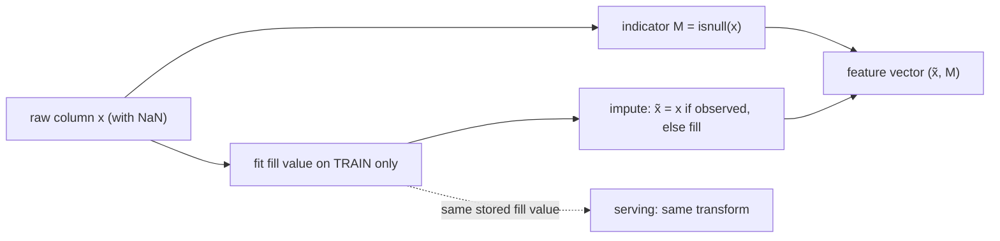

Real tables have holes. A customer skipped the income field, a sensor dropped a
reading, a join found no match. Most models cannot consume a `NaN`, so something
has to fill the hole before training, and the same something has to fill it the
same way at serving time. The fill is called **imputation**. It looks like a
cleaning chore, but it changes the statistics of the feature, and depending on
*why* the value is missing it can either be harmless or throw away the most
predictive fact in the row: that the value was missing at all.

## Why a value is missing

Write $x$ for a feature and $M$ for its **missingness indicator**: $M = 1$ when
$x$ is missing in a row and $M = 0$ when it is observed. Rubin's classification
sorts missing data by what $M$ depends on<FN n="1" />:

- **Missing completely at random (MCAR).** $M$ is independent of everything,
  observed or not. A logging bug that drops 5% of rows at random is MCAR. The
  observed rows are then a random subsample, so their mean and variance are
  unbiased estimates of the full population's.
- **Missing at random (MAR).** $M$ depends only on *other observed* columns.
  Younger customers skip the income question more often, and age is recorded.
  Within each age group the observed incomes are still representative.
- **Missing not at random (MNAR).** $M$ depends on the missing value itself.
  High earners skip the income question *because* their income is high. The
  observed incomes are now biased low, and no amount of reweighting the
  observed columns fixes it.

The classification is about the mechanism, which you usually cannot test from
the data alone. It matters because the cheap fixes are only safe under MCAR, and
the most common production case, a field a person chose not to fill, is often
MNAR.

## What mean imputation does to the statistics

**Mean imputation** replaces every missing $x$ with $\bar{x}_o$, the mean of the
observed values. Take $N$ rows, of which a fraction $p$ are missing, so
$n_o = (1-p)N$ are observed. Write $\tilde{x}_i$ for the imputed column and use the
$1/N$ convention for variances throughout.

**Step 1. The mean is preserved.** The imputed column's mean is

$$
\bar{\tilde{x}} = \frac{1}{N}\Big(\sum_{i \in \text{obs}} x_i + pN\,\bar{x}_o\Big)
= \frac{1}{N}\big(n_o\bar{x}_o + pN\bar{x}_o\big) = \bar{x}_o,
$$

using $\sum_{\text{obs}} x_i = n_o\bar{x}_o$ and $n_o + pN = N$.

**Step 2. The variance shrinks by $(1-p)$.** Every imputed row sits exactly at the
mean, so it contributes zero to the sum of squared deviations:

$$
\operatorname{Var}(\tilde{x}) = \frac{1}{N}\sum_{i \in \text{obs}} (x_i - \bar{x}_o)^2
= \frac{n_o}{N}\cdot\frac{1}{n_o}\sum_{i \in \text{obs}} (x_i - \bar{x}_o)^2
= (1-p)\, s_o^2,
$$

where $s_o^2$ is the variance of the observed values. This is an identity, not an
approximation: impute 30% of a column with its mean and its variance drops to
70% of the observed variance.

**Step 3. The covariance with the target shrinks by $(1-p)$ too.** Let $y$ be a
fully observed target. Imputed rows have $\tilde{x}_i - \bar{x}_o = 0$, so they
drop out of the covariance as well:

$$
\operatorname{Cov}(\tilde{x}, y) = \frac{1}{N}\sum_{i \in \text{obs}} (x_i - \bar{x}_o)(y_i - \bar{y})
= (1-p)\,c_o,
$$

where $c_o$ is the covariance computed on the observed rows. (Replacing $\bar{y}$
by the observed-row mean $\bar{y}_o$ changes nothing, because
$\sum_{\text{obs}}(x_i - \bar{x}_o) = 0$.)

**Step 4. The correlation attenuates by $\sqrt{1-p}$.** Divide the covariance by
the two standard deviations:

$$
\rho(\tilde{x}, y) = \frac{(1-p)\,c_o}{\sqrt{(1-p)s_o^2}\;\sigma_y}
= \sqrt{1-p}\;\frac{c_o}{s_o\,\sigma_y}.
$$

Under MCAR the observed rows are representative, so $c_o/(s_o\sigma_y)$ estimates
the true correlation $\rho$ and the imputed feature reads as
$\sqrt{1-p}\,\rho$. Some reference values:

- $p = 0.05$: correlation kept at $\sqrt{0.95} \approx 0.97$ of its value. Harmless.
- $p = 0.30$: $\sqrt{0.70} \approx 0.84$. A feature with $\rho = 0.8$ looks like $0.67$.
- $p = 0.75$: $\sqrt{0.25} = 0.5$. Half the linear signal is gone<FN n="2" />.


Two contrasting choices sit next to the mean. **Median imputation** fills with the
observed median, which resists outliers in a skewed column such as income, and
the variance still shrinks for the same reason (the imputed rows all sit at one
value). **Mode imputation** fills a categorical column with its most frequent
level, which inflates that level's share by $p$ times the other levels' share.

## The indicator keeps what imputation erases

Under MNAR, the fact that $x$ is missing is information about $y$. If high
earners skip the income field and high earners rarely default, then "income is
missing" predicts "will not default". Mean imputation erases that: a missing row
becomes indistinguishable from an observed row that happens to equal
$\bar{x}_o$. Worse, $\bar{x}_o$ is itself biased low, since the missing incomes
were the high ones.

The fix is to add the indicator $M$ as its own feature, so the model sees both
the filled value and the flag:

$$
x \;\longrightarrow\; \big(\tilde{x},\; M\big).
$$

A linear model can then learn a separate offset for the missing rows, and a tree
can split on $M$ directly. The indicator is cheap, it costs nothing under MCAR
(the model learns a near-zero weight), and it recovers the signal under MNAR<FN n="3" />. One
ordering rule follows: **compute $M$ before imputing**. Once the hole is filled,
nothing in the column records which rows were filled.

The fill value is a fitted parameter, exactly like the mean of a standardizer in
[feature engineering](/pillar/I/I1/feature-engineering). It is learned on the
training split only, stored with the pipeline, and reused unchanged at serving
time. Recomputing $\bar{x}_o$ on each serving batch would make the same raw
input map to different features on different days.



**In practice.** scikit-learn's `SimpleImputer(strategy="mean", add_indicator=True)`
emits the imputed columns and the indicators in one step. Spark ML's `Imputer`
is an estimator: `fit` on the training DataFrame learns the fill values (exposed
as `surrogateDF`) and the fitted model is a stage in the saved pipeline, so
serving applies the training-time values. The indicator column is built with an
`isNull` expression *before* the `Imputer` stage.

## Worked example

The block checks the $(1-p)$ variance identity and the $\sqrt{1-p}$ attenuation
under MCAR, then builds an MNAR column and shows the indicator recovering the
signal that imputation alone loses.

```python
import numpy as np
rng = np.random.default_rng(0)
N = 20000
x = rng.normal(50, 10, N)                          # e.g. monthly income
y = 0.8 * (x - 50) / 10 + rng.normal(0, 0.6, N)    # target linearly tied to x

# MCAR: 30% of rows missing, independent of everything
miss = rng.random(N) < 0.3
p = miss.mean()
fill = x[~miss].mean()                  # the imputer's fitted value
xi = np.where(miss, fill, x)

var_ratio = xi.var() / x[~miss].var()
r_true, r_imp = np.corrcoef(x, y)[0, 1], np.corrcoef(xi, y)[0, 1]
print(f"missing share        p = {p:.3f}")
print(f"variance ratio         = {var_ratio:.3f}   (1 - p = {1 - p:.3f})")
print(f"corr true / imputed    = {r_true:.3f} / {r_imp:.3f}   sqrt(1-p)*r = {np.sqrt(1 - p) * r_true:.3f}")
assert np.isclose(var_ratio, 1 - p)
assert abs(r_imp - np.sqrt(1 - p) * r_true) < 0.01

# MNAR: the higher the income, the more likely it is left blank
miss2 = rng.random(N) < 1 / (1 + np.exp(-(x - 60) / 3))
fill2 = x[~miss2].mean()
xi2 = np.where(miss2, fill2, x)
ind = miss2.astype(float)               # indicator computed BEFORE imputing

def r2(cols):
    X = np.column_stack([np.ones(N)] + cols)
    _, sse, *_ = np.linalg.lstsq(X, y, rcond=None)
    return 1 - sse[0] / ((y - y.mean()) ** 2).sum()

print(f"MNAR: observed mean {fill2:.2f} vs true mean {x.mean():.2f}")
print(f"R^2 imputed only = {r2([xi2]):.3f}   imputed + indicator = {r2([xi2, ind]):.3f}")
assert fill2 < x.mean() - 2            # the fill value is biased low under MNAR
assert r2([xi2, ind]) > r2([xi2]) + 0.05
```

The variance ratio matches $1 - p$ to every printed digit, the imputed
correlation lands on $\sqrt{1-p}\,\rho$, and under MNAR the indicator lifts the
explained variance from about $0.35$ to about $0.59$ because it tells the model
which rows were the high earners.

## Exercises

**Exercise 1.** A column has 1,000 rows, of which 200 are missing. The 800
observed values have variance $s_o^2 = 25$ (computed with $1/800$). After mean
imputation, what is the variance of the full 1,000-row column (with $1/1000$)? By
what factor does the correlation with a fully observed target change under MCAR?

<details>
<summary>Solution</summary>

**Step 1.** The missing fraction is $p = 200/1000 = 0.2$.

**Step 2.** By the identity of Step 2, the imputed variance is

$$
(1-p)\,s_o^2 = 0.8 \times 25 = 20.
$$

Check directly: the 800 observed rows contribute $800 \times 25 = 20{,}000$ to the
sum of squared deviations, the 200 imputed rows contribute $0$, and
$20{,}000/1000 = 20$.

**Step 3.** The correlation is multiplied by $\sqrt{1-p} = \sqrt{0.8} \approx 0.894$,
so a true correlation of $0.5$ reads as about $0.447$.

</details>

**Exercise 2.** A categorical column `channel` has observed shares
`web` 0.6, `app` 0.3, `branch` 0.1, and 25% of rows are missing completely at
random. After mode imputation, what are the three shares in the full column? Which
share is now wrong as an estimate of the true distribution, and by how much?

<details>
<summary>Solution</summary>

**Step 1.** The mode is `web`. The 75% observed rows split as
$0.75 \times (0.6, 0.3, 0.1) = (0.45, 0.225, 0.075)$.

**Step 2.** The 25% missing rows all become `web`:

$$
\text{web} = 0.45 + 0.25 = 0.70, \quad \text{app} = 0.225, \quad \text{branch} = 0.075.
$$

**Step 3.** Under MCAR the true shares are the observed ones, $(0.6, 0.3, 0.1)$.
`web` is overstated by $0.10$, and the other two are understated by
$0.075$ and $0.025$, i.e. each shrinks by the factor $0.75 = 1 - p$. The mode gains
exactly what the others lose: $p \times (1 - 0.6) = 0.25 \times 0.4 = 0.10$.

</details>

**Exercise 3 (code).** The imputer must be fitted on the training split. Simulate
a column whose distribution drifts upward over time (values from later rows are
larger), split the first 70% of rows as train and the rest as test, and inject 30%
MCAR gaps. Compare the fill value learned on train with the one you would get by
(wrongly) fitting on train and test together, and confirm the leaky fill value is
pulled toward the test period.

<details>
<summary>Solution</summary>

```python
import numpy as np
rng = np.random.default_rng(3)
N = 10000
t = np.arange(N)
x = rng.normal(0, 1, N) + 2.0 * t / N        # mean drifts from 0 to 2 over time
miss = rng.random(N) < 0.3
cut = int(0.7 * N)
train, test = slice(0, cut), slice(cut, N)

fill_train = x[train][~miss[train]].mean()            # correct: train only
fill_leaky = x[~miss].mean()                          # wrong: sees test rows
test_mean = x[test][~miss[test]].mean()
print(f"fill (train only) = {fill_train:.3f}")
print(f"fill (leaky)      = {fill_leaky:.3f}")
print(f"test-period mean  = {test_mean:.3f}")
assert fill_train < fill_leaky < test_mean
```

The train-only fill value is about $0.7$, the mean of the first 70% of the
drift. Fitting on everything moves it toward the test-period mean, so the test
rows' imputed values carry information from the test period itself, which is the
same leak as fitting a standardizer on the full dataset.

</details>

The next lesson handles the other column type that breaks in production:
[categoricals whose levels change](/pillar/I/I1/categorical-encoding-production)
between training and serving.

<Footnotes>
  <FNItem n="1">**Rubin, D. B.** (1976). "Inference and missing data". *Biometrika*, 63(3), 581-592. [doi:10.1093/biomet/63.3.581](https://doi.org/10.1093/biomet/63.3.581)</FNItem>
  <FNItem n="2">**Little, R. J. A., & Rubin, D. B.** (2019). *Statistical Analysis with Missing Data* (3rd ed.). Wiley. Single imputation and its effect on variances and correlations.</FNItem>
  <FNItem n="3">**van Buuren, S.** (2018). *Flexible Imputation of Missing Data* (2nd ed.). CRC Press. The missingness indicator method and when it is safe.</FNItem>
</Footnotes>
