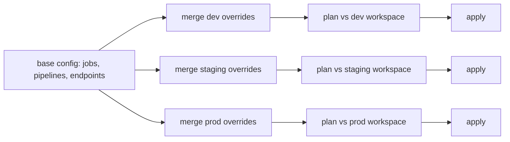

Under [deploy code](/pillar/I/I2/deploy-code-vs-model), the same pipeline has to
exist in development, staging, and production: the training job, the scoring
job, the serving endpoint, their schedules and cluster sizes. Clicking them
together in each workspace's UI produces three environments that drift apart
within a month. Writing a script that calls `create_job` works once and then
fails, or duplicates the job, on the second run. **Declarative deployment**
replaces both with one idea: write down what should exist, and let a tool compute
and perform whatever changes make reality match<FN n="1" />.

## Desired state and actual state

The **desired state** $D$ is a configuration file in version control that lists
resources by a stable key (`jobs/train`, `endpoints/churn`) with their full
specification. The **actual state** $A$ is what exists in the target environment,
read from its API. The tool also keeps a record $O$ of the keys it **owns**,
meaning the resources it created, so it can tell its own resources from ones a
person made by hand.

An imperative script says *do this*: create a job, then set its schedule. A
declarative configuration says *this should be true*: a job named `train` with
this schedule exists. The difference shows on the second run. The script
repeats its actions; the declarative tool finds nothing to do.

## The plan is a difference

Treat $D$ and $A$ as maps from keys to specifications. The **plan** is three sets:

$$
\begin{aligned}
\text{create} &= \{k \in D : k \notin A\},\\
\text{update} &= \{k \in D : k \in A,\ A[k] \ne D[k]\},\\
\text{delete} &= \{k \in O : k \in A,\ k \notin D\}.
\end{aligned}
$$

**Apply** performs the plan: for every key in create or update, set
$A[k] \leftarrow D[k]$; for every key in delete, remove it; then set $O$ to the
keys of $D$.

**Step 1. After apply, every desired key matches.** A key $k \in D$ was either
missing from $A$ (created with spec $D[k]$), present with a different spec
(updated to $D[k]$), or already equal to $D[k]$ (left alone). In all three cases
$A'[k] = D[k]$.

**Step 2. After apply, no owned key is left over.** An owned key not in $D$ that
was in $A$ was deleted. The new ownership set is $O' = \text{keys}(D)$, so every
owned key is now desired.

**Step 3. A second plan is empty.** For $(D, A', O')$: create is empty because
every $k \in D$ is in $A'$ (Step 1); update is empty because $A'[k] = D[k]$
(Step 1); delete is empty because every $k \in O'$ is in $D$ (Step 2). So

$$
\operatorname{apply}(\operatorname{apply}(A)) = \operatorname{apply}(A),
$$

which is **idempotence**: running the deployment again is safe, and rerunning
it after a failure resumes rather than duplicates. It is the same property that
makes a [pipeline task](/pillar/I/I1/orchestration-dags) safe to retry.

**Step 4. Unowned resources are never deleted.** The delete set is drawn from $O$,
not from $A$. A report job someone created by hand in production is in $A$ but
not in $O$, so no plan ever removes it. Without the ownership record, the only
safe rule would be to never delete anything, and removed resources would pile up.

The plan also detects **configuration drift**. If someone edits the production
training job by hand (doubles its cluster, changes its schedule), the next plan
lists `jobs/train` under update, and apply puts it back. Reading the plan before
applying it is the review step: a pull request that changes a schedule shows a
one-line update, while a typo in a key shows up as a create plus a delete.

## One definition, several targets

Environments differ in a few values: production uses bigger clusters, sends
failure alerts to on-call, keeps the endpoint warm. A **target** is a set of
overrides that is deep-merged into the base configuration, so the definition is
written once:



A **deep merge** walks both trees: where both sides have a nested mapping it
merges them key by key, and anywhere else the override's value wins. Overriding
`jobs.train.cluster.workers` changes only that number and keeps the rest of the
job's spec from the base.

**In practice.** Terraform popularized the `plan` / `apply` pair for cloud
infrastructure, and Kubernetes runs the same reconciliation as a loop that
compares desired and observed state continuously<FN n="2" />. On Databricks the
tool is **bundles** (named Declarative Automation Bundles in current docs,
formerly Databricks Asset Bundles): a `databricks.yml` declares jobs, pipelines,
model-serving endpoints, and other resources, with a `targets:` section for
`dev`, `staging`, and `prod`. `databricks bundle validate` checks the file,
`databricks bundle deploy -t prod` reconciles the production workspace, and
`databricks bundle run` starts a job. A CI pipeline runs the deploy on merge, so
nobody needs write access to production to change it.

## Worked example

The block implements deep merge, plan, and apply on plain dictionaries, deploys a
production target, and checks idempotence, drift repair, ownership, and deletion.

```python
import copy

def deep_merge(base, override):
    out = copy.deepcopy(base)
    for k, v in override.items():
        if isinstance(v, dict) and isinstance(out.get(k), dict):
            out[k] = deep_merge(out[k], v)
        else:
            out[k] = copy.deepcopy(v)
    return out

def flatten(cfg):                      # {"jobs": {"train": spec}} -> {"jobs/train": spec}
    return {f"{kind}/{name}": spec for kind, items in cfg.items() for name, spec in items.items()}

def plan(desired, actual, owned):
    d = flatten(desired)
    return {
        "create": sorted(k for k in d if k not in actual),
        "update": sorted(k for k in d if k in actual and actual[k] != d[k]),
        "delete": sorted(k for k in owned if k in actual and k not in d),
    }

def apply(desired, actual, owned):
    d, p = flatten(desired), plan(desired, actual, owned)
    new = dict(actual)
    for k in p["create"] + p["update"]:
        new[k] = copy.deepcopy(d[k])
    for k in p["delete"]:
        del new[k]
    return new, set(d)

base = {
    "jobs": {
        "train": {"schedule": "0 3 * * 1", "cluster": {"workers": 2}, "notify": []},
        "score": {"schedule": "0 5 * * *", "cluster": {"workers": 2}, "notify": []},
    },
    "endpoints": {"churn": {"model": "ml.churn@champion", "scale_to_zero": True}},
}
prod_overrides = {
    "jobs": {"train": {"cluster": {"workers": 8}, "notify": ["ml-oncall"]},
             "score": {"cluster": {"workers": 8}}},
    "endpoints": {"churn": {"scale_to_zero": False}},
}
prod = deep_merge(base, prod_overrides)
assert prod["jobs"]["train"]["schedule"] == "0 3 * * 1"      # kept from base
assert prod["jobs"]["train"]["cluster"]["workers"] == 8      # overridden

actual = {"jobs/legacy-report": {"schedule": "0 9 * * *"}}   # made by hand, not owned
owned = set()

print("first deploy :", plan(prod, actual, owned))
actual, owned = apply(prod, actual, owned)
p2 = plan(prod, actual, owned)
print("second deploy:", p2)
assert p2 == {"create": [], "update": [], "delete": []}      # idempotent

actual["jobs/train"]["cluster"]["workers"] = 2               # someone edits prod by hand
print("after drift  :", plan(prod, actual, owned))
assert plan(prod, actual, owned)["update"] == ["jobs/train"]
actual, owned = apply(prod, actual, owned)

del prod["jobs"]["score"]                                    # remove a job from the config
print("after removal:", plan(prod, actual, owned))
actual, owned = apply(prod, actual, owned)
assert "jobs/score" not in actual and "jobs/legacy-report" in actual
```

The first deploy creates the three resources and leaves the hand-made report
alone; the second deploy finds nothing to do; a manual edit shows up as one update
and is repaired; and removing `score` from the configuration deletes that job
while the unowned report survives.

## Exercises

**Exercise 1.** The desired state is $D = \{a{:}1, b{:}2, c{:}3\}$, the actual state is
$A = \{a{:}1, b{:}5, d{:}4, e{:}7\}$, and the owned set is $O = \{a, b, d\}$. Compute the
plan, the state after apply, and the new owned set.

<details>
<summary>Solution</summary>

**Step 1. Create.** Keys of $D$ not in $A$: $\{c\}$.

**Step 2. Update.** Keys of $D$ in $A$ with a different value: $b$ ($5 \ne 2$). $a$ is
equal, so it is left alone. Update $= \{b\}$.

**Step 3. Delete.** Owned keys in $A$ but not in $D$: $d$. The key $e$ is in $A$ and not
in $D$, but it is not owned, so it stays. Delete $= \{d\}$.

**Step 4.** After apply, $A' = \{a{:}1, b{:}2, c{:}3, e{:}7\}$ and $O' = \{a, b, c\}$. A
second plan is empty: every key of $D$ is in $A'$ with its desired value, and every
owned key is desired.

</details>

**Exercise 2.** A teammate proposes dropping the owned set and deleting every key in
$A$ that is not in $D$, "so production only contains what is in git". Give a
concrete failure this causes on the first deploy to an existing production
workspace, and explain why the owned set is the fix.

<details>
<summary>Solution</summary>

**Step 1.** On the first deploy, $A$ contains everything that already exists in
production: jobs created by other teams, a hand-made monitoring dashboard, the
current serving endpoint someone built before the project adopted declarative
deployment. None of them is in $D$.

**Step 2.** With the proposed rule, the first plan's delete set is all of them,
and apply removes other teams' jobs and the live endpoint. The deploy "succeeds"
and takes production down.

**Step 3.** The owned set restricts deletion to resources the tool itself created.
Pre-existing resources are never owned, so they can only be adopted explicitly
(imported into the configuration), never removed by surprise. The property in
Step 4 of the lesson is what makes declarative deployment safe to introduce into
an environment that already has things in it.

</details>

**Exercise 3 (code).** Write `diff_paths(a, b)` that lists the dotted paths where
two nested configurations differ, so a plan's update can say *what* changed (for
example `cluster.workers`) instead of only *which* resource. Check it on the
production and base specs of the `train` job from the worked example.

<details>
<summary>Solution</summary>

```python
def diff_paths(a, b, prefix=""):
    paths = []
    for k in sorted(set(a) | set(b)):
        here = f"{prefix}{k}"
        if k not in a or k not in b:
            paths.append(here)
        elif isinstance(a[k], dict) and isinstance(b[k], dict):
            paths += diff_paths(a[k], b[k], here + ".")
        elif a[k] != b[k]:
            paths.append(here)
    return paths

base_train = {"schedule": "0 3 * * 1", "cluster": {"workers": 2}, "notify": []}
prod_train = {"schedule": "0 3 * * 1", "cluster": {"workers": 8}, "notify": ["ml-oncall"]}
changes = diff_paths(base_train, prod_train)
print(changes)
assert changes == ["cluster.workers", "notify"]
assert diff_paths(prod_train, prod_train) == []
```

The recursion descends wherever both sides hold a mapping and reports a path
wherever a value differs or a key exists on one side only. This is the
field-level view that `plan` output shows a reviewer.

</details>

With environments and their resources reproducible, the next lessons return to
the training loop itself, beginning with how to
[search hyperparameters](/pillar/I/I2/hyperparameter-search).

<Footnotes>
  <FNItem n="1">**Morris, K.** (2020). *Infrastructure as Code: Dynamic Systems for the Cloud Age* (2nd ed.). O'Reilly. Declarative definitions, idempotent application, and configuration drift.</FNItem>
  <FNItem n="2">**Burns, B., Grant, B., Oppenheimer, D., Brewer, E., & Wilkes, J.** (2016). "Borg, Omega, and Kubernetes". *ACM Queue*, 14(1). [doi:10.1145/2898442.2898444](https://doi.org/10.1145/2898442.2898444)</FNItem>
</Footnotes>
