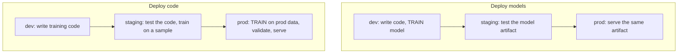

A [model registry](/pillar/I/I2/model-registry) gives every model a version and
[CI/CD](/pillar/I/I2/ml-cicd) puts gates in front of a release. One decision is
still open: *what* moves from one environment to the next. In ordinary software
the answer is the build artifact, compiled once and promoted unchanged. In ML
there are two candidate artifacts, the trained model and the code that trains it,
and picking the wrong one leaves a team retraining by hand in a notebook, or
granting a development workspace read access to production customer data. This
lesson sets out the environments and the two promotion patterns, plus a hybrid,
and the questions that decide between them<FN n="1" />.

## Three environments

An **environment** is a set of compute, storage, permissions, and data that a
stage of the lifecycle runs in. Three is the usual count:

- **Development.** Where data scientists explore and write code. Broad freedom,
  narrow data: samples, masked or synthetic data, or read-only access to a
  subset.
- **Staging.** A production-like copy where the pipeline is tested end to end:
  integration tests, load tests, and the model tests of CI. Nobody depends on
  its output.
- **Production.** Real data, real traffic, restricted write access. Only automated
  pipelines and a few service principals change things here.

The separation can be **direct**, with one workspace (or cloud account) per
environment and hard boundaries between them, or **indirect**, with one shared
workspace in which the environments are separated by access control and naming,
for example three catalogs `dev`, `staging`, `prod` with different grants. Direct
separation is stronger isolation; indirect is cheaper to run and simpler for a
small team.

## Two things you can promote

**Deploy models.** The model is trained in development, registered, and the
trained artifact is promoted through staging to production, where it is served
unchanged. Training happens once. This is the natural fit when training is very
expensive (a large model trained over days) or rare (a model retrained once a
year), so repeating it per environment would be waste. Its costs are elsewhere:
development must see production-quality data to train a useful model, the
training code itself never runs in production and so is never tested there, and
every retraining goes back through a person in development.

**Deploy code.** The *training pipeline* is what gets promoted. Development writes
and tests the code on development data; staging runs it end to end on a sample to
prove it works; production runs the same code on production data, trains the
model there, validates it, and promotes it to serving within production. The
model artifact never crosses an environment boundary. Production data never
leaves production, retraining is an automated production job rather than a
person's task, and the code that trained the serving model is the reviewed code
in version control. The price is that training runs in staging (on a sample) and
again in production, and that data scientists cannot iterate directly on full
production data.

**Hybrid.** Train in staging with read-only access to production data, then
promote the trained model to production. It keeps production writes restricted
and trains once on real data, at the cost of a staging environment that can read
production.

## Choosing

Four questions settle it in most teams:

| Question | Points toward deploy models | Points toward deploy code |
|---|---|---|
| How expensive is one training run? | days of GPU time | minutes to hours |
| How often do you retrain? | rarely, by hand | on a schedule or on drift |
| May development read production data? | yes | no (regulated, PII) |
| Who owns retraining? | the data scientist | the platform, automatically |

For most tabular and classical models, training is cheap relative to the cost of
a governance breach or a stale model, retraining is frequent, and production
data is restricted, so **deploy code** is the default that platform vendors
recommend, Databricks among them<FN n="2" />. Deploy models remains the right
choice for large models where a training run is a project in itself, and for
models obtained from outside (a vendor's model, a pretrained checkpoint) where
there is no training code to promote.

Under deploy code, the [automated retraining](/pillar/I/I4/automated-retraining)
job and the champion-versus-challenger check run inside production, and the
registry alias that serving reads is moved by that job, not by a person. Under
deploy models, the same alias move happens after a person promotes an artifact
built elsewhere, so the registry's audit log records a human action. Both are
sound; they put the trust in different places<FN n="3" />.

## Exercises

**Exercise 1.** A credit-risk team retrains a gradient-boosted model every week on
the latest repayments. One training run takes 40 minutes. Regulation forbids the
development workspace from reading unmasked customer records. Which promotion
pattern fits, and what runs in each environment?

Solution

**Step 1.** Check the four questions: training is cheap (40 minutes), retraining
is frequent (weekly) and should be automated, and development may not read
production data. Every answer points to **deploy code**.

**Step 2.** Development: write the feature and training pipeline, test it on masked
or synthetic data, open a pull request. Staging: CI deploys the pipeline, runs
it end to end on a masked sample, and runs the data and model tests, which proves
the code works without producing the serving model. Production: a weekly job
runs the same code on real data, trains the candidate, compares it with the
current champion, and moves the serving alias if it wins.

**Step 3.** The serving model was trained on production data by reviewed code,
and no customer record ever reached development. A deploy-models setup would
need development to train on real data, which the regulation rules out.

**Exercise 2.** One full training run costs 300 compute units on full data, and
staging trains on a 10% sample at a tenth of the cost. Compare monthly training
cost for deploy models (one dev run per retrain, then the artifact is promoted)
and deploy code (one staging run per code change, one production run per
retrain) for (a) 4 retrains and 2 code changes a month, and (b) 1 retrain and
1 code change a year, expressed per month. Then explain why cost rarely decides it.

Solution

**Step 1. Case (a).** Deploy models: $4 \times 300 = 1{,}200$ units, since each
retrain is a full run in development. Deploy code: staging
$2 \times 30 = 60$ plus production $4 \times 300 = 1{,}200$, total $1{,}260$.

**Step 2. Case (b), per month.** Deploy models: $300/12 = 25$. Deploy code:
$(30 + 300)/12 = 27.5$.

**Step 3.** In both cases deploy code costs about $5$ to $10\%$ more, the price of
the staging run. That gap only matters when one run is very expensive. Otherwise
the deciding factors are the ones the cost model leaves out: whether development
may hold production data, and whether retraining needs a person.

**Exercise 3.** A team using deploy models trains in development on a snapshot
exported from production three months ago, promotes the artifact, and finds that
production accuracy is well below what the model scored in staging. Name two
mechanisms that produce this gap under deploy models specifically, and say how
deploy code removes each.

Solution

**Step 1. Stale data.** The model learned a three-month-old world. Staging tests
were run on the same snapshot, so they agreed with the training set and missed
the drift. Under deploy code, production trains on current production data at
each retrain, so the training distribution is as recent as the job's schedule.

**Step 2. Environment mismatch.** Features were computed by development's copy of
the transformation code and libraries, which may differ from what production
uses at inference (a different library version, a different join), a form of
training-serving skew. Under deploy code, training and the inference pipeline both
run from the same promoted code in the same environment, so the features the model
learned from are computed the same way as the features it scores.

**Step 3.** Both mechanisms come from the model being built somewhere other than
where it runs. Deploy code moves training to where the model runs, which is its
main argument.

The next lesson makes the environments themselves reproducible, describing jobs,
pipelines, and endpoints as code that a tool reconciles against each environment:
[declarative deployment](/pillar/I/I2/declarative-deployment).

<Footnotes>
  <FNItem n="1">**Kreuzberger, D., Kühl, N., & Hirschl, S.** (2023). "Machine learning operations (MLOps): Overview, definition, and architecture". *IEEE Access*, 11. [arXiv:2205.02302](https://arxiv.org/abs/2205.02302)</FNItem>
  <FNItem n="2">**Databricks** (2023). *The Big Book of MLOps* (2nd ed.). Databricks. Development, staging, and production environments, and the deploy-code pattern as the recommended default.</FNItem>
  <FNItem n="3">**Google Cloud** (2020). "MLOps: Continuous delivery and automation pipelines in machine learning". Google Cloud Architecture Center. Automated training pipelines in production (MLOps level 1).</FNItem>
</Footnotes>
