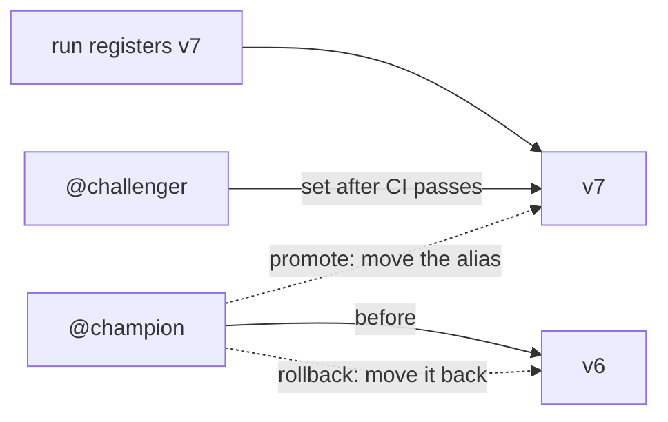

[Experiment tracking](/pillar/I/I2/experiment-tracking) answers *which run produced
this result*. The **model registry** answers the next question a team faces:
*which model is in production right now, and how do I change it safely?* A registry
is a catalog of trained-model **artifacts**, each one immutable and versioned, plus
a small set of named **aliases** (such as `champion` and `challenger`) that point
at versions. Deployment becomes a metadata operation, moving `champion` from
version 6 to version 7, rather than a rebuild, and that one indirection buys
auditability and instant rollback<FN n="1" />.

## A version is an immutable artifact, not a file

When a training run finishes, you do not "save the model" over the last one. You
**register a new version**: a frozen bundle of the serialized weights, the input
and output **signature** (the schema the server validates requests against), the
exact environment (library versions, so it deserializes the same way in two
years), and a back-pointer to the [experiment run](/pillar/I/I2/experiment-tracking)
and [data version](/pillar/I/I1/data-versioning) that produced it. Versions are
append-only and numbered; you never mutate version 6, you register version 7. That
immutability is what makes rollback trivial: the previous good artifact still
exists, untouched.

## Aliases turn a deploy into a pointer swap

An **alias** is a mutable, named pointer to exactly one version of a model. The
serving layer is configured to load *whatever version the `champion` alias points
at*, through a URI such as `models:/ml.credit.default_model@champion`, so it never
hard-codes a version number. Promotion and rollback are then the same operation,
repointing a name:

Promotion and rollback are both one write to the registry, followed by the
consumers picking it up. A consumer resolves the alias when it **loads** the
model, not continuously: a batch job reads `@champion` at the start of its next
run, while a long-running server or a managed serving endpoint keeps the version
it loaded until it reloads or its configuration is updated. A deployment job
therefore usually pairs the alias move with an endpoint update (or a restart) that
re-resolves it. What the indirection removes is the rebuild and the retrain: the
artifact for v6 or v7 already exists, and every consumer finds the right one by
name. The [incident review](/pillar/I/I4/slos-and-error-budgets) question, which
model served a given request, is answered by the
[inference log](/pillar/I/I4/sliced-monitoring), which records the version each
request actually used.

Aliases are free-form and a version can carry several (`champion` and `v2025-q4`
at once), so a team names them after the roles its pipeline actually has. Facts
*about* a version that are not pointers, such as `validation_status = passed` or
the reviewer's name, go in **tags**, key-value metadata attached to the version.

**Aliases replaced stages.** Older registries, including MLflow's original
workspace registry, used a fixed set of **stages** (`None`, `Staging`,
`Production`, `Archived`) that a version moved through. Stages hard-wired one
lifecycle into the tool and allowed only one meaning per name. MLflow has
deprecated stages in favor of aliases and tags, and the Unity Catalog model
registry supports only aliases<FN n="2" />. The idea is unchanged, a label the
server follows, but the label is now chosen by the team and can be as many as it
needs. Environments are expressed separately, for example by registering the
model under a `prod` catalog rather than by a stage name.

## Why the gate matters

Moving an alias is cheap, so something must stand in front of the move. Each
promotion is a **gate** where automated checks must pass first. A version receives
the `challenger` alias only after the test suite of the
[next lesson](/pillar/I/I2/ml-cicd) passes: schema validation, a behavioral
threshold on a held-out set. It receives `champion` only after it beats the
current champion on the comparison the team agreed on. The registry is the spine
those checks hang off: it gives every candidate a stable identity to test,
promote, serve, and, when something regresses, fall back from<FN n="3" />.

## Exercises

**Exercise 1.** A team currently deploys by overwriting `model.pkl` on the serving
host with each new training run, and the serving code loads that fixed filename.
Production starts returning bad predictions an hour after the latest deploy. Walk
through why rollback is hard under this scheme, then describe how a registry with
immutable versions and a `champion` alias turns the same rollback into a single
safe operation.

Solution

**Step 1.** Overwriting `model.pkl` destroys the previous artifact. The known-good
model no longer exists on disk, so rolling back means re-running training (slow,
and not guaranteed to reproduce the old weights without the full lineage) or
hunting for a backup that may not have been kept.

**Step 2.** A registry registers each run as a new immutable version (v6, v7, ...)
and never mutates an existing one. The previous good artifact, v6, is still present
and untouched when v7 is registered.

**Step 3.** The serving layer loads `models:/<name>@champion` rather than a
hard-coded filename. Rollback is moving `champion` from v7 back to v6 and then
having the server re-resolve the alias (a reload or an endpoint update). No
rebuild and no retrain are needed, because v6 still exists exactly as it was.

**Exercise 2.** Two properties are bundled into a registered version: it is
**immutable** (never edited after registration) and it is **versioned**
(append-only, numbered). Argue why immutability alone, without versioning, would
not give you rollback, and why versioning alone, without immutability, would not
give you a trustworthy audit trail. What does each property contribute?

Solution

**Step 1.** Immutability without versioning: if there is only ever one slot that you
refuse to edit, then to ship a new model you must replace the artifact in that
slot, which destroys the old one. There is nothing to roll back to. Immutability
protects a *given* artifact but does not by itself keep the *history* of
artifacts.

**Step 2.** Versioning without immutability: numbered versions exist, but if v6 can
be edited in place after registration, then the artifact an alias points at can
silently change. An auditor reading "v6 served this request" cannot trust that the
current v6 is the v6 that actually served it. The trail is unreliable.

**Step 3.** Immutability guarantees each version's bytes never change; versioning
keeps every version around under a stable number. Together they give a frozen,
complete history: any past champion still exists exactly as it served, which is
what makes both rollback and audit sound. Note where mutability lives: in the
aliases, which are pointers, never in the versions.

**Exercise 3.** Design the aliases, tags, and gates for a team that needs a human
sign-off before any model reaches users, on top of the automated CI checks. Say
which alias moves are automated and which require a person, and explain how the
audit trail supports a later incident review that asks "which model served
request X at time T, and who approved it".

Solution

**Step 1.** Use two aliases, `challenger` and `champion`, and a tag
`approved_by`. A run registers a new version with no alias. If the automated CI
suite (schema, behavioral, threshold tests) passes, the pipeline sets
`validation_status = passed` and moves `challenger` to the version. This step is
automatic, since no user traffic depends on it.

**Step 2.** Moving `champion` to the challenger requires two things: the automated
comparison against the current champion is green, and a named reviewer approves,
which the pipeline records as the `approved_by` tag before it moves the alias.
This move is the human sign-off, so it is not automated. Rollback moves
`champion` back to a prior version, itself an audited (and optionally approved)
alias change.

**Step 3.** A registry stores the *current* alias-to-version mapping, not
necessarily a history of it (MLflow's registry, for instance, keeps only the
current mapping). The history has to be built: the pipeline writes an entry
(version, alias, timestamp, actor) to an audit table each time it moves an alias,
or the platform's audit logs capture the registry API calls. The most direct
answer to "which model served request X at time T" is the inference log, where
the serving layer records the version it used on every request. The
`approved_by` tag on that version then names who approved it, giving the incident
review both the model identity and the accountable person.

The next lesson builds the [CI/CD pipeline](/pillar/I/I2/ml-cicd) that decides
whether a registered version is allowed through the gate.

<Footnotes>
  <FNItem n="1">**Huyen, C.** (2022). *Designing Machine Learning Systems.* O'Reilly. Model versioning, promotion, and deployment as a metadata operation.</FNItem>
  <FNItem n="2">**MLflow Project** (2024). "MLflow Model Registry". MLflow documentation. Model version aliases and tags, and the deprecation of model stages.</FNItem>
  <FNItem n="3">**Sculley, D., et al.** (2015). "Hidden technical debt in machine learning systems". *NeurIPS*. Undeclared model dependencies and the value of a stable, auditable artifact identity.</FNItem>
</Footnotes>
