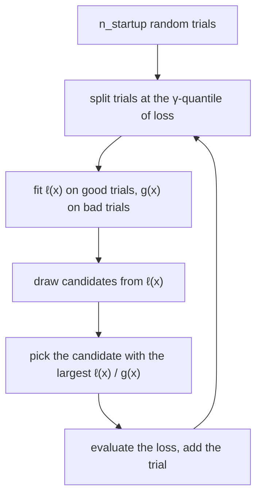

[Random search](/pillar/I/I2/hyperparameter-search) samples every trial from the
same fixed distribution, so trial 50 knows nothing that trial 1 did not.
[Bayesian optimization](/pillar/A/A3/bayesian-optimization) fixes that by fitting a
surrogate model of the loss and choosing the next trial where the expected
improvement is largest, but its usual surrogate, a Gaussian process, models the
loss *as a function of* the hyperparameters, which gets awkward with categorical
choices, conditional parameters, and a few hundred trials. The
**tree-structured Parzen estimator** (TPE) turns the problem around: instead of
modeling the loss given the hyperparameters, it models the hyperparameters given
whether the loss was good<FN n="1" />. It is the default sampler in Optuna, so it
is most likely the algorithm behind the tuning jobs you already run<FN n="2" />.

## Two densities instead of one surrogate

Write $x$ for a hyperparameter configuration and $y$ for its validation loss, to
be minimized. After $n$ trials $(x_1, y_1), \dots, (x_n, y_n)$, pick a threshold
$y^*$ at the $\gamma$-quantile of the observed losses, so a fraction $\gamma$ of
trials (for example the best $20\%$) count as **good**. TPE models

$$
p(x \mid y) =
\begin{cases}
\ell(x) & \text{if } y < y^* \quad \text{(good trials)}\\
g(x) & \text{if } y \ge y^* \quad \text{(bad trials)}.
\end{cases}
$$

Each density is a **Parzen estimator**, also called a kernel density estimate: put
a small Gaussian bump of width $h$ (the bandwidth) on every point and average,

$$
\ell(x) = \frac{1}{|\mathcal{G}|}\sum_{i \in \mathcal{G}} \frac{1}{h\sqrt{2\pi}}
\exp\!\Big(-\frac{(x - x_i)^2}{2h^2}\Big),
$$

where $\mathcal{G}$ is the set of good trials, and $g$ is the same sum over the
bad trials. "Tree-structured" refers to how the method handles conditional
spaces: a parameter that only exists under one branch of a choice (the kernel
width only when `kernel = "rbf"`) gets its own pair of densities, fitted on the
trials where that branch was taken.

## Why the ratio is the expected improvement

The **expected improvement** at threshold $y^*$ is the average amount by which a
new trial at $x$ beats $y^*$, counting zero when it does not:

$$
\mathrm{EI}_{y^*}(x) = \int_{-\infty}^{y^*} (y^* - y)\, p(y \mid x)\, dy.
$$

TPE knows $p(x \mid y)$, not $p(y \mid x)$, so the derivation uses Bayes' rule
to swap them.

**Step 1. Bayes' rule.** $p(y \mid x) = p(x \mid y)\,p(y) / p(x)$, so

$$
\mathrm{EI}_{y^*}(x) = \frac{1}{p(x)}\int_{-\infty}^{y^*} (y^* - y)\, p(x \mid y)\, p(y)\, dy.
$$

**Step 2. Inside the integral, $y < y^*$, so $p(x \mid y) = \ell(x)$.** It does not
depend on $y$ and comes out:

$$
\mathrm{EI}_{y^*}(x) = \frac{\ell(x)}{p(x)}\underbrace{\int_{-\infty}^{y^*} (y^* - y)\, p(y)\, dy}_{K}.
$$

$K$ is positive and the same for every $x$.

**Step 3. Expand $p(x)$.** By the law of total probability over good and bad, with
$P(y < y^*) = \gamma$,

$$
p(x) = \gamma\,\ell(x) + (1 - \gamma)\,g(x).
$$

**Step 4. Divide through by $\ell(x)$.**

$$
\mathrm{EI}_{y^*}(x) = \frac{K\,\ell(x)}{\gamma\,\ell(x) + (1-\gamma)\,g(x)}
= \frac{K}{\gamma + (1-\gamma)\,\dfrac{g(x)}{\ell(x)}}.
$$

The denominator falls as $g(x)/\ell(x)$ falls, so maximizing expected improvement
is the same as **maximizing the ratio $\ell(x)/g(x)$**. The surrogate never has to
predict a loss. TPE only needs to find places where good trials are dense and
bad trials are sparse.

## The algorithm



Candidates are drawn from $\ell$ itself, because the ratio is only large where
$\ell$ has mass. Each new trial updates the split, so the good region tightens as
evidence accumulates. Three numbers control the behavior. The **startup** count
of random trials (Optuna uses $10$) must be large enough for the first split to
mean anything. The fraction $\gamma$ trades exploitation for exploration: a small
$\gamma$ trusts only the very best trials. Optuna's default takes the best $10\%$
of trials, capped at $25$<FN n="3" />. The **number of candidates** per step (Optuna: $24$)
sets how hard each step searches $\ell$.


Each dimension of the space gets its own pair of one-dimensional densities in the
original algorithm, so TPE ignores interactions between hyperparameters unless
you ask for a multivariate variant. Categoricals are handled by replacing the
Gaussian bump with a smoothed frequency count over the choices.

## Direction and sign

A study has a **direction**, minimize or maximize, and an objective function that
returns a number. TPE's good set is "the smallest $\gamma$ fraction" for a
minimizing study and "the largest" for a maximizing one. The two must agree with
the metric. Returning `-f1` from the objective and minimizing is correct;
returning `-f1` and *maximizing* asks for the worst F1 on the grid, and TPE will
concentrate its trials on the configurations with the lowest F1. Nothing
errors: the study converges, the best trial is logged, and it is the worst model.
The cheap guard is to print the best trial's raw metric next to a baseline before
registering anything.

**In practice.** In Optuna, `optuna.create_study(direction="minimize")` uses
`TPESampler` unless you pass another sampler (`RandomSampler` and `GridSampler`
are the common alternatives). With MLflow, the usual layout is one **parent
run** for the study and one **child run** per trial, opened with
`mlflow.start_run(nested=True)` inside the objective, so the experiment view
groups the trials under the study and the best one can be found with a
`search_runs` query ordered by the metric.

## Worked example

The block implements one-dimensional TPE with Gaussian Parzen estimators and
compares it to random search on the same 40-trial budget, across 30 seeds.

```python
import numpy as np
LO, HI = 0.0, 10.0

def loss(x):                                   # a bumpy validation loss to minimize
    return 0.05 * (x - 7.0) ** 2 + 0.3 * np.sin(3 * x) + 0.3

def parzen(points, h):
    def density(x):
        z = (x[:, None] - points[None, :]) / h
        return np.exp(-0.5 * z ** 2).mean(axis=1) / (h * np.sqrt(2 * np.pi))
    return density

def tpe(n_trials, rng, gamma=0.2, n_startup=10, n_cand=24):
    xs = list(rng.uniform(LO, HI, n_startup))
    ys = [loss(x) for x in xs]
    while len(xs) < n_trials:
        X, Y = np.array(xs), np.array(ys)
        order = np.argsort(Y)                          # ascending: minimize
        n_good = max(1, int(np.ceil(gamma * len(X))))
        good, bad = X[order[:n_good]], X[order[n_good:]]
        h = 0.1 * (HI - LO) * len(X) ** (-0.2)         # shrink bandwidth as trials grow
        l, g = parzen(good, h), parzen(bad, h)
        cand = np.clip(rng.choice(good, n_cand) + rng.normal(0, h, n_cand), LO, HI)
        x_next = cand[np.argmax(l(cand) / (g(cand) + 1e-12))]
        xs.append(x_next)
        ys.append(loss(x_next))
    return min(ys)

def random_search(n_trials, rng):
    return loss(rng.uniform(LO, HI, n_trials)).min()

grid = np.linspace(LO, HI, 100001)
best_possible = loss(grid).min()
regret_tpe = [tpe(40, np.random.default_rng(s)) - best_possible for s in range(30)]
regret_rs = [random_search(40, np.random.default_rng(100 + s)) - best_possible for s in range(30)]
print(f"median regret after 40 trials: TPE {np.median(regret_tpe):.5f}, random {np.median(regret_rs):.5f}")
assert np.median(regret_tpe) < 0.2 * np.median(regret_rs)
```

The **regret** is the gap between the best loss a method found and the true
minimum. With the same 40 trials, TPE's median regret is more than an order of
magnitude below random search's, because after the 10 random startup trials
every new trial is drawn where $\ell/g$ is high. The mean regrets are much
closer: in a few seeds TPE locks onto a local minimum, which is the price of
exploiting, and the reason the startup trials and $\gamma$ exist.

## Exercises

**Exercise 1.** At some point in a study, a candidate $x_a$ has $\ell(x_a) = 0.30$,
$g(x_a) = 0.10$, and another candidate $x_b$ has $\ell(x_b) = 0.60$,
$g(x_b) = 0.40$. With $\gamma = 0.2$, compute $\mathrm{EI}/K$ for each from Step 4
and say which one TPE evaluates next.

<details>
<summary>Solution</summary>

**Step 1.** $\mathrm{EI}/K = 1 / (\gamma + (1-\gamma)\,g/\ell)$.

**Step 2.** For $x_a$: $g/\ell = 0.10/0.30 = 0.333$, so
$\mathrm{EI}/K = 1/(0.2 + 0.8 \times 0.333) = 1/0.4667 = 2.14$.

**Step 3.** For $x_b$: $g/\ell = 0.40/0.60 = 0.667$, so
$\mathrm{EI}/K = 1/(0.2 + 0.8 \times 0.667) = 1/0.7333 = 1.36$.

**Step 4.** TPE picks $x_a$. It has half the good-trial density of $x_b$, but the
bad trials are much sparser around it, and the ratio is what counts:
$\ell/g = 3$ against $1.5$.

</details>

**Exercise 2.** A teammate's objective returns `-f1` and the study is created with
`direction="maximize"`. The run finishes with "best value $-0.41$". The baseline
model has F1 $0.72$. Explain what the study did, what the reported number means,
and give two independent fixes.

<details>
<summary>Solution</summary>

**Step 1.** Maximizing $-\mathrm{F1}$ is minimizing F1. TPE's good set was the
trials with the *largest* $-\mathrm{F1}$, i.e. the lowest F1, so the sampler
concentrated on the worst region of the space.

**Step 2.** The best value $-0.41$ is the largest $-\mathrm{F1}$ found, so the
selected trial has F1 $= 0.41$, well below the baseline's $0.72$. The study worked
as configured; the configuration was wrong.

**Step 3.** Fix one: return `f1` and keep `direction="maximize"`. Fix two: keep
returning `-f1` and use `direction="minimize"`. Either way, the sign of the
returned number and the direction must express the same goal. Logging the raw
F1 of the best trial next to the baseline would have caught this before
registration.

</details>

**Exercise 3 (code).** Study how $\gamma$ trades exploitation for exploration.
Using the worked example's `loss` and `tpe`, run 40-trial studies over 30 seeds
for $\gamma = 0.1$ and $\gamma = 0.5$ and report the median regret of each. Then
check that both still beat random search's median regret.

<details>
<summary>Solution</summary>

```python
import numpy as np
LO, HI = 0.0, 10.0

def loss(x):
    return 0.05 * (x - 7.0) ** 2 + 0.3 * np.sin(3 * x) + 0.3

def parzen(points, h):
    def density(x):
        z = (x[:, None] - points[None, :]) / h
        return np.exp(-0.5 * z ** 2).mean(axis=1) / (h * np.sqrt(2 * np.pi))
    return density

def tpe(n_trials, rng, gamma, n_startup=10, n_cand=24):
    xs = list(rng.uniform(LO, HI, n_startup))
    ys = [loss(x) for x in xs]
    while len(xs) < n_trials:
        X, Y = np.array(xs), np.array(ys)
        order = np.argsort(Y)
        n_good = max(1, int(np.ceil(gamma * len(X))))
        good, bad = X[order[:n_good]], X[order[n_good:]]
        h = 0.1 * (HI - LO) * len(X) ** (-0.2)
        l, g = parzen(good, h), parzen(bad, h)
        cand = np.clip(rng.choice(good, n_cand) + rng.normal(0, h, n_cand), LO, HI)
        x_next = cand[np.argmax(l(cand) / (g(cand) + 1e-12))]
        xs.append(x_next)
        ys.append(loss(x_next))
    return min(ys)

best = loss(np.linspace(LO, HI, 100001)).min()
med = {}
for gamma in (0.1, 0.5):
    med[gamma] = np.median([tpe(40, np.random.default_rng(s), gamma) - best for s in range(30)])
rs = np.median([loss(np.random.default_rng(100 + s).uniform(LO, HI, 40)).min() - best for s in range(30)])
print({k: round(float(v), 5) for k, v in med.items()}, "random:", round(float(rs), 5))
assert max(med.values()) < rs
```

Both settings beat random search on this loss. A smaller $\gamma$ builds $\ell$
from fewer, better trials and refines the incumbent basin harder; a larger
$\gamma$ lets mediocre trials into $\ell$, which spreads the candidates and makes
each step less greedy. Which one wins depends on how many basins the loss has
and how many trials you can afford.

</details>

The next lessons leave the search loop and scale a single expensive trial across
many machines, starting with
[data-parallel training](/pillar/I/I2/data-parallel-training).

<Footnotes>
  <FNItem n="1">**Bergstra, J., Bardenet, R., Bengio, Y., & Kégl, B.** (2011). "Algorithms for hyper-parameter optimization". *Advances in Neural Information Processing Systems 24 (NeurIPS)*. The TPE algorithm and the derivation of EI as a density ratio.</FNItem>
  <FNItem n="2">**Akiba, T., Sano, S., Yanase, T., Ohta, T., & Koyama, M.** (2019). "Optuna: A next-generation hyperparameter optimization framework". *KDD*. [arXiv:1907.10902](https://arxiv.org/abs/1907.10902)</FNItem>
  <FNItem n="3">**Watanabe, S.** (2023). "Tree-structured Parzen estimator: Understanding its algorithm components and their roles for better empirical performance". [arXiv:2304.11127](https://arxiv.org/abs/2304.11127)</FNItem>
</Footnotes>
