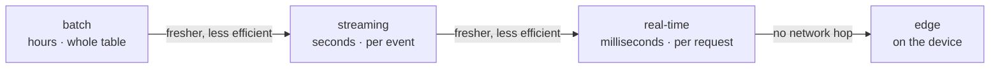

The same trained model can produce predictions in very different ways. A churn
model can score every customer overnight and write a table that the CRM reads in
the morning. It can score events as they stream in and update a score within a
minute. It can sit behind an HTTP endpoint and answer each request in 50 ms, or it
can run inside a phone app. These are **inference modes**, and the choice between
them is mostly not about the model. It is about how fresh the prediction must be,
how many entities need one, and what the idle capacity costs<FN n="1" />.

## Four modes on one spectrum



- **Batch.** A scheduled job reads a table of entities, scores all of them, and
  writes a predictions table. Latency is hours, throughput is as high as the
  cluster allows, and the hardware runs at full utilization for the duration of
  the job, then shuts down.
- **Streaming.** A continuously running job scores records as they arrive on a
  stream, in micro-batches of seconds. Predictions land in a table or topic within
  seconds to minutes of the event.
- **Real-time.** A serving endpoint answers each request synchronously, typically
  in tens to hundreds of milliseconds, using inputs that may only exist at request
  time (what is in the basket now).
- **Edge.** The model runs on the user's device, with no network round trip; the
  constraints are memory and power, covered in
  [edge deployment](/pillar/I/I3/edge-deployment).

Moving right buys freshness and costs efficiency: each request is scored alone,
and capacity must be provisioned for the peak, then sits idle at the trough.
[Latency and throughput](/pillar/I/I3/latency-throughput) gave the queueing view
of one endpoint; this lesson compares the modes.

## How stale is a batch prediction?

A batch job runs every $T$ hours. Each run snapshots its inputs at the start and
takes $J$ hours to finish, after which its predictions replace the previous ones.
Define the **age** of a prediction at the moment it is used as the time since its
inputs were captured.

**Step 1. The prediction in use.** Run $k$ starts at $kT$ and its predictions are
available from $kT + J$ until the next run's are, at $(k+1)T + J$. A use at time $t$
in that interval reads run $k$'s predictions, whose inputs are from time $kT$, so

$$
\text{age}(t) = t - kT, \quad t \in [kT + J,\ (k+1)T + J).
$$

**Step 2. Uses fall uniformly.** If uses are spread evenly over time, $t$ is uniform
on the interval of length $T$, and the age is uniform on $[J, T + J)$.

**Step 3. Take the mean.**

$$
\mathbb{E}[\text{age}] = \frac{J + (T + J)}{2} = \frac{T}{2} + J.
$$

A daily job ($T = 24$ h) taking two hours ($J = 2$ h) serves predictions that are on
average $14$ hours old and up to $26$ hours old. That is fine for a churn score
that changes slowly, and useless for fraud on a card transaction, whose decisive
input (this transaction) did not exist when the batch ran. The question that picks
the mode is therefore **when do the inputs become known?** If every input exists
before the decision is needed and changes slowly, batch works. If a decisive input
appears at request time, only streaming or real-time can use it.

## What each mode costs

Batch cost scales with the **population** scored. With $N$ entities and a cost $c_b$
per prediction at full utilization, one run costs

$$
C_{\text{batch}} = N\,c_b,
$$

whether or not anyone reads the scores. If only a small fraction of customers log
in on a given day, most of the batch's work is thrown away.

Real-time cost scales with **provisioned capacity**. A replica costs $\pi$ per hour,
handles $\mu$ requests per second, and is run at a target utilization $\rho$ (below
1, so latency stays low, as Little's law showed). For $Q$ requests a day the
average rate is $\lambda = Q/86{,}400$, and the number of replicas is

$$
R = \max\!\Big(1,\ \Big\lceil \frac{\lambda}{\rho\,\mu} \Big\rceil\Big),
\qquad
C_{\text{rt}} = 24\,\pi\,R \text{ per day}.
$$

The $\max(1, \cdot)$ is the **idle floor**: one replica runs all day even at three
requests an hour, unless the endpoint is allowed to scale to zero and pay a cold
start on the first request. A contrasting pair with the worked example's numbers
($N = 20$ million customers, $c_b = 2 \times 10^{-6}$, $\pi = 1$, $\mu = 100$,
$\rho = 0.6$):

- **$Q = 1$ million requests a day.** One replica covers it ($60$ requests per second
  per replica is $5.18$ million a day): real-time costs $24$ a day, the daily batch
  $40$. Real-time is cheaper *and* fresher, because the batch scores 19 million
  customers nobody asked about.
- **$Q = 30$ million requests a day.** Six replicas: real-time costs $144$ a day,
  still against $40$ for batch. If the decisions can tolerate 14-hour-old scores,
  batch is about 3.6 times cheaper.


Streaming sits between: it runs continuously like an endpoint, but processes
records in micro-batches at high utilization like a batch job, and fits inputs
that arrive as events (clicks, transactions, sensor readings) when a lag of
seconds is acceptable.

## Scoring a large table

Batch inference on a large table is distributed: the table is split into $P$
partitions spread across $W$ workers. The one decision that matters is where the
model is **loaded**. Loading costs $L$ seconds (deserialize weights, import
libraries), and scoring a row costs $c$ seconds. Loading once per row costs
$N(L + c)$ seconds of work in total; loading once per partition costs $PL + Nc$.
With $N = 10^7$ rows, $P = 200$, $L = 2$ s, $c = 20\ \mu$s and $W = 50$ workers, the
first takes about $111$ hours of wall time and the second about $12$ seconds. A
vectorized UDF that receives a whole partition (or a large chunk of one) as an
array is the standard way to get the second shape.

**In practice.** On Databricks, a registered model becomes a Spark UDF with
`mlflow.pyfunc.spark_udf(spark, model_uri)`, which loads the model on each worker and
scores the table batch by batch; a model logged with the feature engineering
client (`fe.log_model`) can instead be scored with `fe.score_batch`, which joins the stored features to a table of keys.
The same UDF can run inside a streaming pipeline's final table, and the same
registered model can be served from a Model Serving endpoint, so one artifact
covers all three modes<FN n="2" />.

## Worked example

The block simulates the staleness of a daily batch job, computes the two cost
curves and their break-even point, and compares per-row and per-partition model
loading.

```python
import numpy as np
rng = np.random.default_rng(0)

# 1. Staleness of a batch job with period T and duration J
T, J = 24.0, 2.0
t = rng.uniform(J + 10 * T, J + 1000 * T, 200_000)     # uses spread evenly over time
k = np.floor((t - J) / T)                               # which run's predictions are live
age = t - k * T
print(f"mean age = {age.mean():.2f} h  (T/2 + J = {T / 2 + J:.2f} h), max = {age.max():.2f} h")
assert abs(age.mean() - (T / 2 + J)) < 0.1

# 2. Daily cost: batch over a population vs an always-on endpoint
N, c_b = 20e6, 2e-6
pi, mu, rho = 1.0, 100.0, 0.6

def realtime_cost(Q):
    lam = Q / 86400
    replicas = np.maximum(1, np.ceil(lam / (rho * mu)))
    return 24 * pi * replicas

batch_cost = N * c_b
for Q in (1e6, 1e7, 3e7):
    print(f"Q = {Q:>12,.0f}/day: real-time {realtime_cost(Q):6.1f}  batch {batch_cost:5.1f}")
Qs = np.logspace(4, 8, 40001)
breakeven = Qs[np.argmax(realtime_cost(Qs) > batch_cost)]
print(f"real-time stops being cheaper above about {breakeven / 1e6:.2f} M requests/day")
assert abs(breakeven - rho * mu * 86400) / (rho * mu * 86400) < 0.001

# 3. Where to load the model in a distributed batch job
rows, P, L, c, W = 1e7, 200, 2.0, 20e-6, 50
per_row = rows * (L + c) / W
per_partition = (P * L + rows * c) / W
print(f"load per row: {per_row / 3600:.0f} h   load per partition: {per_partition:.0f} s")
assert per_row / per_partition > 10_000
```

The simulated mean age matches $T/2 + J = 14$ hours. Real-time is cheaper than the
daily batch until traffic outgrows one replica, about $5.18$ million requests a day
with these numbers, after which the second replica's cost passes the batch job's.
Loading the model per partition instead of per row turns a job of more than four
days into one of twelve seconds.

## Exercises

**Exercise 1.** A recommendation table is rebuilt every 6 hours by a job that takes
45 minutes. What are the mean and the maximum age of the recommendations a user
sees? If the product requires a mean age below 2 hours, what is the longest period
$T$ that satisfies it with the same job duration?

<details>
<summary>Solution</summary>

**Step 1.** With $T = 6$ h and $J = 0.75$ h, the mean age is
$T/2 + J = 3 + 0.75 = 3.75$ h, and the maximum is $T + J = 6.75$ h (a use just before
the next run lands).

**Step 2.** Require $T/2 + 0.75 < 2$, so $T/2 < 1.25$ and $T < 2.5$ h.

**Step 3.** The job would need to run more often than every 2.5 hours, which with a
45-minute run means the cluster is busy about 30% of the time. At that point a
streaming job that updates recommendations as events arrive is worth pricing.

</details>

**Exercise 2.** A fraud model must decide within 200 ms whether to approve a card
transaction, and its most important feature is the amount of *this* transaction
compared with the customer's recent average. Argue from the "when are the inputs
known" rule which modes are possible. Then describe which part of the computation
could still be done in batch.

<details>
<summary>Solution</summary>

**Step 1.** The decisive input, the current amount, exists only when the
transaction is attempted. A batch score computed earlier cannot include it, so
batch is ruled out for the decision. The 200 ms budget also rules out a streaming
job with second-scale micro-batches. Only real-time (or on-device) inference can
make this decision.

**Step 2.** The customer's recent average amount does not depend on this
transaction. It can be precomputed by a batch or streaming job and stored where
the endpoint can look it up by customer id in a few milliseconds.

**Step 3.** The resulting split is common: slow-moving aggregates computed ahead of
time, request-time values computed on the request, and the model combining the
two in the endpoint. The precomputed part is cheap and high-throughput; only the
last step pays real-time prices.

</details>

**Exercise 3 (code).** With the worked example's cost model, suppose the endpoint
may **scale to zero**: replicas are billed by the hour they are up, and an hour with
no requests costs nothing. Requests arrive only during a 10-hour business day, at a
uniform rate. Compute the daily real-time cost for $Q = 1$ million and
$Q = 30$ million requests a day, and the new break-even $Q$ against the $40$-per-day
batch.

<details>
<summary>Solution</summary>

```python
import numpy as np
N, c_b = 20e6, 2e-6
pi, mu, rho = 1.0, 100.0, 0.6
hours_active = 10
batch_cost = N * c_b

def scaled_cost(Q):
    lam = Q / (hours_active * 3600)                       # rate during the active hours
    replicas = np.maximum(1, np.ceil(lam / (rho * mu)))
    return hours_active * pi * replicas

for Q in (1e6, 3e7):
    print(f"Q = {Q:>12,.0f}: real-time {scaled_cost(Q):5.1f} vs batch {batch_cost:.1f}")
Qs = np.logspace(4, 8, 40001)
be = Qs[np.argmax(scaled_cost(Qs) > batch_cost)]
print(f"break-even ≈ {be / 1e6:.2f} M requests/day")
assert scaled_cost(1e6) == 10.0 and scaled_cost(3e7) == 140.0
```

At 1 million requests the cost drops from $24$ to $10$, since one replica now runs 10
hours. At 30 million the rate during business hours needs 14 replicas, so the cost
is $140$, barely different from $144$: scale-to-zero removes the idle floor, but
compressing the same traffic into fewer hours raises the peak. Real-time stays
cheaper than batch up to about $8.6$ million requests a day, where a fifth replica
is needed.

</details>

The next lesson packages the model so the same artifact can be loaded by the batch
job, the stream, and the endpoint:
[model packaging](/pillar/I/I3/model-packaging).

<Footnotes>
  <FNItem n="1">**Huyen, C.** (2022). *Designing Machine Learning Systems.* O'Reilly. Batch prediction versus online prediction, and streaming features.</FNItem>
  <FNItem n="2">**Kleppmann, M.** (2017). *Designing Data-Intensive Applications.* O'Reilly. Batch and stream processing as two ends of one design space.</FNItem>
</Footnotes>
