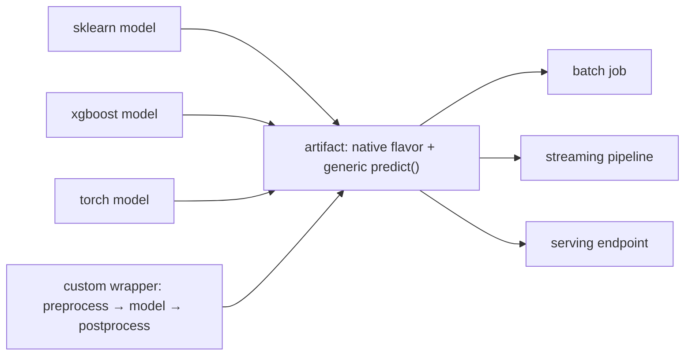

A trained model is a set of weights plus an implicit contract: the columns it
expects, in some order, with some types, after some preprocessing, producing
some output, under some library versions. Training code knows that contract
because it just built it. The batch job, the streaming pipeline, and the serving
endpoint from [the previous lesson](/pillar/I/I3/inference-modes) do not, and
each one written separately is a chance to get it wrong. **Packaging** makes the
contract explicit and ships it with the weights, so every consumer loads one
artifact and calls one method<FN n="1" />.

## One interface over many frameworks

Models come from different libraries: scikit-learn, XGBoost, LightGBM, PyTorch,
a hand-written rule. Each has its own save format and its own predict call. A
packaging format stores each in its native **flavor** and also exposes all of
them through one generic interface, a single `predict(input) -> output`. The
consumer never branches on the framework:



The artifact also records the environment: the exact library versions it was
trained with (a `requirements.txt` or conda file). A model pickled with one major
version of a library can fail to load, or load and behave differently, under
another. Pinning the environment in the artifact lets a server two years later
rebuild what the model needs instead of guessing.

## The signature turns silent errors into loud ones

A **signature** is the declared input and output schema: an ordered list of
`(column name, type)` for inputs, and the same for outputs. The packaged predict
call checks every request against it before the model sees the data.

The failure it prevents is a **named confusion** between position and name. A
model trained on a numeric matrix knows its columns only by position: column 0
was `income`, column 1 was `age`. If a caller builds the matrix as
`[age, income]`, every value is a valid number, the model returns a valid
probability, and nothing errors. The predictions are wrong, for every row,
indefinitely. With a signature, the request carries names, the packaged model
reorders columns by name into the training order, and a request that lacks
`income` fails with an error naming the missing column.

Three checks cover most of the value:

- **Presence.** Every declared input column exists. A missing column raises.
- **Order by name.** Columns are selected by name into the declared order, so a
  caller's column order does not matter.
- **Type.** Each column's type is compatible. Safe widening (integer to float) is
  allowed; anything lossy or nonsensical (a string where a number belongs) raises.

The cost of a loud failure is one rejected request and an alert. The cost of a
silent one is a model that scores garbage until someone notices the business
metric, which in [production drift](/pillar/I/I4/production-drift) terms can be
weeks.

## A custom wrapper owns pre- and post-processing

The weights rarely make the whole prediction. Inputs need the imputation and
scaling fitted at training time (from
[feature engineering](/pillar/I/I1/feature-engineering)), and outputs need turning
into what the consumer wants: a probability *and* a decision at the business
threshold, perhaps a reason code. If that logic lives in each consumer, the batch
job and the endpoint will diverge. A **custom wrapper** packages it with the
model: a small class with a predict method that runs preprocess, then the model,
then postprocess, and is saved as the artifact. The fitted preprocessing
parameters (fill values, means, standard deviations, the threshold) are stored
inside it, so they travel with the weights and are versioned with them in the
[registry](/pillar/I/I2/model-registry).

**In practice.** MLflow's `pyfunc` is this design. Every flavor
(`mlflow.sklearn`, `mlflow.xgboost`, and so on) can be loaded with
`mlflow.pyfunc.load_model(uri)` and called with `.predict(df)`. A custom wrapper
subclasses `mlflow.pyfunc.PythonModel` and implements
`predict(self, context, model_input)`, for example returning both the positive
class probability and the label. The signature is usually inferred from sample
data with `infer_signature(X, y_pred)` and passed to `log_model`, and Unity
Catalog's registry requires a signature on every registered version. At load time
MLflow checks inputs against it, so a missing column raises rather than scores.
For distributed batch scoring the same artifact becomes a Spark UDF with
`mlflow.pyfunc.spark_udf(spark, model_uri)`<FN n="2" />.

## Worked example

The block packages a small logistic model with its preprocessing and a
signature, then checks that a reordered request scores identically, that the bare
positional model scores a reordered request wrongly without any error, and that a
missing column or a string column raises.

```python
import numpy as np
rng = np.random.default_rng(0)

# Training: two features, fitted preprocessing, logistic weights
n = 5000
income = rng.normal(50, 15, n)
age = rng.normal(40, 12, n)
y = (rng.random(n) < 1 / (1 + np.exp(-(0.08 * (income - 50) - 0.05 * (age - 40))))).astype(int)

X = np.column_stack([income, age])
mu, sd = X.mean(0), X.std(0)
Z = (X - mu) / sd
w = np.zeros(2); b = 0.0
for _ in range(3000):                           # plain gradient descent on log loss
    p = 1 / (1 + np.exp(-(Z @ w + b)))
    w -= 0.5 * Z.T @ (p - y) / n
    b -= 0.5 * (p - y).mean()

def bare_model(matrix):                          # positional: knows column 0 and 1 only
    return 1 / (1 + np.exp(-(((matrix - mu) / sd) @ w + b)))

class PackagedModel:
    signature = [("income", "float"), ("age", "float")]

    def __init__(self, threshold):
        self.threshold = threshold

    def _validate(self, request):
        cols = []
        for name, kind in self.signature:
            if name not in request:
                raise ValueError(f"missing input column '{name}'")
            col = np.asarray(request[name])
            if not np.issubdtype(col.dtype, np.number):
                raise TypeError(f"column '{name}' has type {col.dtype}, expected {kind}")
            cols.append(col.astype(float))      # safe widening: int -> float
        return np.column_stack(cols)            # columns placed by NAME, in signature order

    def predict(self, context, model_input):
        proba = bare_model(self._validate(model_input))
        return {"probability": proba, "label": (proba >= self.threshold).astype(int)}

model = PackagedModel(threshold=0.5)
req = {"income": np.array([80.0, 30.0]), "age": np.array([25, 60])}      # age arrives as int
reordered = {"age": req["age"], "income": req["income"]}
out = model.predict(None, req)
assert np.allclose(out["probability"], model.predict(None, reordered)["probability"])
print("packaged :", out["probability"].round(3), out["label"])

right = bare_model(np.column_stack([req["income"], req["age"]]))
swapped = bare_model(np.column_stack([req["age"], req["income"]]))     # caller got the order wrong
print("bare, right order :", right.round(3))
print("bare, swapped     :", swapped.round(3), "(no error raised)")
assert np.allclose(right, out["probability"]) and not np.allclose(right, swapped)

for bad in ({"income": req["income"]}, {"income": req["income"], "age": np.array(["25", "60"])}):
    try:
        model.predict(None, bad)
        raise AssertionError("should have failed")
    except (ValueError, TypeError) as e:
        print("rejected:", e)
```

The packaged model gives the same probabilities whatever order the caller sends
the columns in, and accepts the integer `age` by widening it. The bare model fed
the swapped matrix returns different, confident-looking probabilities with no
error. The missing column and the string column are both rejected with a message
naming the column.

## Exercises

**Exercise 1.** A model's signature is `income: float, age: float,
channel: string`. For each request below, say whether a name-based validator like
the worked example's (extended to strings) accepts it, rejects it, or accepts it
with a conversion, and why: (a) columns in the order `channel, age, income`; (b)
`income` sent as integers; (c) `age` missing; (d) an extra column `zip`.

<details>
<summary>Solution</summary>

**Step 1. (a)** Accepted unchanged. The validator selects columns by name into the
signature's order, so the caller's order is irrelevant.

**Step 2. (b)** Accepted with a conversion. Integer to float is a safe widening:
every integer is representable, and the model sees the same values it would have
seen as floats.

**Step 3. (c)** Rejected with an error naming `age`. There is no correct value to
substitute; imputing silently would hide a broken caller.

**Step 4. (d)** Accepted, with `zip` ignored: the validator only reads declared
columns. Some tools warn on extra columns; none should feed an undeclared column
to the model.

</details>

**Exercise 2.** A team keeps the decision threshold ($0.35$) in the endpoint's
configuration, and the batch scoring job hard-codes $0.5$, which was the value
when the job was written. Describe the discrepancy this produces and redesign the
packaging so it cannot happen. What happens to the threshold when a new model
version is registered?

<details>
<summary>Solution</summary>

**Step 1.** The same customer gets a probability of, say, $0.4$ in both places,
is declined online (above $0.35$) and approved in the nightly batch (below $0.5$).
Reports built from the batch table disagree with what customers experienced, and
nothing errors.

**Step 2.** Move the threshold into the custom wrapper as a stored parameter, as
`PackagedModel(threshold=...)` does, and have the wrapper return the label along
with the probability. Every consumer then reads the label from the artifact rather
than recomputing it.

**Step 3.** The threshold becomes part of the model version. Registering a new
version with a recalibrated threshold changes it everywhere at once when the
serving alias moves, and rolling back the alias rolls back the threshold too,
because they are one artifact.

</details>

**Exercise 3 (code).** Extend the validator with a range check: the signature
records, for each column, the minimum and maximum seen in training, and requests
with any value more than 50% of the training range outside it are rejected. Use
the training data from the worked example to build the ranges, and check that
`income = 55` passes while `income = 55000` (dollars sent where the model expects
thousands) is rejected.

<details>
<summary>Solution</summary>

```python
import numpy as np
rng = np.random.default_rng(0)
income = rng.normal(50, 15, 5000)
age = rng.normal(40, 12, 5000)
ranges = {"income": (income.min(), income.max()), "age": (age.min(), age.max())}

def check_ranges(request, ranges, slack=0.5):
    for name, (lo, hi) in ranges.items():
        col = np.asarray(request[name], dtype=float)
        pad = slack * (hi - lo)
        if (col < lo - pad).any() or (col > hi + pad).any():
            raise ValueError(f"column '{name}' outside the training range [{lo:.1f}, {hi:.1f}]")

check_ranges({"income": [55.0], "age": [30.0]}, ranges)           # passes
try:
    check_ranges({"income": [55000.0], "age": [30.0]}, ranges)
    raise AssertionError("should have failed")
except ValueError as e:
    print("rejected:", e)
print("income training range:", [round(float(v), 1) for v in ranges["income"]])
```

A unit error such as dollars for thousands passes every type check, since it is
still a float, but lands three orders of magnitude outside the training range, so a
range check catches it at the boundary. The slack keeps legitimate tail values
from tripping the check; how much slack to allow is a judgment about the feature.

</details>

The next lesson rolls a packaged model out to live traffic gradually:
[deployment strategies](/pillar/I/I3/deployment-strategies).

<Footnotes>
  <FNItem n="1">**Paleyes, A., Urma, R.-G., & Lawrence, N. D.** (2022). "Challenges in deploying machine learning: A survey of case studies". *ACM Computing Surveys*, 55(6). [arXiv:2011.09926](https://arxiv.org/abs/2011.09926)</FNItem>
  <FNItem n="2">**Zaharia, M., et al.** (2018). "Accelerating the machine learning lifecycle with MLflow". *IEEE Data Engineering Bulletin*, 41(4), 39-45. The MLflow Models format: flavors behind a generic python_function interface.</FNItem>
</Footnotes>
