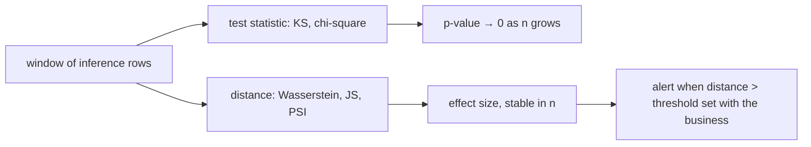

[Drift detection](/pillar/I/I1/drift-detection) gave two statistics, KS for
continuous features and PSI for binned ones. In production they meet two
problems. First, the KS statistic only says *that* two distributions differ, on a
$[0, 1]$ scale that saturates: a mean shift of 3 standard deviations and one of
50 both read as $D \approx 1$. Second, a monitoring job runs on large windows, and
on a million rows every test statistic is significant, so an alert keyed to a
p-value pages someone for shifts nobody cares about. This lesson adds two
distances that fix the first problem and derives the second one so the fix is
clear: alert on an effect size, not on a p-value.

## The Wasserstein distance

Picture each distribution as a pile of sand of total mass one spread along the
feature axis. The **Wasserstein-1 distance** (also called the earth mover's
distance) is the least average distance the sand must travel to turn one pile
into the other. Formally, for distributions $P$ and $Q$,

$$
W_1(P, Q) = \inf_{\pi} \mathbb{E}_{(X, Y) \sim \pi}\,\lvert X - Y \rvert,
$$

where the infimum runs over all **couplings** $\pi$: joint distributions whose
first marginal is $P$ and second is $Q$. A coupling is a transport plan, saying
how much mass at $x$ goes to $y$.

**Step 1. In one dimension the best plan matches quantiles.** On the real line,
the optimal coupling pairs the $u$-th quantile of $P$ with the $u$-th quantile of
$Q$ for every $u \in (0, 1)$, a known result of optimal transport<FN n="1" />.
Crossing two paths is never cheaper than uncrossing them, so the monotone
matching wins. With $F^{-1}$ and $G^{-1}$ the quantile functions,

$$
W_1 = \int_0^1 \big\lvert F^{-1}(u) - G^{-1}(u) \big\rvert\, du.
$$

**Step 2. The same number is the area between the two CDFs.** Draw the two CDFs
$F$ and $G$ in the plane. The quantile integral of Step 1 sums horizontal slices
of the region between the curves (height $du$, width $\lvert F^{-1} - G^{-1}\rvert$).
Summing the same region in vertical slices (width $dv$, height $\lvert F - G\rvert$)
gives the same area, so

$$
W_1 = \int_{-\infty}^{\infty} \lvert F(v) - G(v) \rvert\, dv.
$$

Compare KS, which is the *largest* vertical gap $\sup_v \lvert F - G \rvert$.
Wasserstein integrates the gap, so it accounts for how far the mass moved, not
only whether it moved.

**Step 3. A pure shift moves $W_1$ by the shift.** If $Q$ is $P$ moved right by
$\delta$, then $G^{-1}(u) = F^{-1}(u) + \delta$ for every $u$, and Step 1 gives

$$
W_1 = \int_0^1 \lvert \delta \rvert\, du = \lvert \delta \rvert.
$$

$W_1$ is measured **in the feature's own units**. Drift of $W_1 = 12$ on a
`transaction_amount` column means the typical value moved by about 12 in the column's currency, which a
product owner can judge, and the scale never saturates.

**Step 4. The sample estimator.** For two samples of equal size $n$, the empirical
quantile functions are step functions that pair the $i$-th smallest values
$a_{(i)}$ and $b_{(i)}$, so

$$
\widehat{W}_1 = \frac{1}{n}\sum_{i=1}^{n} \lvert a_{(i)} - b_{(i)} \rvert.
$$

A magnitude scale for a standard-normal reference makes the contrast with KS
concrete (values from the worked example):

- Shift $\delta = 0.5$: KS $\approx 0.20$, $W_1 \approx 0.5$.
- Shift $\delta = 3$: KS $\approx 0.87$, $W_1 \approx 3$.
- Shift $\delta = 10$ or $50$: KS $= 1.00$ for both, $W_1 \approx 10$ and $50$.


## The Jensen-Shannon divergence

For a binned or categorical feature with reference shares $p$ and current shares
$q$, KL divergence is the natural comparison, but it is asymmetric and infinite
when a bin is empty in one histogram and not the other. The
**Jensen-Shannon divergence** compares both to their average
$m = \tfrac{1}{2}(p + q)$<FN n="2" />:

$$
\mathrm{JS}(p, q) = \tfrac{1}{2}\,\mathrm{KL}(p \,\Vert\, m) + \tfrac{1}{2}\,\mathrm{KL}(q \,\Vert\, m).
$$

It is symmetric by construction, and it is finite even with empty bins, since
$m_i > 0$ wherever $p_i > 0$ or $q_i > 0$.

**It is bounded by $\ln 2$.** Since $m_i = \tfrac{1}{2}(p_i + q_i) \ge \tfrac{1}{2}p_i$,
every ratio satisfies $p_i / m_i \le 2$, so

$$
\mathrm{KL}(p \,\Vert\, m) = \sum_i p_i \ln\frac{p_i}{m_i} \le \sum_i p_i \ln 2 = \ln 2,
$$

and the same holds for $q$. Averaging the two gives $\mathrm{JS} \le \ln 2$, with
equality when $p$ and $q$ have disjoint supports (every ratio equals $2$). In base-2
logarithms the bound is $1$. Some libraries report the **Jensen-Shannon distance**,
$\sqrt{\mathrm{JS}}$, which is a true metric; check which one a dashboard shows
before comparing thresholds.

## Why tests flag everything at scale

The chi-square test for a categorical feature compares observed counts
$O_i$ in a window of $n$ rows with the counts $E_i$ expected under the reference
shares:

$$
\chi^2 = \sum_i \frac{(O_i - E_i)^2}{E_i}.
$$

**Step 1. Write the counts as shares.** $O_i = n q_i$ and $E_i = n p_i$.

**Step 2. Factor out $n$.**

$$
\chi^2 = \sum_i \frac{n^2 (q_i - p_i)^2}{n\, p_i} = n \sum_i \frac{(q_i - p_i)^2}{p_i}.
$$

The sum depends only on the shares, which describe the size of the shift. The
statistic is that fixed effect size times $n$. The critical value at a given level
does not depend on $n$ ($3.841$ for one degree of freedom at $\alpha = 0.05$), so
any nonzero shift becomes "significant" once $n$ is large enough.

A contrasting pair shows the consequence. A binary feature moves from $50/50$ to
$51/49$, so the sum is $2 \times 0.01^2 / 0.5 = 0.0004$:

- Window of $n = 1{,}000$ rows: $\chi^2 = 0.4$, not significant.
- Window of $n = 1{,}000{,}000$ rows: $\chi^2 = 400$, a p-value indistinguishable from zero.

The shift is identical, and its Jensen-Shannon divergence is about $5 \times 10^{-5}$ in
both windows. The KS test behaves the same way: its critical value shrinks like
$1/\sqrt{n}$, so a fixed gap $D$ eventually exceeds it. Tests answer "is there
*any* difference?", which at production volume is almost always yes. Distances
answer "how big is the difference?", which is what an alert should key on<FN n="3" />.



**In practice.** Monitoring tools compute both families on every window.
Databricks data profiling, for example, writes a drift metrics table with
per-column statistics such as `wasserstein_distance`, comparing each window to a
baseline table and to the previous window. A useful alert queries that table for
a distance above a threshold the feature's owner agreed on, rather than for a
p-value below $0.05$.

## Worked example

The block checks the saturation of KS against Wasserstein, the $\ln 2$ bound of
Jensen-Shannon, and the linear growth of chi-square with the window size.

```python
import numpy as np
rng = np.random.default_rng(0)
n = 20000
ref = rng.normal(0, 1, n)

def ks(a, b):
    grid = np.sort(np.concatenate([a, b]))
    Fa = np.searchsorted(np.sort(a), grid, side="right") / a.size
    Fb = np.searchsorted(np.sort(b), grid, side="right") / b.size
    return np.max(np.abs(Fa - Fb))

def w1(a, b):                       # equal sizes: mean gap between matched order statistics
    return np.mean(np.abs(np.sort(a) - np.sort(b)))

for delta in (0.5, 3, 10, 50):
    cur = rng.normal(delta, 1, n)
    print(f"shift {delta:>4}: KS = {ks(ref, cur):.3f}   W1 = {w1(ref, cur):.3f}")
    assert abs(w1(ref, cur) - delta) < 0.05
assert ks(ref, rng.normal(10, 1, n)) == ks(ref, rng.normal(50, 1, n)) == 1.0

def kl(p, q):
    nz = p > 0
    return np.sum(p[nz] * np.log(p[nz] / q[nz]))

def js(p, q):
    m = 0.5 * (p + q)
    return 0.5 * kl(p, m) + 0.5 * kl(q, m)

disjoint = js(np.array([1.0, 0.0]), np.array([0.0, 1.0]))
print(f"JS of disjoint histograms = {disjoint:.4f}  (ln 2 = {np.log(2):.4f})")
assert np.isclose(disjoint, np.log(2))

p, q = np.array([0.50, 0.50]), np.array([0.51, 0.49])
for N in (1_000, 10_000, 1_000_000):
    chi2 = (((N * q - N * p) ** 2) / (N * p)).sum()
    print(f"n = {N:>9,}: chi2 = {chi2:7.1f}  significant = {chi2 > 3.841}   JS = {js(p, q):.2e}")
```

$W_1$ tracks each shift to within a few hundredths while KS sticks at $1.00$ for
both large shifts. The disjoint histograms hit the $\ln 2$ ceiling. Chi-square
rises from $0.4$ to $400$ on the same one-point shift and crosses the $3.841$
critical value between $1{,}000$ and $10{,}000$ rows, while JS does not move.

## Exercises

**Exercise 1.** A reference sample of a latency feature is $\{10, 20, 30, 40\}$ ms
and the current window is $\{12, 22, 35, 51\}$ ms. Compute $\widehat{W}_1$ by hand and
state it in milliseconds. Then compute the KS statistic and say what each number
tells an on-call engineer.

<details>
<summary>Solution</summary>

**Step 1.** Both samples are already sorted with $n = 4$. Pair order statistics:
gaps $\lvert 10 - 12\rvert = 2$, $\lvert 20 - 22\rvert = 2$, $\lvert 30 - 35\rvert = 5$,
$\lvert 40 - 51\rvert = 11$.

**Step 2.** $\widehat{W}_1 = (2 + 2 + 5 + 11)/4 = 5$ ms. On average, the current
distribution sits 5 ms to the right of the reference.

**Step 3.** For KS, evaluate both ECDFs at the pooled points. At $v = 10$:
$F = 0.25$, $G = 0$. At $v = 20$: $F = 0.5$, $G = 0.25$. At $v = 30$:
$F = 0.75$, $G = 0.5$. At $v = 40$: $F = 1$, $G = 0.75$. At $12, 22, 35, 51$ the two ECDFs
coincide, so the gap is $0$. The maximum is $D = 0.25$.

**Step 4.** KS says one quarter of the mass is out of place at worst; Wasserstein
says how far it moved, 5 ms on average and most of it in the upper tail (the
$11$ ms gap), which is the number to compare with a latency budget.

</details>

**Exercise 2.** A categorical feature with three levels has reference shares
$p = (0.6, 0.3, 0.1)$. A window of $n$ rows shows $q = (0.58, 0.31, 0.11)$. Write
$\chi^2$ as a function of $n$, and find the smallest $n$ at which the test is
significant at $\alpha = 0.05$ with two degrees of freedom (critical value
$5.991$).

<details>
<summary>Solution</summary>

**Step 1.** Compute the effect-size sum
$\sum_i (q_i - p_i)^2 / p_i$:

$$
\frac{(-0.02)^2}{0.6} + \frac{0.01^2}{0.3} + \frac{0.01^2}{0.1}
= 0.000667 + 0.000333 + 0.001 = 0.002.
$$

**Step 2.** By the derivation, $\chi^2 = 0.002\,n$.

**Step 3.** Solve $0.002\,n > 5.991$: $n > 2{,}995.5$, so $n = 2{,}996$ rows. A
monitor running on daily windows of $100{,}000$ rows would report $\chi^2 = 200$
for a shift whose largest change is two percentage points.

</details>

**Exercise 3 (code).** Show that Wasserstein responds to a change in *spread* and
not only in location. Draw the reference from $\mathcal{N}(0, 1)$ and the current
window from $\mathcal{N}(0, \sigma^2)$ for $\sigma = 1, 2, 4$. For a pure scale
change the quantile functions satisfy $G^{-1}(u) = \sigma F^{-1}(u)$, so derive
$W_1 = (\sigma - 1)\,\mathbb{E}\lvert Z \rvert = (\sigma - 1)\sqrt{2/\pi}$ for
$\sigma \ge 1$ and check it numerically.

<details>
<summary>Solution</summary>

**Step 1.** From Step 1 of the lesson,
$W_1 = \int_0^1 \lvert \sigma F^{-1}(u) - F^{-1}(u)\rvert\,du
= (\sigma - 1)\int_0^1 \lvert F^{-1}(u)\rvert\,du$. The last integral is
$\mathbb{E}\lvert Z\rvert$ for $Z \sim \mathcal{N}(0,1)$, which equals $\sqrt{2/\pi}$.

```python
import numpy as np
rng = np.random.default_rng(2)
n = 50000
ref = rng.normal(0, 1, n)

def w1(a, b):
    return np.mean(np.abs(np.sort(a) - np.sort(b)))

for sigma in (1, 2, 4):
    cur = rng.normal(0, sigma, n)
    theory = (sigma - 1) * np.sqrt(2 / np.pi)
    print(f"sigma {sigma}: W1 = {w1(ref, cur):.3f}  theory = {theory:.3f}")
    assert abs(w1(ref, cur) - theory) < 0.03
```

The mean is unchanged, so a monitor watching only the average sees nothing, while
$W_1$ grows by $\sqrt{2/\pi} \approx 0.80$ per unit of extra standard deviation.

</details>

Distances tell you a feature moved; the next lesson asks *where* in the traffic it
moved, by breaking the inference log into
[slices](/pillar/I/I4/sliced-monitoring).

<Footnotes>
  <FNItem n="1">**Villani, C.** (2009). *Optimal Transport: Old and New.* Springer. The one-dimensional case and the quantile coupling.</FNItem>
  <FNItem n="2">**Lin, J.** (1991). "Divergence measures based on the Shannon entropy". *IEEE Transactions on Information Theory*, 37(1), 145-151. [doi:10.1109/18.61115](https://doi.org/10.1109/18.61115)</FNItem>
  <FNItem n="3">**Rabanser, S., Günnemann, S., & Lipton, Z. C.** (2019). "Failing loudly: An empirical study of methods for detecting dataset shift". *NeurIPS*. [arXiv:1810.11953](https://arxiv.org/abs/1810.11953)</FNItem>
</Footnotes>
