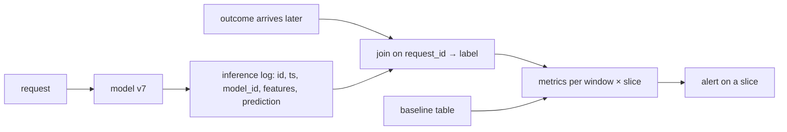

[Production drift](/pillar/I/I4/production-drift) and
[drift distances](/pillar/I/I4/drift-distances) watch the *inputs*. Eventually
labels arrive (a loan defaults or does not, a click happens or does not) and the
model's *quality* can be measured directly. The measurement is only as good as
what was logged at prediction time, and it is only useful if it is broken down:
a model whose overall accuracy holds steady at 90% can be failing badly for new
customers on one platform, because that group is too small to move the average.
This lesson builds the inference log, derives why aggregates hide slices, and
deals with the statistical cost of looking at many slices at once.

## The inference log

An **inference log** (or inference table) is an append-only table with one row
per prediction. The minimum useful schema:

| Column | Why it is there |
|---|---|
| `request_id` | joins the row to the label when it arrives |
| `timestamp` | defines the monitoring window |
| `model_id` (version) | separates traffic when two versions serve at once |
| input features | input drift, and slicing by any feature |
| `prediction` (and score) | quality metrics, calibration |
| `label` (filled later) | quality metrics once ground truth lands |

The label column is empty at write time. A separate job fills it by joining on
`request_id` when the outcome is known, which can take hours (a click) or months
(a default). Quality metrics are therefore always computed on a window that
closed at least one label delay ago. The metrics are computed per **window**
(a day, a week) and compared against a **baseline**, either a fixed reference
table (the validation set) or the previous window, which catch different things:
the baseline catches slow decay, the previous window catches a sudden break.



## Why the aggregate hides a slice

Partition the traffic into **slices** $s = 1, \dots, S$ (platform, country,
customer tenure, any feature expression). Let $w_s$ be slice $s$'s share of the
window's rows, with $\sum_s w_s = 1$, and $A_s$ the model's accuracy on slice $s$.

**Step 1. The aggregate is a weighted mean.** Accuracy is the fraction of correct
rows, and the correct rows split by slice, so

$$
A = \sum_{s=1}^{S} w_s\, A_s.
$$

**Step 2. One slice failing moves the aggregate by its weight.** If slice $k$'s
accuracy drops by $\delta$ and nothing else changes,

$$
\Delta A = w_k\,(A_k - \delta) - w_k A_k = -\,w_k\,\delta.
$$

A slice holding $5\%$ of traffic whose accuracy falls by $20$ points moves the
aggregate by $1$ point, from $90\%$ to $89\%$, which is inside the week-to-week
noise of most dashboards.

**Step 3. The mix can move the aggregate with no slice changing.** Between a
baseline window (weights $w_s$, accuracies $A_s$) and a current window
($w'_s$, $A'_s$), add and subtract $w_s A'_s$:

$$
A' - A = \underbrace{\sum_s w_s\,(A'_s - A_s)}_{\text{within-slice change}}
\;+\; \underbrace{\sum_s (w'_s - w_s)\,A'_s}_{\text{mix change}}.
$$

If a marketing campaign doubles the share of a slice on which the model was
always weak, the aggregate falls although every $A'_s = A_s$. The first term is
zero, the second carries the whole drop, and retraining is the wrong response.
The decomposition says which one happened.


## Testing many slices

The fix for Step 2 is to test every slice. For each slice, compare the current
window's accuracy with the baseline's using a two-proportion $z$ test: with
$n_s$ and $n'_s$ rows and pooled accuracy $\bar{A}_s$,

$$
z_s = \frac{A'_s - A_s}{\sqrt{\bar{A}_s(1 - \bar{A}_s)\,\big(1/n_s + 1/n'_s\big)}}.
$$

The denominator shows the second problem: a small slice has a large standard
error, so it needs a large drop to be detectable at all.

Testing many slices brings the problem of [multiple testing](/pillar/B/B1/multiple-testing).
With $m$ slices tested at level $\alpha$ each and no real change anywhere, the
tests are roughly independent, so

$$
P(\text{at least one false alarm}) = 1 - (1 - \alpha)^m.
$$

At $\alpha = 0.05$: $m = 1$ gives $5\%$, $m = 20$ gives $64\%$, $m = 100$ gives
$99.4\%$. A monitor slicing by 20 segments would page someone on most days for
nothing. Two standard corrections apply<FN n="1" />:

- **Bonferroni.** Test each slice at $\alpha/m$. By the union bound the chance of
  any false alarm is at most $m \cdot \alpha/m = \alpha$. Simple and conservative.
- **Benjamini-Hochberg.** Sort the $m$ p-values, $p_{(1)} \le \dots \le p_{(m)}$, find
  the largest $j$ with $p_{(j)} \le j\alpha/m$, and flag slices $1$ through $j$. This
  controls the expected fraction of false flags among the flagged ones, which
  suits a dashboard that lists suspects for a person to review.

## Fairness gaps are slice metrics

When a slice is a group of people (by age band, region, or another attribute the
team has decided to protect), the slice comparison becomes a fairness metric.
Two common ones, for a binary classifier with prediction $\hat{y}$ and group
attribute $G$<FN n="2" />:

- **Demographic parity difference**:
  $P(\hat{y} = 1 \mid G = a) - P(\hat{y} = 1 \mid G = b)$, the gap in positive
  prediction rates. It needs no labels, so it is available immediately.
- **Equal opportunity difference**:
  $P(\hat{y} = 1 \mid y = 1, G = a) - P(\hat{y} = 1 \mid y = 1, G = b)$, the gap in
  true positive rates. It needs labels, so it lags by the label delay.

Both are per-window numbers from the same inference log, so they drift like any
other metric and are monitored the same way: a value, a baseline, and an alert
threshold someone owns. Monitoring guides call a widening gap **bias drift**.

**In practice.** Databricks data profiling takes an inference table and builds
these per-window metrics: you name the prediction, label, model-id and timestamp
columns, give a baseline table, and list **slicing expressions** (for example
`"Age > 15"`), and it writes profile and drift metric tables per window and per
slice, fairness metrics included. Other stacks (Evidently, WhyLabs, a scheduled
SQL job) follow the same schema-window-slice-baseline pattern<FN n="3" />.

## Worked example

The block simulates a baseline and a current window over ten slices, degrades a
single 5% slice, and checks Step 2's prediction, the per-slice tests with
Bonferroni, and the false-alarm rate when nothing changes.

```python
import numpy as np
from math import erf, sqrt
rng = np.random.default_rng(0)

S = 10
w = np.array([0.20, 0.15, 0.15, 0.10, 0.10, 0.08, 0.07, 0.05, 0.05, 0.05])
acc_base = np.full(S, 0.90)
acc_cur = acc_base.copy()
acc_cur[7] = 0.70                        # one 5% slice loses 20 points
n = 50000

def window(acc):
    s = rng.choice(S, n, p=w)            # which slice each request falls in
    return s, rng.random(n) < acc[s]     # whether the prediction was correct

def two_sided_p(z):
    return 2 * (1 - 0.5 * (1 + erf(abs(z) / sqrt(2))))

sb, cb = window(acc_base)
sc, cc = window(acc_cur)
print(f"aggregate accuracy: baseline {cb.mean():.4f}, current {cc.mean():.4f}, "
      f"predicted change {-w[7] * 0.20:+.3f}")

pvals = []
for k in range(S):
    a, b = cb[sb == k], cc[sc == k]
    pooled = np.concatenate([a, b]).mean()
    z = (b.mean() - a.mean()) / np.sqrt(pooled * (1 - pooled) * (1 / a.size + 1 / b.size))
    pvals.append(two_sided_p(z))
flagged = np.where(np.array(pvals) < 0.05 / S)[0]
print("slices flagged with Bonferroni:", flagged)
assert list(flagged) == [7]

# No real change: how often does at least one of 20 slice tests fire?
m, reps = 20, 2000
z_null = rng.normal(size=(reps, m))
p_null = np.vectorize(two_sided_p)(z_null)
raw = (p_null < 0.05).any(axis=1).mean()
bonf = (p_null < 0.05 / m).any(axis=1).mean()
print(f"P(any false alarm), 20 slices: unadjusted {raw:.3f} (theory {1 - 0.95 ** m:.3f}), Bonferroni {bonf:.3f}")
assert abs(raw - (1 - 0.95 ** m)) < 0.03 and bonf < 0.07
```

The aggregate moves by less than a point, close to the $-w_k\delta = -0.01$ of
Step 2, while the slice test isolates slice 7 alone. With 20 slices and no real
change, unadjusted tests raise at least one alarm in about $64\%$ of windows, as
$1 - 0.95^{20}$ predicts, and Bonferroni brings that back to about $5\%$.

## Exercises

**Exercise 1.** A fraud model's weekly recall is $0.80$ overall. The traffic is
$70\%$ card-present (recall $0.85$) and $30\%$ online (recall $0.683$). Next week the
online share rises to $50\%$ and both per-slice recalls stay the same. Compute the
new aggregate recall and split the change with Step 3's decomposition. (Treat the
shares as shares of fraud cases.)

<details>
<summary>Solution</summary>

**Step 1.** Check the baseline: $0.7 \times 0.85 + 0.3 \times 0.683 = 0.595 + 0.205 = 0.800$.

**Step 2.** New aggregate: $0.5 \times 0.85 + 0.5 \times 0.683 = 0.425 + 0.3415 = 0.7665$.

**Step 3.** Within-slice term: $\sum_s w_s (A'_s - A_s) = 0$, since no slice
changed. Mix term: $(0.5 - 0.7)(0.85) + (0.5 - 0.3)(0.683) = -0.170 + 0.1366 = -0.0334$.
The whole drop of $3.3$ points is mix. The model did not get worse at catching any
kind of fraud; there is more of the kind it was always weaker at.

</details>

**Exercise 2.** A monitor tests 40 slices every day at $\alpha = 0.05$ with no
correction. Assuming independent tests and no real change, what is the probability
of at least one alert on a given day, and the expected number of days per 30-day
month with at least one false alert? What per-test level does Bonferroni use, and
what is then the bound on the daily false-alarm probability?

<details>
<summary>Solution</summary>

**Step 1.** $1 - 0.95^{40} = 1 - 0.1285 = 0.8715$.

**Step 2.** Expected alert days: $30 \times 0.8715 \approx 26$ days a month.

**Step 3.** Bonferroni tests each slice at $0.05/40 = 0.00125$. The union bound gives
$P(\text{any alarm}) \le 40 \times 0.00125 = 0.05$, about $1.5$ false-alarm days a
month. The cost is power: a real drop in a small slice must now reach a smaller
p-value to be flagged.

</details>

**Exercise 3 (code).** Compute fairness gaps from an inference log. Simulate
20,000 rows with a binary group attribute ($30\%$ in group $b$), true labels with a
$20\%$ positive rate in both groups, and a model whose true positive rate is
$0.80$ for group $a$ and $0.65$ for group $b$, with a $10\%$ false positive rate for
both. Compute the demographic parity difference and the equal opportunity
difference, and check the second against $0.15$.

<details>
<summary>Solution</summary>

```python
import numpy as np
rng = np.random.default_rng(4)
n = 20000
group_b = rng.random(n) < 0.30
y = rng.random(n) < 0.20
tpr = np.where(group_b, 0.65, 0.80)
yhat = np.where(y, rng.random(n) < tpr, rng.random(n) < 0.10)

dp = yhat[~group_b].mean() - yhat[group_b].mean()
eo = yhat[~group_b & y].mean() - yhat[group_b & y].mean()
print(f"demographic parity difference = {dp:.3f}")
print(f"equal opportunity difference  = {eo:.3f}")
assert abs(eo - 0.15) < 0.04
assert abs(dp - 0.2 * 0.15) < 0.02
```

The equal opportunity gap recovers the $0.15$ TPR difference. The demographic
parity gap is smaller, about $0.2 \times 0.15 = 0.03$, because positive prediction
rates mix the TPR (weighted by the $20\%$ base rate) with the shared false
positive rate: $0.2 \times 0.80 + 0.8 \times 0.10 = 0.24$ for group $a$ against
$0.2 \times 0.65 + 0.8 \times 0.10 = 0.21$ for group $b$. The two metrics measure
different things, and a monitor that tracks only the label-free one understates
this model's gap by a factor of five.

</details>

When a slice alert does fire, the next question is whether to retrain, and on
what trigger: [automated retraining](/pillar/I/I4/automated-retraining).

<Footnotes>
  <FNItem n="1">**Benjamini, Y., & Hochberg, Y.** (1995). "Controlling the false discovery rate: A practical and powerful approach to multiple testing". *Journal of the Royal Statistical Society: Series B*, 57(1), 289-300. [doi:10.1111/j.2517-6161.1995.tb02031.x](https://doi.org/10.1111/j.2517-6161.1995.tb02031.x)</FNItem>
  <FNItem n="2">**Hardt, M., Price, E., & Srebro, N.** (2016). "Equality of opportunity in supervised learning". *NeurIPS*. [arXiv:1610.02413](https://arxiv.org/abs/1610.02413)</FNItem>
  <FNItem n="3">**Breck, E., Cai, S., Nielsen, E., Salib, M., & Sculley, D.** (2017). "The ML test score: A rubric for ML production readiness and technical debt reduction". *IEEE International Conference on Big Data*. [doi:10.1109/BigData.2017.8258038](https://doi.org/10.1109/BigData.2017.8258038)</FNItem>
</Footnotes>
