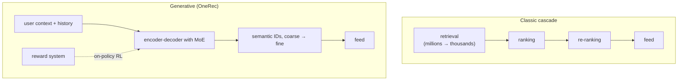

For a decade, industrial recommenders scaled by adding features to deep ranking models
(pillar N4's DLRM family), and their quality stopped improving with compute long before
language models did. In 2024 Meta reported a different path: treat a user's action history as
a sequence, train one large sequence model to predict the next action, and quality starts to
scale with compute the way language models do. Its **HSTU** architecture reached 1.5 trillion
parameters and improved online A/B metrics by 12.4%<FN n="1" />. In 2025 Kuaishou's **OneRec**
went further and replaced the whole retrieve-then-rank cascade with a single generative model in
production<FN n="2" />. This lesson covers the HSTU layer, why it drops softmax, and what an
end-to-end generative recommender changes.

## Recommendation as sequential transduction

The generative-retrieval lesson framed recommendation as generating the next item's semantic
ID. HSTU generalizes the framing: a user's history is one long sequence of tokens (items viewed,
liked, skipped, with timestamps), and both retrieval and ranking become **sequential
transduction** tasks over it, predicting the next item and predicting the user's action on a
candidate<FN n="1" />. Features that DLRMs encoded as hundreds of hand-built aggregates ("clicks
on this category in 7 days") are left implicit in the sequence for the model to compute.

## The HSTU layer

An HSTU layer has three parts<FN n="1" />:

$$
U(X), V(X), Q(X), K(X) = \mathrm{Split}\big(\phi_1(f_1(X))\big),
$$

$$
A(X)V(X) = \phi_2\!\left(Q(X)K(X)^\top + \mathrm{rab}^{p,t}\right) V(X),
$$

$$
Y(X) = f_2\Big(\mathrm{Norm}\big(A(X)V(X)\big) \odot U(X)\Big),
$$

where $f_1, f_2$ are single linear layers, $\phi_1$ and $\phi_2$ are both SiLU, $\mathrm{Norm}$ is
layer normalization, and $\mathrm{rab}^{p,t}$ is a learned **relative attention bias** over
position and **time** differences, the same "attention should know elapsed time" idea as the
continuous-time RoPE lesson in D8. The gate $U(X)$ multiplies the attention output elementwise,
replacing the separate feed-forward block of a standard transformer layer.

The striking choice is $\phi_2 = \mathrm{SiLU}$ in place of softmax: attention weights are
computed pointwise and are not normalized to sum to 1.

## Why drop softmax: it forgets how many

Softmax makes the output a weighted *average*, and averages discard counts. Consider a query
for which $n$ of $H$ history items are relevant, each with score $s_r$, while the rest score
$s_0$, and suppose relevant items share value $v_r$.

**Step 1: Softmax weight on the relevant items.** Their total weight is

$$
a_{\text{rel}}(n) = \frac{n e^{s_r}}{n e^{s_r} + (H - n) e^{s_0}}.
$$

**Step 2: It saturates.** When $e^{s_r} \gg e^{s_0}$, $a_{\text{rel}} \to 1$ already for small $n$,
and the output approaches $v_r$ whether the user interacted with 1 relevant item or 30. With
$H = 64$, $s_r = 6$, $s_0 = 0$: $a_{\text{rel}}(1) = 0.865$ and $a_{\text{rel}}(8) = 0.983$.

**Step 3: Pointwise attention counts.** With unnormalized weights $\phi(s)$ (scaled by a constant
$1/N$), the relevant contribution is $n\,\phi(s_r)\, v_r / N$, which grows linearly with $n$.

How *much* a user engages with something is exactly what a recommender needs to know, which is
why Zhai et al. argue softmax makes the intensity of user preferences hard to capture, and also
that it suits poorly the non-stationary vocabularies of streaming recommendation<FN n="1" />. The
layer normalization after the pointwise aggregation keeps training stable without the softmax's
built-in normalization.


## What HSTU reported

All from the HSTU paper<FN n="1" />:

- up to 65.8% NDCG improvement over baselines on public datasets;
- 5.3 to 15.2 times faster than FlashAttention2-based transformers on 8,192-token sequences;
- model quality scaling as a power law of training compute across three orders of magnitude,
  up to GPT-3/LLaMA-2 scale, the behaviour DLRMs never showed;
- **M-FALCON**, an inference algorithm that micro-batches candidates so that 285 times more
  complex models are served at 1.50 to 2.99 times speedups within the same inference budget as
  traditional DLRMs;
- a 1.5-trillion-parameter deployment with +12.4% in online A/B tests.

## OneRec: one model instead of a cascade

The N7 funnel lesson explained why production recommenders are cascades: a cheap retrieval
stage narrows millions of items to thousands, a ranker scores those, a re-ranker orders the top.
Each stage is a separate model with its own objective, and the stages can disagree. OneRec
replaces the cascade with one **encoder-decoder** model that reads the user's context and
generates the recommended items' semantic IDs directly<FN n="2" />.

- **Item tokens.** Items are tokenized into coarse-to-fine semantic IDs with three levels of
  residual k-means (RQ-Kmeans), which the authors found reconstructs better than RQ-VAE.
- **Capacity.** Each decoder layer uses a mixture-of-experts feed-forward network, the same
  sparse scaling as modern LLMs (E3).
- **Alignment.** After pretraining, the model is trained with on-policy reinforcement learning
  against a reward system that encodes user preferences, the recommender analogue of RLHF.

OneRec reports serving 25% of the total queries per second in Kuaishou's apps, App Stay Time
gains of 0.54% and 1.24% in Kuaishou and Kuaishou Lite, an operating expense of 10.6% of the
traditional pipeline, and model FLOPs utilization of 23.7% in training and 28.8% in inference,
against 4.6% and 11.2% before<FN n="2" />. That last pair is the systems argument for generative
recommenders: a cascade of small models spends most of its time on memory-bound feature lookups,
while one large transformer keeps the GPU busy.



## Check it on arrays

```python
import numpy as np

rng = np.random.default_rng(0)
d, H = 16, 64
q = rng.normal(size=d); q /= np.linalg.norm(q)
v_rel = rng.normal(size=d)
silu = lambda s: s / (1 + np.exp(-s))

# 1) Softmax output stays flat as relevant actions accumulate; pointwise SiLU grows
out = {}
for n in (1, 8, 32):
    K = rng.normal(scale=0.3, size=(H, d)); K[:n] += 6 * q
    V = rng.normal(scale=0.3, size=(H, d)); V[:n] += v_rel
    s = K @ q
    a = np.exp(s - s.max()); a /= a.sum()
    out[n] = (np.linalg.norm(a @ V), np.linalg.norm((silu(s) / H) @ V))
    print(f"n = {n:2d}: softmax output {out[n][0]:.2f}, pointwise output {out[n][1]:.2f}")
assert abs(out[32][0] / out[1][0] - 1) < 0.1 and out[32][1] / out[1][1] > 10

# 2) Softmax saturation in closed form
a_rel = lambda n, sr=6.0, s0=0.0: n * np.exp(sr) / (n * np.exp(sr) + (H - n) * np.exp(s0))
print(f"softmax weight on relevant items: n=1 {a_rel(1):.3f}, n=8 {a_rel(8):.3f}")
assert np.isclose(a_rel(1), 0.865, atol=1e-3)

# 3) One HSTU layer (no relative bias), causal, on a toy sequence
T = 10
X = rng.normal(size=(T, d))
f1, f2 = rng.normal(size=(d, 4 * d)) / np.sqrt(d), rng.normal(size=(d, d)) / np.sqrt(d)
U, Vv, Q, Kk = np.split(silu(X @ f1), 4, axis=1)
Aw = silu(Q @ Kk.T) * np.tril(np.ones((T, T))) / T        # pointwise, causal, scaled by 1/N
AV = Aw @ Vv
norm = (AV - AV.mean(1, keepdims=True)) / (AV.std(1, keepdims=True) + 1e-6)
Y = (norm * U) @ f2
print("HSTU layer output shape:", Y.shape)
assert Y.shape == (T, d)

# 4) OneRec's reported utilization gains
print(f"MFU gain: training {23.7 / 4.6:.1f}x, inference {28.8 / 11.2:.1f}x")
```

The first check reproduces the figure: softmax output barely moves from 1 to 32 relevant
actions while the pointwise output grows more than tenfold; the second gives the closed-form
saturation (0.865 of the mass on a single relevant item); the third runs one causal HSTU layer
end to end; and the last turns OneRec's MFU figures into 5.2 and 2.6 times utilization gains.

## Exercises

**Exercise 1.** With $H = 64$ history items, relevant score $s_r = 3$ and irrelevant $s_0 = 0$,
compute the softmax weight on the relevant items for $n = 1$ and $n = 16$. Does softmax still
saturate?

<details>
<summary>Solution</summary>

**Step 1.** $e^3 = 20.09$. For $n = 1$: $20.09 / (20.09 + 63) = 0.242$.

**Step 2.** For $n = 16$: $321.4 / (321.4 + 48) = 0.870$.

**Step 3.** With a weaker score gap the weight still grows with $n$, so softmax carries some
count information, but only through the competition with irrelevant items and only until it
saturates. Pointwise attention carries it directly at every gap.

</details>

**Exercise 2.** A cascade spends 40% of its serving budget on retrieval, 45% on ranking and 15%
on re-ranking. OneRec reports an OPEX of 10.6% of the traditional pipeline. If the cascade cost
1,000 GPU-hours per day, what does OneRec cost, and how many times more GPU efficiency does it
need to deliver its larger model?

<details>
<summary>Solution</summary>

**Step 1.** OneRec costs $0.106 \times 1{,}000 = 106$ GPU-hours per day (the stage split does not
matter for the total).

**Step 2.** The reported MFU rises from 11.2% to 28.8% in inference, a $2.57\times$ gain: every
GPU-hour does about 2.6 times more useful compute. The rest of the saving comes from replacing
many feature-heavy stage models with one model whose work is dominated by dense matrix
multiplication.

</details>

**Exercise 3 (code).** Run the causal pointwise attention from the closing code on a sequence
where items 0, 3, 5 and 8 are copies of the same relevant item, and show that the output norm
at the final position grows with the number of relevant items seen so far when the query is
that item.

<details>
<summary>Solution</summary>

```python
import numpy as np

rng = np.random.default_rng(5)
d, T = 16, 10
silu = lambda s: s / (1 + np.exp(-s))
rel = rng.normal(size=d); rel /= np.linalg.norm(rel)
X = rng.normal(scale=0.3, size=(T, d))
norms = []
for upto in (1, 2, 3, 4):
    Xc = X.copy()
    for j in [0, 3, 5, 8][:upto]:
        Xc[j] += 4 * rel
    s = Xc @ (4 * rel)                         # query = the relevant item
    norms.append(np.linalg.norm((silu(s) / T) @ Xc))
print([round(n, 2) for n in norms])
assert all(a < b for a, b in zip(norms, norms[1:]))
```

Each additional copy of the relevant item adds its own unnormalized contribution, so the output
grows with the count: the model can distinguish a one-off view from a repeated habit.

</details>

With generative recommenders, the Recommender Systems pillar reaches the same place as language
modeling: one large sequence model, scaled with compute and aligned with reinforcement learning.

<Footnotes>
  <FNItem n="1">**Zhai, J., Liao, L., Liu, X., Wang, Y., et al.** (2024). "Actions Speak Louder than Words: Trillion-Parameter Sequential Transducers for Generative Recommendations". *ICML*. [arXiv:2402.17152](https://arxiv.org/abs/2402.17152)</FNItem>
  <FNItem n="2">**OneRec Team, Zhou, G., Deng, J., Zhang, J., Cai, K., et al.** (2025). "OneRec Technical Report". [arXiv:2506.13695](https://arxiv.org/abs/2506.13695)</FNItem>
</Footnotes>
